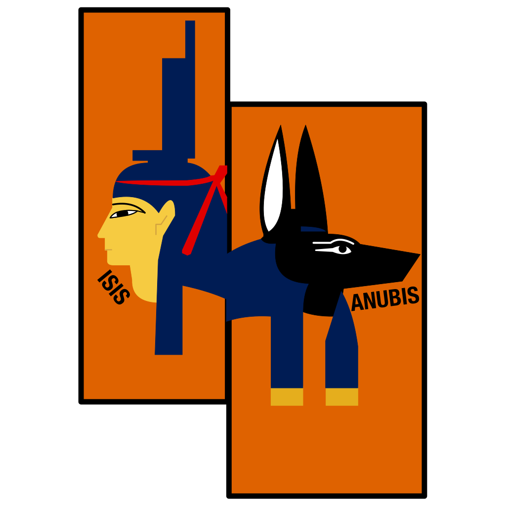
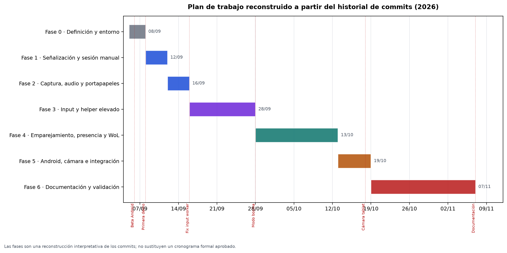
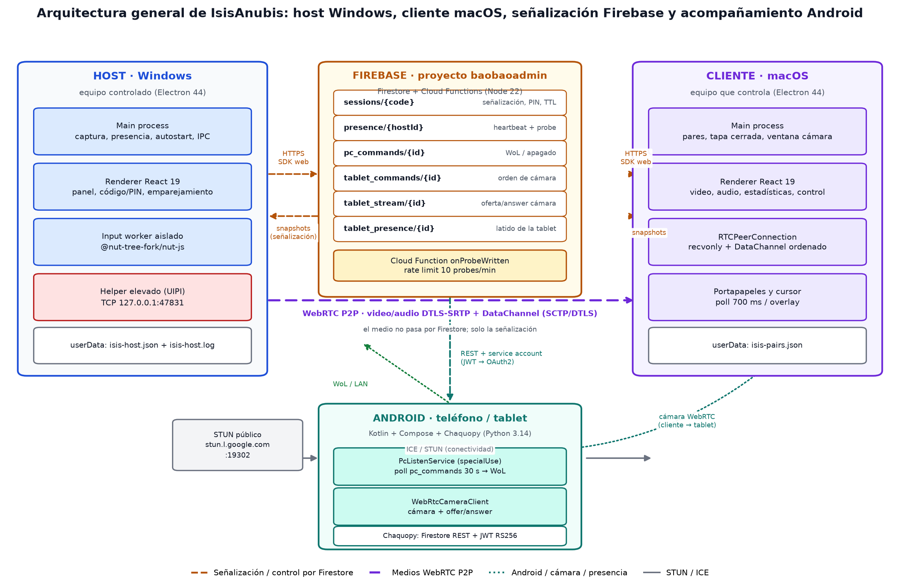
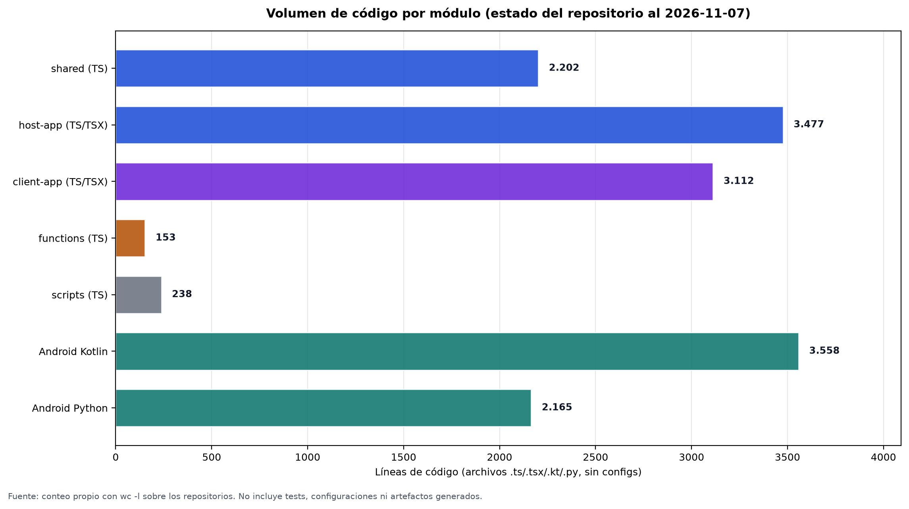
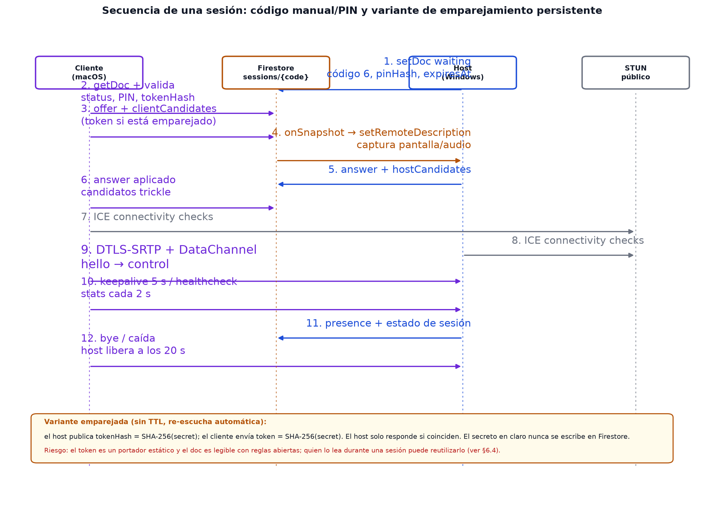
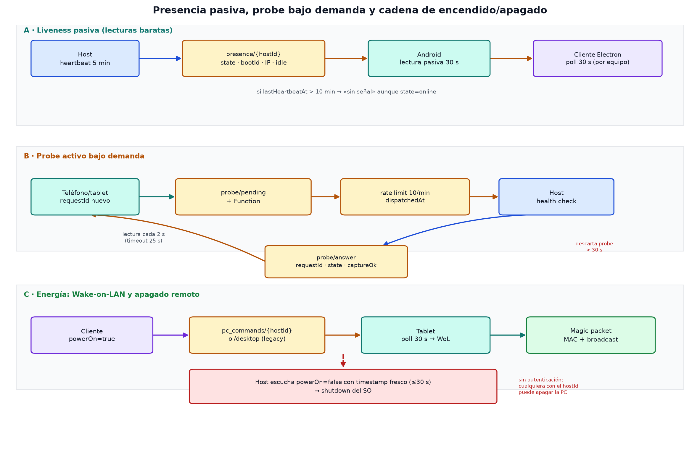
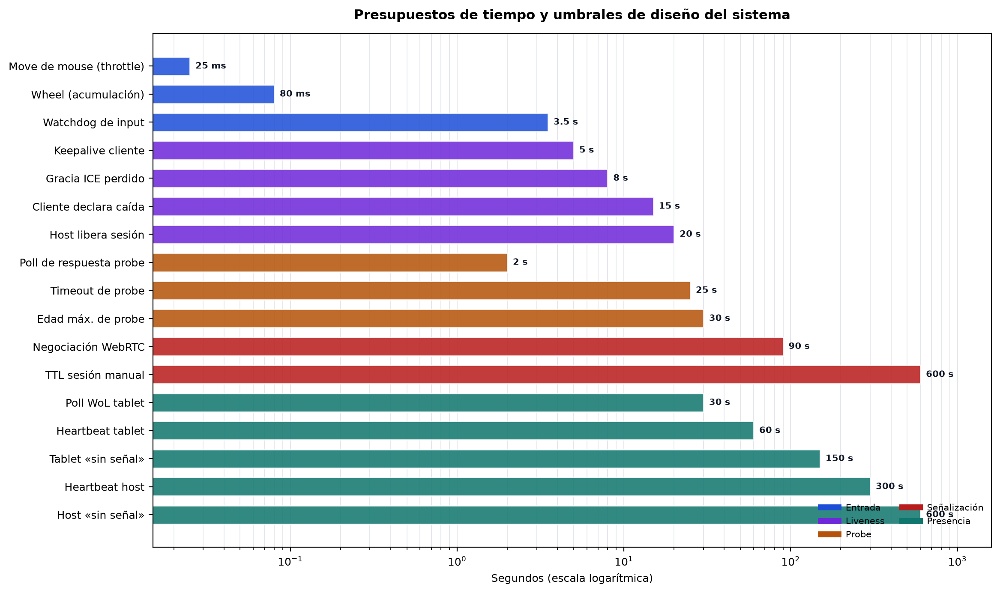
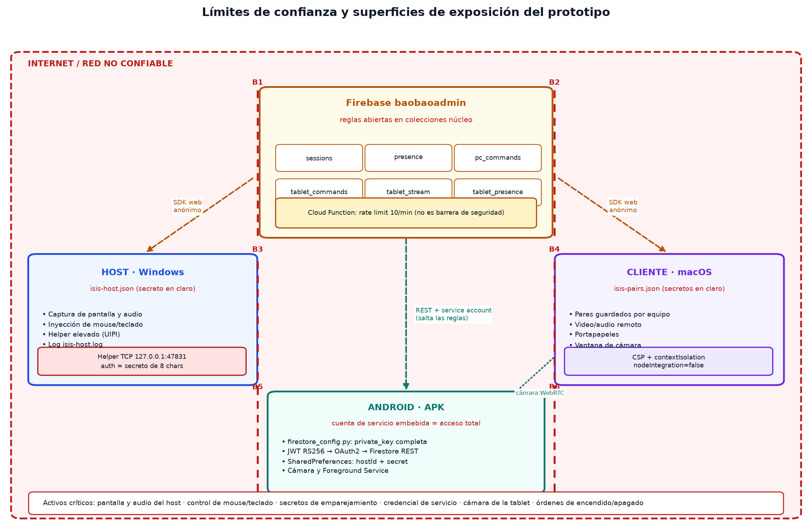
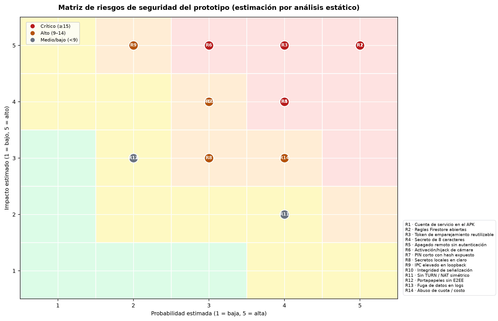

<!-- portada -->

# IsisAnubis

## Sistema de escritorio remoto y control de presencia para host Windows, cliente macOS y aplicación Android

**Documentación técnica y académica del proyecto**



---

| Campo | Detalle |
| --- | --- |
| **Autor** | _[Nombre completo del autor]_ |
| **Institución** | _[Universidad / Institución]_ |
| **Facultad / Programa** | _[Facultad / Carrera / Programa académico]_ |
| **Materia / Seminario** | _[Materia / Seminario / Proyecto de grado]_ |
| **Docente / Tutor** | _[Nombre del docente o tutor]_ |
| **Fecha** | Noviembre de 2026 |
| **Versión del documento** | 1.0 |
| **Repositorio de escritorio** | `/Users/jyang/Dev/personal/isisanubis` |
| **Repositorio Android** | `/Users/jyang/AndroidStudioProjects/IsisAnubis` |

> Documento elaborado a partir del código fuente, la configuración, el historial de cambios y la documentación existente de los dos repositorios. Las mediciones empíricas de rendimiento no estaban disponibles al cierre de esta versión; por ello se distinguen explícitamente los **resultados de ingeniería verificables**, las **métricas de diseño derivadas de la configuración** y las **mediciones pendientes**, cuyo procedimiento se define en el Anexo F.

<!-- pagebreak -->

<!-- inicio-cuerpo -->

# Agradecimientos

_[Sección opcional. Sustituir por el texto real o eliminar antes de la entrega.]_

Agradezco a _[personas, docentes, familia, compañeros]_ por su apoyo durante el desarrollo de este proyecto. Su acompañamiento permitió sostener un trabajo iterativo de ingeniería, pruebas y documentación que atraviesa dos plataformas de escritorio y una aplicación móvil.

# Dedicatoria

_[Sección opcional. Sustituir por el texto real o eliminar antes de la entrega.]_

A _[persona o grupo]_, por _[motivo]_.

# Índice general

<!-- TOC -->

_En la versión DOCX, este índice se genera automáticamente como campo de tabla de contenido. Si aparece vacío, haga clic derecho sobre el índice y elija «Actualizar campos», o seleccione todo el documento (Ctrl+A en Windows, Cmd+A en macOS) y pulse F9._

1. Introducción
   1.1 Antecedentes y origen del proyecto
   1.2 Planteamiento del problema
   1.3 Justificación
   1.4 Alcance y delimitación
   1.5 Objetivo general
   1.6 Objetivos específicos
   1.7 Estructura del documento
2. Marco teórico y conceptual
   2.1 Antecedentes y soluciones relacionadas
   2.2 Computación remota y escritorio remoto
   2.3 Arquitectura peer-to-peer y señalización
   2.4 WebRTC: ICE, STUN, TURN, DTLS-SRTP y canales de datos
   2.5 Captura de pantalla y audio loopback
   2.6 Inyección de entrada y UIPI en Windows
   2.7 Señalización serverless con Firestore
   2.8 Presencia, heartbeat, probe y Wake-on-LAN
   2.9 Seguridad: identidad sin cuentas, hash, emparejamiento y superficies de ataque
   2.10 Tecnologías empleadas
3. Metodología
   3.1 Enfoque y tipo de investigación
   3.2 Objeto de estudio y unidades de análisis
   3.3 Procedimiento por fases
   3.4 Técnicas e instrumentos
   3.5 Materiales y herramientas
   3.6 Plan de trabajo y cronograma
   3.7 Variables e indicadores
   3.8 Consideraciones éticas y de privacidad
4. Resultados y análisis
   4.1 Producto construido y arquitectura general
   4.2 Métricas de código y estructura de los repositorios
   4.3 Flujo de sesión manual y emparejada
   4.4 Presencia, probe y cadena de energía
   4.5 Aplicación Android: modos, cámara y servicios
   4.6 Métricas de diseño y presupuestos de tiempo
   4.7 Verificación estática, compilación y cobertura de requisitos
   4.8 Análisis frente a los objetivos
   4.9 Análisis de seguridad: resumen ejecutivo
   4.10 Limitaciones de la evidencia y plan de validación
5. Conclusiones y recomendaciones
   5.1 Conclusiones
   5.2 Recomendaciones
6. Seguridad del sistema
   6.1 Activos, adversarios y modelo de amenazas
   6.2 Límites de confianza y superficies de ataque
   6.3 Inventario de controles: qué se usa, dónde y cómo
   6.4 Identidad y emparejamiento
   6.5 Códigos de sesión, PIN y control de acceso
   6.6 Reglas de Firestore y modelo de confianza
   6.7 Medios WebRTC, señalización e integridad
   6.8 Almacenamiento local de secretos
   6.9 Endurecimiento de Electron
   6.10 Helper elevado de Windows
   6.11 Aplicación Android y cuenta de servicio embebida
   6.12 Permisos, componentes y servicios Android
   6.13 Presencia, probe, apagado remoto y Wake-on-LAN
   6.14 Cámara de la tablet
   6.15 Registro de riesgos
   6.16 Plan de endurecimiento priorizado
   6.17 Respuesta a incidentes y rotación de credenciales
   6.18 Privacidad, consentimiento y cumplimiento
   6.19 Checklist de despliegue seguro
7. Referencias
8. Anexos
   Anexo A. Matriz de trazabilidad de casos de uso
   Anexo B. Constantes y parámetros de configuración
   Anexo C. Mapa de módulos y archivos
   Anexo D. Protocolo de mensajes y documentos de Firestore
   Anexo E. Instrumento de encuesta y consentimiento informado
   Anexo F. Protocolo de medición empírica y matriz de datos
   Anexo G. Checklist de seguridad y despliegue
   Anexo H. Glosario
   Anexo I. Registro de evidencias y capturas
   Anexo J. Extractos de código representativos

<!-- /TOC -->

# Lista de tablas

<!-- LOT -->

| N.º | Título |
| --- | --- |
| 1.1 | Datos generales del proyecto |
| 1.2 | Objetivos específicos y criterios de logro |
| 1.3 | Alcance y exclusiones |
| 2.1 | Comparación de enfoques de escritorio remoto |
| 2.2 | Tecnologías y versiones principales |
| 2.3 | Conceptos de seguridad aplicados |
| 3.1 | Fases, actividades y entregables |
| 3.2 | Técnicas e instrumentos de recolección |
| 3.3 | Materiales y herramientas |
| 3.4 | Variables e indicadores |
| 3.5 | Consideraciones éticas y de privacidad |
| 4.1 | Métricas de código por módulo |
| 4.2 | Constantes y presupuestos de tiempo |
| 4.3 | Verificación estática y compilación |
| 4.4 | Cobertura de casos de uso |
| 4.5 | Matriz de pruebas funcionales planificadas |
| 4.6 | Correspondencia entre objetivos y evidencia |
| 4.7 | Resumen de hallazgos de seguridad |
| 4.8 | Limitaciones de la evidencia |
| 5.1 | Conclusiones por objetivo |
| 5.2 | Recomendaciones priorizadas |
| 6.1 | Activos y criticidad |
| 6.2 | Modelo STRIDE aplicado |
| 6.3 | Inventario de controles: qué, dónde y cómo |
| 6.4 | Controles ausentes o débiles |
| 6.5 | Registro de riesgos y mitigaciones |
| 6.6 | Plan de endurecimiento P0/P1/P2 |
| 6.7 | Privacidad y cumplimiento |
| 6.8 | Checklist de despliegue seguro |
| A.1 | Trazabilidad caso de uso–requisito–módulo–prueba |
| B.1 | Constantes y parámetros |
| C.1 | Mapa de archivos principales |
| D.1 | Mensajes del canal de datos |
| D.2 | Documentos y colecciones de Firestore |
| E.1 | Cuestionario de validación de usuario |
| F.1 | Matriz de datos para medición empírica |
| F.2 | Escenarios de medición |
| G.1 | Checklist de seguridad y despliegue |
| I.1 | Registro de evidencias |

<!-- /LOT -->

# Lista de figuras

<!-- LOF -->

| N.º | Título |
| --- | --- |
| 3.1 | Plan de trabajo reconstruido a partir del historial de commits |
| 4.1 | Arquitectura general de IsisAnubis |
| 4.2 | Volumen de código por módulo |
| 4.3 | Secuencia de una sesión y variante de emparejamiento |
| 4.4 | Presencia pasiva, probe bajo demanda y cadena de energía |
| 4.5 | Presupuestos de tiempo y umbrales de diseño |
| 6.1 | Límites de confianza y superficies de exposición |
| 6.2 | Matriz de riesgos de seguridad |

<!-- /LOF -->

# Resumen

IsisAnubis es un sistema de escritorio remoto de arquitectura asimétrica que permite controlar un equipo Windows desde un cliente macOS, con una aplicación Android complementaria para presencia, encendido remoto y cámara. El host captura pantalla y audio, inyecta mouse y teclado, sincroniza el portapapeles y opera de forma desatendida mediante emparejamiento persistente y modo servicio. La señalización utiliza Firebase Firestore y los medios viajan directamente entre pares con WebRTC; el proyecto no depende de servidores propios ni de cuentas de terceros.

El trabajo se desarrolló con un enfoque de investigación aplicada y diseño de desarrollo tecnológico iterativo. Se analizaron los dos repositorios, se reconstruyeron los requisitos, se documentó la arquitectura, se ejecutaron verificaciones estáticas y de compilación, y se elaboró un modelo de amenazas específico. Los resultados incluyen un producto funcional compuesto por cinco paquetes de escritorio y una aplicación Android, con 9.182 líneas de código TypeScript/TSX y 5.723 líneas Kotlin/Python, verificación de tipos satisfactoria en los cinco paquetes de escritorio y compilación Kotlin correcta en Android.

La revisión de seguridad identifica riesgos críticos que deben resolverse antes de cualquier exposición a redes no confiables: una cuenta de servicio de Firebase embebida en el APK con acceso amplio a Firestore, reglas de Firestore abiertas en las colecciones núcleo, un token de emparejamiento estático y reutilizable, y órdenes de apagado remoto sin autenticación. El documento no oculta estas debilidades: las describe, las prioriza y propone un plan de endurecimiento en tres niveles. También define el protocolo para obtener las mediciones de latencia, fps, bitrate y estabilidad que aún faltan.

**Palabras clave:** escritorio remoto, WebRTC, Firebase Firestore, Electron, Android, seguridad, presencia, Wake-on-LAN, emparejamiento, arquitectura peer-to-peer.

# Abstract

IsisAnubis is an asymmetric remote desktop system that lets a macOS client control a Windows host, complemented by an Android app for presence, remote power-on, and camera streaming. The host captures screen and audio, injects mouse and keyboard input, synchronizes the clipboard, and can run unattended through persistent pairing and a service mode. Signaling uses Firebase Firestore, while media travels directly between peers over WebRTC; the project relies on neither proprietary servers nor third-party accounts.

The work followed an applied research and iterative technology-development approach. Both repositories were analyzed, requirements were reconstructed, the architecture was documented, static and build verifications were executed, and a project-specific threat model was produced. Results include a working product made of five desktop packages and one Android app, with 9,182 lines of TypeScript/TSX and 5,723 lines of Kotlin/Python, successful type checking in all five desktop packages, and a successful Android Kotlin build.

The security review identifies critical risks that must be addressed before exposing the system to untrusted networks: a Firebase service-account key embedded in the APK with broad Firestore access, open Firestore rules on core collections, a static and replayable pairing token, and unauthenticated remote shutdown commands. The document does not conceal these weaknesses: it describes them, prioritizes them, and proposes a three-tier hardening plan. It also defines the protocol required to obtain the missing latency, fps, bitrate, and stability measurements.

**Keywords:** remote desktop, WebRTC, Firebase Firestore, Electron, Android, security, presence, Wake-on-LAN, pairing, peer-to-peer architecture.

# Nota sobre el estado de la evidencia

Este documento se apoya en tres tipos de evidencia y los distingue a lo largo del texto:

1. **Evidencia de código y configuración:** archivos, constantes, reglas, manifiestos y flujos verificables en los repositorios. Es la base principal de los capítulos 1 a 4 y 6.
2. **Evidencia de verificación estática:** resultados de `pnpm typecheck` en los paquetes de escritorio y de `./gradlew :app:compileDebugKotlin --offline` en Android. Se reportan en el capítulo 4.
3. **Evidencia empírica pendiente:** latencia de input, RTT, fps, bitrate, pérdida de paquetes, estabilidad en redes reales y percepción de usuario. **No se inventan datos.** El Anexo F contiene el diseño experimental, la matriz de datos y los pasos para producirla.

Los nombres de autor, institución, materia, docente y fechas de inicio son marcadores de posición porque no fueron suministrados. Deben reemplazarse antes de la entrega formal.


<!-- pagebreak -->


# 1. Introducción

## 1.1 Antecedentes y origen del proyecto

El acceso remoto a un equipo de escritorio es una necesidad recurrente en soporte técnico, administración de equipos, educación a distancia y trabajo híbrido. Las soluciones comerciales dominantes —Chrome Remote Desktop, TeamViewer, AnyDesk y, en el ámbito corporativo, RDP y VNC— resolvieron el problema con distintos modelos: algunas priorizan la simplicidad y la atravesabilidad de NAT, otras la integración con directorios y políticas empresariales. Sin embargo, todas imponen un costo de adopción: cuentas de terceros, agentes con privilegios elevados, telemetría, licencias o dependencia de infraestructura ajena.

IsisAnubis nace de una necesidad concreta: controlar un equipo Windows desde una Mac de forma desatendida, sin cuentas de terceros y con una señalización mínima en la nube. El proyecto se planteó como una alternativa propia y auditable, construida sobre tecnologías abiertas: Electron para el escritorio, React para la interfaz, WebRTC para los medios, Firebase Firestore para la señalización y una aplicación Android para funciones de acompañamiento (presencia, encendido remoto y cámara). El nombre evoca a Isis y Anubis, figuras mitológicas egipcias asociadas a la protección y al tránsito entre mundos: una metáfora del puente entre dos equipos separados por la red.

El repositorio de escritorio contiene cinco paquetes (`shared`, `host-app`, `client-app`, `functions`, `scripts`) y el repositorio Android contiene una aplicación Kotlin con un puente Python/Chaquopy. Ambos se desarrollaron de forma iterativa entre septiembre y octubre de 2026. La documentación existente (`REQUERIMIENTOS.md`, `BUILD.md` y los comentarios de código) fue la base para reconstruir los requisitos y verificar la implementación.

## 1.2 Planteamiento del problema

El problema se puede formular en cuatro dimensiones:

1. **Dependencia de terceros.** Las soluciones comerciales requieren cuentas, suscripciones o agentes propietarios. Para un usuario que administra sus propios equipos, esto implica ceder control sobre la identidad, la disponibilidad y los datos de la sesión.
2. **Complejidad de la infraestructura.** Montar un servidor de retransmisión propio (TURN, señalización, autenticación) incrementa el costo operativo y la superficie de ataque. El proyecto necesitaba una alternativa serverless, con la capa gratuita de Firebase como mínimo viable.
3. **Operación desatendida.** El host debe escuchar sin intervención humana, sobrevivir a reinicios, ocultarse en la bandeja del sistema y recuperarse de fallos de captura o de entrada. Las soluciones domésticas suelen fallar en este punto: si el usuario cierra la ventana, se pierde el acceso.
4. **Trazabilidad y seguridad.** Al tratarse de un proyecto propio, era posible —y necesario— documentar el modelo de confianza, los secretos, las superficies de ataque y los riesgos. La seguridad no podía quedar como una afirmación de marketing: debía explicarse qué se usa, dónde y cómo, incluyendo lo que falta.

A esto se suma una necesidad práctica: el usuario quería saber si la PC estaba encendida antes de intentar conectarse, encenderla remotamente cuando estuviera apagada y, en ciertos escenarios, usar la cámara de una tablet como cámara remota. Esas funciones no forman parte del núcleo de escritorio remoto, pero motivaron la aplicación Android y el diseño de presencia distribuida.

## 1.3 Justificación

La justificación del proyecto se organiza en cinco argumentos:

- **Técnica.** WebRTC ofrece transporte cifrado, bajo consumo y conexión directa entre pares; Firestore ofrece señalización serverless con sincronización en tiempo real. La combinación permite construir un escritorio remoto funcional sin servidores propios.
- **Económica.** El proyecto no paga licencias ni servidores dedicados. La señalización y la presencia caben en la capa gratuita de Firebase para el volumen de un usuario personal; el costo marginal es principalmente eléctrico y de ancho de banda.
- **Académica.** El proyecto integra requisitos, arquitectura, protocolos, seguridad, pruebas y documentación. Permite analizar decisiones de ingeniería reales: por qué STUN y no TURN, por qué un helper elevado en Windows, por qué SHA-256 y no una función de derivación de claves, por qué las reglas abiertas son coherentes con el prototipo pero incompatibles con producción.
- **De privacidad.** Al no depender de un proveedor de escritorio remoto, el flujo de pantalla y audio no pasa por un servidor de terceros. La señalización sí pasa por Firebase, pero el contenido multimedia viaja P2P y se cifra con DTLS-SRTP.
- **De aprendizaje.** La documentación de las debilidades —incluida la clave de servicio embebida en el APK— tiene un valor formativo: muestra que un prototipo puede funcionar y, a la vez, tener riesgos críticos que deben resolverse antes de production.

La utilidad práctica esperada es un sistema que permita, desde una Mac, abrir una sesión por código o por emparejamiento, ver la pantalla del Windows, usar mouse y teclado, copiar y pegar texto, y consultar la calidad de la conexión. Desde Android, el usuario puede consultar el estado de la PC, encenderla por Wake-on-LAN y ver la cámara de la tablet. La documentación busca que ese sistema sea comprensible, mantenible y evaluable por terceros.

## 1.4 Alcance y delimitación

### 1.4.1 Alcance incluido

El proyecto incluye:

- **Host Windows** (Electron 44 + React 19): captura de pantalla y audio, inyección de mouse y teclado, portapapeles bidireccional, presencia, autoinicio, modo servicio, bandeja del sistema y helper elevado para cruzar UIPI.
- **Cliente macOS** (Electron 44 + React 19): conexión por código/PIN o por emparejamiento, visualización de video y audio, control remoto, métricas de calidad, reconexión automática, modo "solo bocina" y ventana de cámara de la tablet.
- **Paquete compartido** (`@isisanubis/shared`): protocolo de señalización, generación de códigos, emparejamiento, presencia, tipos de control, configuración de Firebase y componentes de estado.
- **Cloud Function** (`onProbeWritten`): relé del probe de presencia y rate limit de 10 solicitudes por minuto.
- **Scripts de administración**: listar, limpiar y reiniciar sesiones de Firestore con el Admin SDK.
- **Aplicación Android** (Kotlin + Compose + Chaquopy): modos teléfono y tablet, presencia pasiva, probe activo, Wake-on-LAN, servicio en primer plano y streaming de cámara por WebRTC.
- **Documentación**: requisitos, build, arquitectura, seguridad, resultados, conclusiones, referencias y anexos.

### 1.4.2 Exclusiones

Quedan fuera de esta versión:

- Host Linux o macOS como plataforma oficial (el host está pensado para Windows; existe un modo de desarrollo en macOS, pero no es el objetivo).
- Cliente iOS o Android como cliente de control de escritorio (Android es acompañamiento, no cliente de pantalla completa).
- Multiplexación de varios clientes sobre un mismo host (una sola sesión activa a la vez).
- Transferencia de archivos, impresión remota, audio bidireccional y grabación de sesiones.
- TURN propio o servicio de retransmisión para NAT simétrico; el sistema usa STUN público y falla en redes que bloquean la conexión directa.
- Autenticación de usuarios con Firebase Auth, App Check, cuentas, roles y auditoría centralizada. El prototipo usa un modelo de confianza basado en códigos, PIN y secretos de emparejamiento.
- Cifrado de extremo a extremo a nivel de aplicación (E2EE) sobre WebRTC; se usa el cifrado estándar DTLS-SRTP.
- Firma de código, notarización, autoactualización firmada y despliegue empresarial.
- Validación empírica formal con usuarios y mediciones de rendimiento en redes reales; se define el protocolo, pero no se ejecutó al cierre de esta versión.

### 1.4.3 Supuestos

- El host y el cliente tienen conectividad a Internet y pueden alcanzar los servidores de Firebase y el STUN público.
- El usuario del host autoriza la captura de pantalla y la inyección de entrada.
- El host puede ejecutarse con una cuenta de usuario de Windows con permisos para registrar tareas programadas y solicitar elevación una vez.
- La tableta Android está en la misma red local que la PC para enviar el magic packet de Wake-on-LAN, o el router permite el reenvío del broadcast.
- El proyecto Firebase `baobaoadmin` está disponible y las reglas desplegadas coinciden con el archivo versionado; esto último debe verificarse en la consola.

**Tabla 1.1.** Datos generales del proyecto.

| Aspecto | Detalle |
| --- | --- |
| Nombre | IsisAnubis |
| Tipo de sistema | Escritorio remoto asimétrico + acompañamiento móvil |
| Host | Windows, Electron 44, React 19, TypeScript |
| Cliente | macOS, Electron 44, React 19, TypeScript |
| Android | Kotlin, Jetpack Compose, Chaquopy Python 3.14 |
| Señalización | Firebase Firestore, proyecto `baobaoadmin` |
| Medios | WebRTC P2P, STUN público, DTLS-SRTP, SCTP |
| Presencia | Heartbeat cada 5 min + probe bajo demanda + Cloud Function |
| Energía | Wake-on-LAN desde tablet; apagado remoto desde host |
| Versión host | 0.1.3 |
| Versión cliente | 0.1.13 |
| Versión Android | 1.0 (versionCode 1) |
| Repositorios | Escritorio: 5 paquetes; Android: 1 módulo + Python |
| Periodo reconstruido | 2026-09-05 a 2026-10-19 (commits) |
| Documento | Versión 1.0, noviembre de 2026 |

## 1.5 Objetivo general

Diseñar, construir y documentar un sistema de escritorio remoto host–cliente que permita controlar un equipo Windows desde un cliente macOS, con transmisión de pantalla y audio, inyección de mouse y teclado, portapapeles sincronizado, emparejamiento persistente y una aplicación Android complementaria para presencia, encendido remoto y cámara, utilizando Firebase Firestore como señalización y WebRTC como transporte de medios.

## 1.6 Objetivos específicos

**Tabla 1.2.** Objetivos específicos y criterios de logro.

| N.º | Objetivo específico | Criterio de logro | Evidencia |
| --- | --- | --- | --- |
| OE-1 | Implementar una sesión manual por código de 6 caracteres, con PIN opcional y TTL de 10 minutos. | El host publica `sessions/{code}` en estado `waiting`; el cliente conecta; los errores `code_not_found`, `session_busy`, `pin_required` y `pin_wrong` se muestran. | `signaling.ts`, `host-app/App.tsx`, `client-app/App.tsx` |
| OE-2 | Implementar emparejamiento persistente con `hostId` y secreto, sin publicar el secreto en Firestore. | El host guarda solo `tokenHash`; el cliente envía `token`; el host rechaza token ausente o inválido; la sesión re-escucha. | `pairing.ts`, `signaling.ts`, `isis-host.json`, `isis-pairs.json` |
| OE-3 | Transmitir pantalla y audio con captura de escritorio y audio loopback. | El cliente recibe video/audio; el host informa el modo de captura; el modo "solo bocina" funciona sin video. | `host-app/main.ts`, `signaling.ts`, `client-app/App.tsx` |
| OE-4 | Inyectar mouse y teclado de forma serializada, con recuperación ante bloqueos. | El input remoto responde; la cola se limita a 40 eventos; el watchdog reinicia a los 3,5 s; "Reiniciar input" libera botones. | `input.ts`, `input-worker.ts`, `main.ts` |
| OE-5 | Sincronizar el portapapeles en ambos sentidos. | Texto copiado en un extremo se pega en el otro en menos de 2 s, sin eco. | `client-app/App.tsx`, `host-app/main.ts` |
| OE-6 | Operar de forma desatendida con autoinicio, modo servicio y bandeja. | El host inicia con Windows, se oculta y re-escucha; el helper elevado se registra con `HighestAvailable`. | `main.ts`, `forge.config.ts`, `BUILD.md` |
| OE-7 | Publicar presencia pasiva y responder probes bajo demanda. | `presence/{hostId}` se actualiza cada 5 min y por eventos; la app Android lee sin escribir; el probe tiene timeout y rate limit. | `presence.ts`, `config.ts`, `functions/src/index.ts` |
| OE-8 | Publicar la IP LAN actual y permitir el chequeo LAN desde Android. | `lastLocalIp` se actualiza en cada latido; la tablet la empuja al `PcPollingLoop`. | `presence.ts`, `polling_loop.py`, `TabletActivity.kt` |
| OE-9 | Permitir el emparejamiento de la app Android con un host específico. | La app guarda `hostId` + secreto en SharedPreferences y apunta probe/presence a `presence/{hostId}`. | `SettingsManager.kt`, `SettingsActivity.kt`, `HostPresence.kt` |
| OE-10 | Encender la PC por Wake-on-LAN desde el cliente y apagarla remotamente. | El cliente escribe `pc_commands/{hostId}`; la tablet envía el magic packet; el host ejecuta el shutdown con timestamp fresco. | `tablet.ts`, `polling_loop.py`, `presence.ts` |
| OE-11 | Transmitir la cámara de la tablet al cliente por WebRTC. | El cliente escribe `tablet_commands/{hostId}`; la tablet valida token y frescura; el cliente recibe el stream. | `tablet.ts`, `WebRtcCameraClient.kt`, `TabletActivity.kt` |
| OE-12 | Documentar la seguridad con un modelo de amenazas y un plan de endurecimiento. | Se identifican activos, límites de confianza, controles, riesgos y acciones P0/P1/P2. | Capítulo 6 |

## 1.7 Estructura del documento

El documento se organiza en ocho capítulos. El capítulo 2 presenta el marco teórico y conceptual: escritorio remoto, WebRTC, Firestore, presencia, Wake-on-LAN y principios de seguridad. El capítulo 3 describe la metodología: enfoque, fases, técnicas, materiales, cronograma, variables y ética. El capítulo 4 presenta los resultados: arquitectura, métricas de código, flujos, presupuestos de tiempo, verificación estática, cobertura de requisitos y análisis frente a los objetivos. El capítulo 5 sintetiza conclusiones y recomendaciones. El capítulo 6 desarrolla la seguridad en profundidad, con el inventario de controles, el modelo de amenazas, los riesgos y el plan de endurecimiento. El capítulo 7 contiene las referencias en formato APA 7. El capítulo 8 reúne los anexos: matrices, constantes, mapa de código, protocolo, encuesta, protocolo de medición, checklist, glosario, registro de evidencias y extractos de código.

**Tabla 1.3.** Alcance y exclusiones.

| Dimensión | Incluido | Excluido |
| --- | --- | --- |
| Plataformas | Host Windows, cliente macOS, Android acompañante | Host Linux/macOS oficial, cliente iOS, cliente Android de control |
| Sesiones | Código + PIN, emparejamiento persistente, un cliente por host | Multicliente, multiusuario, salas, transferencia de archivos |
| Medios | Pantalla, audio loopback, cámara de tablet | Audio bidireccional, grabación, impresión remota |
| Red | P2P con STUN público | TURN propio, NAT simétrico, redes que bloquean UDP |
| Seguridad | DTLS-SRTP, hash de secretos, aislamiento Electron, helper autenticado | Firebase Auth, App Check, E2EE de aplicación, firma de código, auditoría central |
| Validación | Verificación estática y de compilación; protocolo de medición | Benchmark formal y estudio de usuarios ejecutados |


# 2. Marco teórico y conceptual

## 2.1 Antecedentes y soluciones relacionadas

El escritorio remoto tiene una larga tradición en la informática. Los enfoques clásicos —RDP, VNC y sus variantes— se basan en un servidor que captura la pantalla y un cliente que la muestra, con un protocolo de actualización de regiones y un canal de entrada. RDP, desarrollado por Microsoft, está optimizado para Windows y ofrece integración con sesiones, impresoras, portapapeles y audio; VNC es más simple y multiplataforma, pero suele tener menor calidad de video y menos funciones de seguridad. Ambos requieren normalmente una red accesible o un túnel.

Las soluciones modernas de acceso remoto (Chrome Remote Desktop, TeamViewer, AnyDesk) añaden atraviesamiento de NAT, señalización en la nube, autenticación, relay cuando la conexión directa falla y funciones de colaboración. Su ventaja es la facilidad de uso; su costo es la dependencia de cuentas, la telemetría y, en algunos casos, licencias. El proyecto se inspira en Chrome Remote Desktop por su modelo de código de acceso y su simplicidad, pero se diferencia en que la señalización es propia (Firebase) y el código es auditable.

WebRTC, estandarizado por el IETF y el W3C, es la base técnica de los medios. Originalmente pensado para videoconferencia en el navegador, hoy se usa también en aplicaciones nativas (Electron, Android) y en sistemas de escritorio remoto. Su fortaleza es que resuelve la negociación de sesión, la conectividad (ICE/STUN/TURN), el cifrado (DTLS-SRTP) y los canales de datos (SCTP sobre DTLS), con una pila madura y ampliamente desplegada.

**Tabla 2.1.** Comparación de enfoques de escritorio remoto.

| Enfoque | Fortalezas | Limitaciones | Relación con IsisAnubis |
| --- | --- | --- | --- |
| RDP | Integración profunda con Windows, alto rendimiento en LAN, audio/portapapeles | Requiere Windows Pro/Server, configuración de red, autenticación de dominio | No se usa; el host es una app Electron, no un servicio RDP |
| VNC | Multiplataforma, protocolo simple, código abierto | Seguridad variable, calidad de video limitada, requiere red/túnel | Inspiración conceptual; no se usa |
| Chrome Remote Desktop | Código de acceso, atraviesa NAT con relay de Google, fácil de usar | Dependencia de cuenta Google, telemetría, poca personalización | Referencia de experiencia; la señalización es propia |
| TeamViewer / AnyDesk | Relay global, funciones empresariales, soporte | Licencias, cuentas, agentes propietarios, telemetría | Alternativa que el proyecto busca evitar |
| WebRTC P2P propio | Sin servidores de medios, cifrado estándar, bajo costo, auditable | NAT simétrico, señalización propia, más complejidad de seguridad | Base del proyecto |

## 2.2 Computación remota y escritorio remoto

Un sistema de escritorio remoto debe resolver cinco problemas:

1. **Captura:** obtener los píxeles de la pantalla y, opcionalmente, el audio del sistema.
2. **Codificación y transporte:** comprimir y enviar el flujo con latencia y ancho de banda aceptables.
3. **Presentación:** decodificar y mostrar el flujo en el cliente, con sincronización de audio y video.
4. **Entrada:** capturar mouse y teclado en el cliente, transportarlos y reconstruirlos en el host.
5. **Estado de sesión:** negociar, mantener, recuperar y cerrar la sesión, incluyendo presencia y reconexión.

La calidad de un escritorio remoto se mide por la latencia de ida y vuelta, la tasa de frames, el bitrate, la pérdida de paquetes, la nitidez y la sensación de respuesta del cursor. La latencia de input es especialmente crítica: un retardo de 100–200 ms se percibe como "pesado"; por encima de 300 ms la operación se vuelve incómoda. Por eso el proyecto prioriza el control del mouse y del teclado sobre la calidad visual absoluta.

Un concepto central es la **separación entre plano de control y plano de medios**. El plano de control (señalización) negocia direcciones, códecs, credenciales y estado; el plano de medios transporta video, audio y datos. En IsisAnubis, el primero usa Firestore y el segundo usa WebRTC P2P. Esta separación permite que una caída de Firestore no corte una sesión ya establecida, aunque impide reconectar si la señalización no vuelve.

## 2.3 Arquitectura peer-to-peer y señalización

En una arquitectura P2P, los extremos se conectan directamente. Para lograrlo necesitan intercambiar:

- **Descripción de sesión (SDP):** códecs, direcciones, puertos, huellas DTLS y direcciones de medios.
- **Candidatos ICE:** combinaciones de IP, puerto y protocolo por las que se puede intentar la conexión.
- **Credenciales y estado:** quién es el oferente, quién responde, si la sesión está activa o cerrada.

La señalización es el "servicio de citas" que permite ese intercambio. Puede implementarse con WebSockets, HTTP, un broker MQTT o, como en este caso, una base de datos en tiempo real. Firestore ofrece documentos, colecciones, subcolecciones y listeners; el host y el cliente escriben y observan documentos, y la latencia de propagación es suficiente para una negociación que dura segundos.

La topología de IsisAnubis es asimétrica:

- El **host** crea la sesión y espera; es el respondedor WebRTC y el dueño de la captura.
- El **cliente** busca la sesión, crea la oferta y es el oferente; recibe video/audio y envía control.
- La **tablet Android** no es un par de la sesión de escritorio: es un nodo auxiliar que lee presencia, envía Wake-on-LAN y, si se le pide, transmite su cámara por un WebRTC separado.
- **Firebase** es el punto de encuentro y el almacén de estado; **STUN** ayuda a descubrir la dirección pública.

## 2.4 WebRTC: ICE, STUN, TURN, DTLS-SRTP y canales de datos

**ICE (Interactive Connectivity Establishment)** es el marco de negociación de conectividad. Reúne candidatos (host, servidor reflexivo y relay), los prioriza y prueba pares hasta encontrar una ruta. **STUN** permite descubrir la dirección pública y el puerto asignado por NAT. **TURN** es un relay para cuando la conexión directa falla; IsisAnubis no lo implementa, por lo que las redes con NAT simétrico o UDP bloqueado no conectan.

**DTLS-SRTP** es el perfil obligatorio de WebRTC para medios: DTLS autentica y negocia claves; SRTP cifra y autentica los paquetes de audio y video. Las huellas DTLS viajan en el SDP, de modo que los extremos pueden verificar que la clave negociada corresponde a la sesión. Esto protege los medios en tránsito, pero **no** protege la señalización ni autentica a los extremos más allá de la huella.

**SCTP sobre DTLS** proporciona canales de datos. En IsisAnubis se usa un `RTCDataChannel` ordenado para enviar mensajes JSON de control: mouse, teclado, portapapeles, cursor, resolución y keepalive. El canal viaja cifrado por DTLS, pero el contenido es texto JSON; no hay cifrado de aplicación adicional.

**Estadísticas WebRTC.** `RTCPeerConnection.getStats()` expone contadores de bytes, frames, paquetes perdidos, jitter y RTT. El cliente consulta cada 2 s y muestra `RTT ms · Mbit/s · fps`. Es una herramienta de observabilidad, no de seguridad.

## 2.5 Captura de pantalla y audio loopback

En Electron, la captura de pantalla se obtiene con `desktopCapturer` y `getDisplayMedia` (o el fallback legacy `getUserMedia` con `chromeMediaSource`). El host configura un `setDisplayMediaRequestHandler` que elige la pantalla primaria sin mostrar el selector, lo que permite operar en modo desatendido. La captura se limita a 30 fps para equilibrar calidad y costo.

El audio del sistema en Windows se captura mediante loopback. En el modo "solo bocina", el cliente ofrece una sesión sin sección `m=video`; el host captura únicamente audio y evita abrir una segunda captura de pantalla, que en Windows degradaba el pipeline de entrada. En macOS, el cliente activa un modo de tapa cerrada (`pmset disablesleep`, apagado de pantalla y un watcher de `ioreg`) para mantener el audio con la tapa cerrada, restaurando la configuración al salir. Es una solución de plataforma, no de WebRTC.

## 2.6 Inyección de entrada y UIPI en Windows

La inyección de mouse y teclado se realiza con `@nut-tree-fork/nut-js` en un proceso aislado (`input-worker`). La serialización evita condiciones de carrera y permite medir el tiempo de cada operación. Si una operación supera 3,5 s, el host reinicia el worker sin cortar el video.

Windows aplica **UIPI (User Interface Privilege Isolation)**: un proceso de integridad media no puede enviar mensajes de entrada a ventanas de integridad alta (por ejemplo, el Administrador de tareas, el menú de inicio elevado o ciertos flyouts de la bandeja). Para cruzar esa barrera, el host registra una tarea programada con `HighestAvailable` que ejecuta un **helper elevado**. El helper escucha en `127.0.0.1:47831` y autentica con el secreto de emparejamiento. El proceso principal (captura, señalización, UI) sigue corriendo con integridad normal: solo el helper está elevado. Este diseño reduce la superficie de ataque, pero crea un canal local privilegiado que debe protegerse.

## 2.7 Señalización serverless con Firestore

Firestore es una base de datos de documentos con sincronización en tiempo real. Su modelo encaja con la señalización:

- `sessions/{code}`: documento principal de la sesión, con estado, oferta, respuesta, PIN y tokens.
- `sessions/{code}/clientCandidates` y `hostCandidates`: subcolecciones de candidatos ICE.
- `presence/{hostId}`: estado del host (heartbeat, IP, captura, idle).
- `presence/{hostId}/probe/{pending,answer,rate}`: documentos fijos del probe.
- `pc_commands/{docId}`: órdenes de encendido/apagado.
- `tablet_commands/{hostId}` y `tablet_stream/{hostId}`: cámara de la tablet.
- `tablet_presence/{hostId}`: latido de la app Android.

Las **reglas de seguridad** de Firestore son el mecanismo de autorización. En el prototipo, las colecciones núcleo usan `allow read, write: if true`, lo que significa que cualquier cliente con la configuración web del proyecto puede leer y escribir. El archivo `firestore.rules` advierte que es una copia documentada, no necesariamente el estado desplegado. Esta decisión es coherente con un prototipo personal, pero es incompatible con un entorno multiusuario o expuesto a Internet.

Las **Cloud Functions** permiten reaccionar a escrituras. `onProbeWritten` consume el rate limit y marca el probe como `dispatched`. No es una barrera de seguridad: si el rate limit falla, la función deja pasar el probe para no romper la disponibilidad. Su objetivo es higiene y control de cuotas.

## 2.8 Presencia, heartbeat, probe y Wake-on-LAN

La **presencia** responde a la pregunta "¿está la PC encendida y operable?". Hay dos mecanismos:

1. **Liveness pasiva:** el host escribe `presence/{hostId}` cada 5 minutos y en eventos de `powerMonitor` (boot, suspend, resume, lock, unlock, shutdown). La app Android y el cliente leen el documento sin escribir. Si `lastHeartbeatAt` tiene más de 10 minutos, la UI muestra "sin señal" aunque el último estado diga `online`.
2. **Probe activo:** el teléfono o la tablet escribe `probe/pending` con un `requestId`; la Cloud Function aplica el rate limit y marca `dispatched`; el host hace un health check (`desktopCapturer` + `powerMonitor`) y responde en `probe/answer`. El cliente espera hasta 25 s y descarta respuestas de más de 30 s.

El **heartbeat** es barato (≈288 escrituras por día por host) y suficiente para saber si la PC "estuvo viva". El **probe** es la fuente autoritativa para saber si está operable "ahora". La separación evita gastar escrituras y cuotas en cada consulta de UI.

**Wake-on-LAN (WoL)** es un estándar de facto basado en un "magic packet": una trama Ethernet con la MAC del equipo repetida 16 veces, enviada a la dirección de broadcast. La tablet escucha `pc_commands/desktop` (o `pc_commands/{hostId}`) y, cuando ve `powerOn=true` con un `timestamp` nuevo, envía el paquete. El host escucha el mismo documento para `powerOn=false` y ejecuta un apagado del sistema si el timestamp es fresco (≤30 s). Este último comando es sensible: sin autenticación, cualquiera con el `hostId` puede apagar la PC.

## 2.9 Seguridad: identidad sin cuentas, hash, emparejamiento y superficies de ataque

El prototipo no usa cuentas de usuario. La identidad se basa en tres secretos:

- **Código de sesión:** 6 caracteres de un alfabeto de 31 símbolos (sin `i/l/o/0/1`), generado con `crypto.getRandomValues`. Entropía ≈ 29,7 bits.
- **PIN opcional:** se almacena como `pinHash = SHA-256(pin)` y se compara en el cliente. No hay mínimo de longitud ni rate limit.
- **Secreto de emparejamiento:** 8 caracteres del mismo alfabeto, generado con `crypto.getRandomValues`. Entropía ≈ 39,6 bits. El host guarda `tokenHash = SHA-256(secret)`; el cliente envía `token = SHA-256(secret)` en la oferta. El secreto en claro nunca se escribe en Firestore.

SHA-256 es una función hash criptográfica, no una función de derivación de claves (KDF) ni un MAC. Para un secreto de alta entropía, un hash simple es aceptable como compromiso; para un secreto de 8 caracteres, es vulnerable a fuerza bruta si el hash se expone. Además, el token es un **portador estático**: quien lo lee puede reutilizarlo. Estas distinciones se desarrollan en el capítulo 6.

Los principios de seguridad aplicados son:

- **Mínimo privilegio:** solo el helper de entrada se eleva; el resto corre con integridad normal.
- **Defensa en profundidad:** aislamiento de renderer, CSP, fuses de Electron, autenticación del helper, reglas de Firestore (aunque abiertas), rate limit.
- **Separación de planos:** la señalización no transporta medios; los medios no pasan por Firestore.
- **Minimización de secretos:** el secreto de emparejamiento no se publica; solo su hash.
- **Degradación controlada:** si la captura falla, la sesión sigue sin video; si el rate limit falla, el probe se permite; si el helper no conecta, se usa input local de respaldo.

## 2.10 Tecnologías empleadas

La selección de tecnologías responde a tres criterios: madurez del ecosistema, disponibilidad en las plataformas objetivo y posibilidad de operar sin infraestructura propia. La Tabla 2.2 resume las versiones declaradas en ambos repositorios; la Tabla 2.3 conecta esos componentes con los conceptos de seguridad que se aplican a lo largo del documento.

**Tabla 2.2.** Tecnologías y versiones principales.

| Componente | Tecnología | Versión | Uso |
| --- | --- | --- | --- |
| Desktop runtime | Electron | 44 | Host y cliente |
| UI | React | 19 | Paneles de host y cliente |
| Lenguaje | TypeScript | 5.6 | Todo el escritorio |
| Build | Vite / Electron Forge | 8 / 7.11 | Empaquetado |
| Monorepo | pnpm | 11.3 | Workspaces hoisted |
| Señalización | Firebase JS SDK | 11 | Firestore web |
| Funciones | firebase-functions / admin | 7.4 / 14.5 | Node 22 |
| Medios | WebRTC | nativo Electron | Video/audio/datos |
| Entrada | @nut-tree-fork/nut-js | 4.2.6 | Inyección |
| Android | Kotlin / Compose | 2.2.10 / BOM 2026.02.01 | UI |
| Android WebRTC | io.github.webrtc-sdk | 125.6422.07 | Cámara |
| Android Python | Chaquopy | 17.0.0 / Python 3.14 | Firestore REST |
| Android build | AGP / Gradle | 9.2.1 / 9.4.1 | Compilación |
| STUN | stun.l.google.com | 19302 | Descubrimiento |

**Tabla 2.3.** Conceptos de seguridad aplicados.

| Concepto | Definición | Aplicación en IsisAnubis |
| --- | --- | --- |
| Confidencialidad | Solo quien está autorizado accede a la información | DTLS-SRTP para medios; HTTPS para Firestore; secretos locales |
| Integridad | La información no cambia sin detección | DTLS/SRTP; huellas SDP; validación de token; hash de PIN |
| Disponibilidad | El sistema funciona cuando se necesita | Heartbeat, reconexión, re-escucha, modo servicio |
| Autenticación | Probar la identidad | Código/PIN, token de emparejamiento |
| Autorización | Decidir qué puede hacer quien se autenticó | Reglas de Firestore (abiertas en el prototipo), validación de token |
| No repudio | No poder negar una acción | **No implementado**; no hay auditoría firmada |
| Mínimo privilegio | Dar solo los permisos necesarios | Helper elevado aislado; preload acotado; permisos Android |
| Defensa en profundidad | Varias capas de control | Aislamiento + CSP + fuses + auth helper + rate limit |
| Superficie de ataque | Puntos por los que se puede entrar | Firestore, WebRTC, helper local, APK, cámara |
| Factor humano | Errores y decisiones de usuarios | Código/PIN débiles, secretos compartidos, falta de consentimiento |


# 3. Metodología

## 3.1 Enfoque y tipo de investigación

El proyecto se abordó como una **investigación aplicada** con un **diseño de desarrollo tecnológico iterativo e incremental**. No se buscó producir conocimiento teórico nuevo sobre WebRTC o Firestore, sino aplicar conocimiento existente para construir un artefacto funcional y evaluar sus decisiones de ingeniería. El enfoque es **mixto**:

- **Cualitativo:** análisis de código, revisión documental, reconstrucción de requisitos, observación de flujos y elaboración de un modelo de amenazas.
- **Cuantitativo:** conteo de líneas de código, número de commits, constantes de tiempo, entropía de secretos, presupuestos de latencia y, cuando se ejecute el protocolo del Anexo F, métricas de RTT, fps, bitrate y pérdida.

El diseño iterativo se refleja en el historial de commits: cada fase agregó una capacidad verificable (señalización, captura, input, emparejamiento, presencia, Android, cámara) y corrigió problemas detectados en uso real. La documentación se construyó al final, pero se apoyó en los comentarios y decisiones registrados en el código.

El método principal fue el **análisis de artefactos**: se leyó el código, se identificaron los contratos entre módulos, se reconstruyeron los requisitos y se contrastó lo implementado con lo especificado. Se complementó con **verificación estática** (`tsc --noEmit`, compilación Kotlin) y con un **análisis de seguridad** basado en STRIDE y en el modelo de límites de confianza.

## 3.2 Objeto de estudio y unidades de análisis

El objeto de estudio es el sistema IsisAnubis en su estado de octubre de 2026. Las unidades de análisis son:

1. **Paquete `shared`:** protocolo de señalización, emparejamiento, presencia, tipos de control y configuración.
2. **Host Electron:** captura, audio, input, helper elevado, autoinicio, bandeja, presencia y apagado remoto.
3. **Cliente Electron:** UI, conexión, video/audio, control, portapapeles, estadísticas, reconexión, modo bocina y cámara.
4. **Cloud Functions:** relé de probe y rate limit.
5. **Scripts de administración:** listado, limpieza y reinicio de sesiones.
6. **App Android:** modos teléfono/tablet, presencia, probe, WoL, servicio en primer plano y cámara WebRTC.
7. **Infraestructura Firebase:** proyecto `baobaoadmin`, colecciones, reglas y configuración.
8. **Documentación existente:** `REQUERIMIENTOS.md`, `BUILD.md`, comentarios y este documento.

No se trabajó con una muestra probabilística de usuarios. La unidad de observación empírica, cuando se ejecute el Anexo F, será una **muestra por conveniencia** de dos equipos (Windows y macOS), una tablet Android y tres escenarios de red. Los resultados de usabilidad no se extrapolan a toda la población; se interpretan como evidencia de viabilidad del prototipo.

## 3.3 Procedimiento por fases

El procedimiento se organizó en siete fases. Las fechas son una reconstrucción a partir de los commits de ambos repositorios; no sustituyen un cronograma formal aprobado.

**Tabla 3.1.** Fases, actividades y entregables.

| Fase | Periodo (aprox.) | Actividades | Entregables |
| --- | --- | --- | --- |
| Fase 0 · Definición y entorno | 2026-09-05 a 2026-09-08 | Configuración de monorepo, Electron Forge, Firebase, primer esqueleto; app Android inicial | Repositorios, build base, primeras pantallas |
| Fase 1 · Señalización y sesión manual | 2026-09-08 a 2026-09-12 | `HostPeer`/`ClientPeer`, códigos, PIN, oferta/respuesta, candidatos ICE, sesión `waiting/active` | Sesión por código funcional; primera demo |
| Fase 2 · Captura, audio y portapapeles | 2026-09-12 a 2026-09-16 | `getDisplayMedia`, audio loopback, portapapeles, cursor, métricas | Video/audio remoto; sincronización de texto |
| Fase 3 · Input y helper elevado | 2026-09-16 a 2026-09-28 | Worker aislado, cola, watchdog, helper UIPI, autoinicio, bandeja, modo servicio | Control remoto estable; fix de `MODULE_NOT_FOUND`; modo bocina |
| Fase 4 · Emparejamiento, presencia y WoL | 2026-09-28 a 2026-10-13 | `hostId`/secreto, token, heartbeat, `lastLocalIp`, probe, Cloud Function, `pc_commands`, WoL | Emparejamiento persistente; presencia; encendido/apagado |
| Fase 5 · Android, cámara e integración | 2026-10-13 a 2026-10-19 | Modos teléfono/tablet, `PcListenService`, cámara WebRTC, `tablet_commands`, `tablet_stream`, presencia de tablet | APK beta; cámara funcional; chequeos de presencia |
| Fase 6 · Documentación y validación | 2026-10-19 a 2026-11-07 | Revisión de código, requisitos, seguridad, métricas, figuras, documento y verificación estática | Este documento; figuras; plan de medición |

**Figura 3.1.** Plan de trabajo reconstruido a partir del historial de commits.



_Fuente: elaboración propia a partir de `git log` de ambos repositorios. Las fases son interpretativas._

La secuencia no fue estrictamente lineal. Hubo retrabajo: el input se congelaba en menús elevados de Windows, lo que obligó a introducir el helper; el worker empaquetado falló por una dependencia transitiva de `nut-js`, lo que obligó a corregir la clausura de `forge.config.ts`; el modo bocina se agregó después de detectar que la segunda captura degradaba el input. Estos retrocesos son parte normal de un diseño iterativo y se documentan porque explican decisiones del producto.

## 3.4 Técnicas e instrumentos

**Tabla 3.2.** Técnicas e instrumentos de recolección.

| Técnica | Instrumento | Qué se obtuvo | Limitación |
| --- | --- | --- | --- |
| Revisión documental | `REQUERIMIENTOS.md`, `BUILD.md`, comentarios de código | Requisitos, casos de uso, criterios de aceptación, decisiones | Documento previo con placeholders |
| Análisis de código | Lectura de archivos, `grep`, `wc -l`, `git log` | Arquitectura, contratos, constantes, métricas | No sustituye pruebas dinámicas |
| Verificación estática | `pnpm typecheck`, `tsc --noEmit` | Ausencia de errores de tipos en escritorio | No valida comportamiento en runtime |
| Compilación | `./gradlew :app:compileDebugKotlin --offline` | Compilación Kotlin correcta | No valida UI ni integración real |
| Análisis de seguridad | STRIDE, límites de confianza, revisión de secretos y reglas | Riesgos, controles, plan de endurecimiento | Basado en código, no en pentest |
| Observación de flujos | Diagramas de secuencia y de estado | Confirmación de contratos entre módulos | Derivada del código, no de trazas reales |
| Pruebas funcionales | Flags de diagnóstico (`--isis-*`), logs | Evidencia de pipelines | **Pendiente de ejecución formal** |
| Medición de rendimiento | `getStats`, logs, cronómetro, `ping` | RTT, fps, bitrate, latencia | **Pendiente**; protocolo en Anexo F |
| Encuesta de usuario | Cuestionario Likert + preguntas abiertas | Percepción de utilidad y usabilidad | **Pendiente**; instrumento en Anexo E |

## 3.5 Materiales y herramientas

**Tabla 3.3.** Materiales y herramientas.

| Categoría | Elemento | Uso |
| --- | --- | --- |
| Hardware | PC con Windows 10/11 (host) | Captura, input, helper, autoinicio |
| Hardware | Mac con macOS (cliente) | Video/audio, control, modo bocina |
| Hardware | Tablet Android (API 24+) | Modo tablet, WoL, cámara |
| Hardware | Teléfono Android | Probe, presencia, WoL |
| Red | LAN doméstica y red externa | Pruebas P2P y presencia |
| Software | Node.js ≥22, pnpm 11.3 | Monorepo y builds |
| Software | Electron 44, React 19, Vite 8, TypeScript 5.6 | Desktop |
| Software | Firebase CLI, Firestore, Cloud Functions | Señalización |
| Software | Android Studio, AGP 9.2.1, Gradle 9.4.1, Kotlin 2.2.10 | Android |
| Software | Chaquopy 17.0.0, Python 3.14 | Puente Android–Firestore |
| Software | `@nut-tree-fork/nut-js` 4.2.6 | Inyección de entrada |
| Software | WebRTC (Electron y `io.github.webrtc-sdk`) | Medios y datos |
| Software | `python-docx`, `matplotlib` | Generación de documento y figuras |
| Documentación | `REQUERIMIENTOS.md`, `BUILD.md`, `firestore.rules` | Base de requisitos y operación |

## 3.6 Plan de trabajo y cronograma

El plan se reconstruyó con los commits:

- **Escritorio:** 18 commits entre el 8 de septiembre y el 19 de octubre de 2026. Hitos: Fase 0, primera demo, corrección de mouse, modo bocina, fix del worker, funciones de presencia/WoL, cámara.
- **Android:** 4 commits entre el 5 de septiembre y el 18 de octubre de 2026. Hitos: primer commit, beta funcional, checkpoint y cámara funcional.

La Figura 3.1 muestra el cronograma. La fase 6 se extendió hasta el 7 de noviembre de 2026 para incluir esta documentación y la verificación estática. El esfuerzo se concentró en tres áreas: estabilidad de input (la más costosa), emparejamiento/presencia y la integración Android.

El plan de trabajo puede expresarse también como una secuencia de entregables:

1. **Entregable 1:** sesión manual por código con video.
2. **Entregable 2:** control de mouse/teclado y portapapeles.
3. **Entregable 3:** emparejamiento persistente y modo servicio.
4. **Entregable 4:** presencia, probe, WoL y apagado remoto.
5. **Entregable 5:** app Android con modos teléfono/tablet y cámara.
6. **Entregable 6:** documentación, seguridad y plan de validación.

## 3.7 Variables e indicadores

**Tabla 3.4.** Variables e indicadores.

| Variable | Tipo | Indicador | Instrumento | Meta de diseño |
| --- | --- | --- | --- | --- |
| Latencia de input | Cuantitativa continua | Tiempo entre evento en cliente y efecto en host (ms) | Logs + video de alta velocidad | ≤100 ms en LAN; ≤200 ms en Internet |
| RTT de sesión | Cuantitativa continua | `currentRoundTripTime` (ms) | `getStats()` cada 2 s | ≤150 ms |
| Tasa de frames | Cuantitativa discreta | fps decodificados | `getStats()` | ≥24 fps en movimiento |
| Bitrate | Cuantitativa continua | Mbit/s de video | `getStats()` | 2–8 Mbit/s según contenido |
| Pérdida de paquetes | Cuantitativa continua | Porcentaje de paquetes perdidos | `getStats()` | ≤1 % |
| Tiempo de conexión | Cuantitativa continua | Desde `start()` hasta `connected` (s) | Logs | ≤10 s en LAN; ≤20 s en Internet |
| Reconexión | Cuantitativa discreta | Intentos hasta recuperar | Logs/UI | ≤3 intentos; ≤5 s |
| Estabilidad | Cuantitativa continua | Minutos sin caída | Logs | ≥60 min |
| Usabilidad | Cualitativa ordinal | Puntuación Likert 1–5 | Encuesta | ≥4/5 |
| Seguridad | Cualitativa ordinal | Nivel de riesgo | Matriz L×I | Sin riesgos críticos antes de exponer |
| Cobertura de requisitos | Cuantitativa discreta | CU con evidencia en código | Matriz de trazabilidad | 19/19 |
| Documentación | Cuantitativa discreta | Secciones completas | Checklist | 100 % |

## 3.8 Consideraciones éticas y de privacidad

El proyecto manipula pantalla, audio, entrada, portapapeles y cámara: son datos sensibles. Las consideraciones éticas son parte del diseño, no un apéndice.

**Tabla 3.5.** Consideraciones éticas y de privacidad.

| Principio | Aplicación | Estado |
| --- | --- | --- |
| Consentimiento informado | El operador del host debe autorizar la captura y el control; el usuario del cliente debe saber que controla un equipo real | **Parcial:** no hay pantalla de consentimiento explícita; se asume en la operación |
| Transparencia | El host debe mostrar que está siendo controlado; la tablet debe indicar que la cámara está activa | **Parcial:** hay estado en UI y notificación de servicio; falta indicador persistente en pantalla |
| Minimización | Solo se recogen datos necesarios: estado, IP, deviceName, timestamps | **Parcial:** se publican IPs y SDP en Firestore |
| Confidencialidad | Medios cifrados en tránsito; secretos fuera de la nube | **Parcial:** secreto en claro local; service account en APK |
| Retención | Las sesiones deben limpiarse; los logs deben rotar | **Parcial:** TTL de sesiones, limpieza de candidatos, log rotativo 2 MB; sin política formal |
| Derechos de las personas | No capturar terceros sin consentimiento; permitir borrar datos | **Pendiente:** no hay interfaz de borrado ni política de privacidad |
| Ética académica | No usar datos reales de personas; anonimizar evidencias | **Aplicable** a este documento; las capturas deben anonimizarse |
| Legalidad | Cumplir la ley de protección de datos aplicable (GDPR, LFPDPPP u otra) | **Pendiente:** requiere revisión legal según jurisdicción |

Para la validación con usuarios se propone un consentimiento breve (Anexo E) que explique: qué se observa, qué se registra, cuánto dura, cómo se anonimiza y cómo se puede retirar. No se deben capturar pantallas con datos personales de terceros; las evidencias deben difuminarse. La cámara de la tablet solo debe activarse con una acción explícita del usuario y con un indicador visible.


# 4. Resultados y análisis

## 4.1 Producto construido y arquitectura general

El resultado principal es un sistema funcional compuesto por dos aplicaciones de escritorio, un paquete compartido, una Cloud Function, scripts de administración y una aplicación Android. La Figura 4.1 muestra la arquitectura general.

**Figura 4.1.** Arquitectura general de IsisAnubis.



_Fuente: elaboración propia a partir del código de ambos repositorios._

La arquitectura separa tres planos:

1. **Plano de control:** Firestore transporta documentos de sesión, presencia, comandos y cámara. El host y el cliente usan el SDK web de Firebase con la API key pública; la tablet usa el SDK REST con una cuenta de servicio.
2. **Plano de medios:** WebRTC conecta host y cliente (video/audio y DataChannel) y cliente y tablet (cámara). El medio no pasa por Firestore.
3. **Plano local:** el host captura, inyecta entrada y publica presencia; el cliente muestra, controla y mide; la tablet escucha comandos y envía WoL.

El host está diseñado para Windows y el cliente para macOS. La asimetría es deliberada: Windows ofrece loopback de audio y UIPI, macOS ofrece una experiencia de cliente y el modo de tapa cerrada. El paquete `shared` es agnóstico y contiene el protocolo.

## 4.2 Métricas de código y estructura de los repositorios

**Tabla 4.1.** Métricas de código por módulo.

| Módulo | Lenguaje | Archivos principales | Líneas | Rol |
| --- | --- | --- | --- | --- |
| `packages/shared` | TypeScript | `signaling.ts`, `config.ts`, `pairing.ts`, `presence.ts`, `control.ts`, `tablet.ts` | 2.202 | Protocolo, tipos, configuración |
| `packages/host-app` | TypeScript/TSX | `main.ts`, `App.tsx`, `presence.ts`, `input.ts`, `input-worker.ts` | 3.477 | Host Windows |
| `packages/client-app` | TypeScript/TSX | `App.tsx`, `main.ts`, `CameraWindow.tsx` | 3.112 | Cliente macOS |
| `packages/functions` | TypeScript | `index.ts` | 153 | Rate limit y relé de probe |
| `packages/scripts` | TypeScript | `admin.ts`, `listSessions.ts`, `resetSessions.ts`, `cleanSessions.ts` | 238 | Administración |
| **Total escritorio** | | | **9.182** | |
| Android Kotlin | Kotlin | 14 archivos | 3.558 | UI, servicio, cámara, presencia |
| Android Python | Python | 8 archivos | 2.165 | Firestore REST, JWT, polling, WoL |
| **Total Android** | | | **5.723** | |
| **Total general** | | | **14.905** | |

**Figura 4.2.** Volumen de código por módulo.



_Fuente: conteo propio con `wc -l` sobre los repositorios. No incluye tests, configuraciones ni artefactos generados._

Los datos de la Tabla 4.1 y la Figura 4.2 muestran que el esfuerzo se concentra en el host y el cliente (6.589 líneas, 44 % del total), seguido por Android (5.723 líneas, 38 %) y el paquete compartido (2.202 líneas, 15 %). La Cloud Function es pequeña (153 líneas) porque su responsabilidad es acotada: rate limit y despacho. Los scripts de administración son herramientas de operación, no parte del producto.

El historial de commits es corto pero significativo:

- **Escritorio:** 18 commits, del 8 de septiembre al 19 de octubre de 2026. Los mensajes muestran una progresión desde "Fase 0" y "Fase 5 Complete, First Demo" hasta correcciones específicas de mouse, modo bocina, worker y cámara.
- **Android:** 4 commits, del 5 de septiembre al 18 de octubre de 2026: "First Commit", "Beta Funcional", "Check point before cam feature" y "Cam feature functional".

La brevedad del historial no refleja la complejidad: muchos cambios se agruparon en commits grandes. Para un análisis de evolución más fino sería recomendable un historial con commits atómicos y mensajes convencionales.

## 4.3 Flujo de sesión manual y emparejada

La Figura 4.3 resume el intercambio de señalización y las dos variantes de acceso: código manual y emparejamiento persistente.

**Figura 4.3.** Secuencia de una sesión y variante de emparejamiento.



_Fuente: elaboración propia a partir de `packages/shared/src/signaling.ts`._

### 4.3.1 Sesión manual por código

El host genera un código de 6 caracteres con `crypto.getRandomValues` y el alfabeto `abcdefghjkmnpqrstuvwxyz23456789` (31 símbolos). Publica `sessions/{code}` con:

- `status: waiting`
- `machineCode`, `deviceName`
- `pinProtected`, `pinHash` (si hay PIN)
- `createdAt`, `updatedAt`, `expiresAt` (10 minutos)

El cliente lee el documento, valida que exista, que no esté `active`, que el PIN coincida (si aplica) y que el token de emparejamiento corresponda (si la sesión es persistente). Luego crea la oferta WebRTC, agrega transceivers `recvonly` de video y audio, publica la oferta y sus candidatos. El host observa el documento, aplica la descripción remota, captura pantalla/audio, agrega los tracks y publica la respuesta. Los candidatos se intercambian con encolado `trickle` para los que llegan antes de la descripción remota. Cuando el canal de datos abre, ambos envían `hello`, activan el keepalive y la sesión pasa a `active`.

Los errores se comunican con códigos estables: `code_not_found`, `session_busy`, `pin_required`, `pin_wrong`, `pair_required`, `pair_token_missing`, `pair_token_invalid`, `timeout`, `lookup_failed`. La UI del cliente los traduce a mensajes en español.

### 4.3.2 Emparejamiento persistente

El host genera un `hostId` de 8 caracteres y un `secret` de 8 caracteres. Guarda el secreto en `userData/isis-host.json` y publica solo `tokenHash = SHA-256(secret)` en `sessions/{hostId}`. El cliente guarda `id`, `name`, `secret`, `createdAt` y `lastConnectedAt` en `userData/isis-pairs.json`. Al conectar, envía `token = SHA-256(secret)` junto con la oferta. El host compara el token con su hash y rechaza si falta o no coincide.

La sesión emparejada no tiene TTL: al terminar, el host vuelve a `waiting` para el próximo cliente. El `hostId` es estable hasta que el usuario regenera el emparejamiento; en ese caso, los clientes viejos dejan de conectar porque su token ya no coincide.

### 4.3.3 Sesión "solo bocina"

El cliente ofrece sin sección `m=video`; el host detecta la ausencia de video y captura solo audio loopback. Esto evita abrir una segunda captura de pantalla, que en Windows degradaba el input. En macOS, el cliente activa el modo de tapa cerrada: `pmset disablesleep 1`, `displaysleepnow` y un watcher de `ioreg` para detectar el cierre y restaurar la configuración al salir.

## 4.4 Presencia, probe y cadena de energía

La Figura 4.4 relaciona el latido pasivo, el probe bajo demanda y la cadena de energía que despierta al host.

**Figura 4.4.** Presencia pasiva, probe bajo demanda y cadena de energía.



_Fuente: elaboración propia a partir de `presence.ts`, `functions/src/index.ts`, `polling_loop.py` y `config.ts`._

### 4.4.1 Heartbeat

El host publica `presence/{hostId}` cada 5 minutos (`PRESENCE_HEARTBEAT_MS = 300.000 ms`) y en eventos de `powerMonitor`: boot, suspend, resume, lock, unlock y shutdown. El documento incluye `state`, `bootId`, `deviceName`, `appVersion`, `lastEventAt`, `lastHeartbeatAt`, `lastLocalIp`, `captureOk` e `idle`.

La IP se obtiene de `os.networkInterfaces()` y se filtran adaptadores virtuales (VMware, Docker, WSL, Hyper-V, TUN/TAP). Se republica en cada latido, de modo que un DHCP renovado se refleja en ≤5 minutos. La app Android y el cliente leen el documento sin escribir. Si `lastHeartbeatAt` tiene más de 10 minutos, la UI muestra "sin señal" aunque el último `state` diga `online`.

### 4.4.2 Probe

El teléfono o la tablet escribe `presence/{hostId}/probe/pending` con un `requestId` nuevo. La Cloud Function `onProbeWritten`:

1. Detecta un `requestId` distinto del anterior (para no reaccionar a su propio sello).
2. Consume el rate limit de 10 probes por minuto sobre `probe/rate`.
3. Si está permitido, marca `state: dispatched` y `dispatchedAt`.
4. Si no, escribe `probe/answer` con `ok: false`, `reason: rate_limited` y campos vacíos.

El host observa `pending`, descarta probes con `dispatchedAt` de más de 30 s, ejecuta un health check (`desktopCapturer` + `powerMonitor`) y escribe `probe/answer` con `requestId`, `state`, `captureOk`, `idle`, `uptime` y `respondedAt`. El teléfono lee `answer` cada 2 s y declara timeout a los 25 s.

### 4.4.3 Wake-on-LAN y apagado

El cliente escribe `pc_commands/{hostId}` con `powerOn=true`, `timestamp` fresco, `senderDevice: "client"` y merge para no pisar `pcOnline/pcCheckedAt`. La tablet, en modo escucha, lee el documento cada 30 s (mínimo 10 s), detecta un `timestamp` nuevo y envía el magic packet a la MAC y broadcast configurados. El cliente vuelve a chequear presencia a los ~8 s y ~45 s.

El host escucha `pc_commands/{hostId}` para `powerOn=false`. Si el `timestamp` está dentro de la ventana de 30 s (`POWER_OFF_ACCEPT_WINDOW_MS`) y no fue visto antes, publica `offline` y ejecuta `shutdown.exe /s /t 10` en Windows (o `osascript` en macOS, `shutdown -h now` en Linux). La ventana evita apagar la PC por un comando viejo que quedó en el documento.

## 4.5 Aplicación Android: modos, cámara y servicios

La app Android tiene tres actividades principales:

- **`MainActivity`:** selección de modo (teléfono/tablet) y acceso a ajustes.
- **`PhoneActivity`:** presencia, probe, encendido/apagado y configuración.
- **`TabletActivity`:** presencia, cámara, estado del servicio y controles de tablet.
- **`SettingsActivity`:** MAC, broadcast, puerto WoL, intervalo de poll, IP de la PC, puertos de chequeo y emparejamiento con host.

El **modo teléfono** usa `HostPresence` para leer `presence/{hostId}` y `solicitar_probe` para un chequeo activo. El **modo tablet** agrega `PcListenService`, un servicio en primer plano de tipo `specialUse` que mantiene la escucha de `pc_commands` y el polling de WoL. Se eligió `specialUse` porque `dataSync` tiene un límite de ~6 horas diarias en Android 15+, incompatible con una tablet desatendida. El servicio publica una notificación persistente y se reinicia si el loop Python deja de correr.

La **cámara** se streaming por un WebRTC separado:

1. El cliente escribe `tablet_commands/{hostId}` con `cameraStream=true`, `mode`, `timestamp`, `requestId` y `token`.
2. La tablet lee el comando, verifica frescura (≤60 s) y token (`sha256(secret)`), y pide permiso de cámara si hace falta.
3. La tablet crea/limpia `tablet_stream/{hostId}`, publica `requestId`, `tokenHash`, `deviceName`, `mode` y `status: waiting`.
4. El cliente espera a ver su `requestId` en el documento de stream y negocia como oferente `recvonly` de video.
5. La tablet responde con su cámara, publica candidatos y el cliente recibe el stream en una ventana separada.

El puente Python/Chaquopy implementa el cliente REST de Firestore: firma un JWT RS256 con la cuenta de servicio, obtiene un token OAuth2 con scope `https://www.googleapis.com/auth/datastore` y llama a la API REST. Esto evita agregar el SDK de Firebase a Python, pero introduce el riesgo crítico de la clave embebida (capítulo 6).

## 4.6 Métricas de diseño y presupuestos de tiempo

**Tabla 4.2.** Constantes y presupuestos de tiempo.

| Parámetro | Valor | Fuente | Propósito |
| --- | --- | --- | --- |
| `PRESENCE_HEARTBEAT_MS` | 300.000 ms (5 min) | `config.ts` | Latido del host |
| `PRESENCE_STALE_AFTER_MS` | 600.000 ms (10 min) | `config.ts` | Umbral de "sin señal" |
| `PRESENCE_PASSIVE_POLL_MS` | 30.000 ms | `config.ts` | Poll pasivo de Android |
| `PROBE_RATE_LIMIT_MAX` | 10 | `config.ts` | Probes por ventana |
| `PROBE_RATE_LIMIT_WINDOW_MS` | 60.000 ms | `config.ts` | Ventana de rate limit |
| `PROBE_MAX_AGE_MS` | 30.000 ms | `config.ts` | Descarte de probe viejo |
| `PROBE_TIMEOUT_MS` | 25.000 ms | `config.ts` | Espera del cliente |
| `POWER_OFF_ACCEPT_WINDOW_MS` | 30.000 ms | `config.ts` | Frescura del apagado |
| `TABLET_CMD_FRESH_MS` | 60.000 ms | `config.ts` | Frescura de cámara |
| `TABLET_PRESENCE_HEARTBEAT_MS` | 60.000 ms | `config.ts` | Latido de tablet |
| `TABLET_PRESENCE_STALE_MS` | 150.000 ms | `config.ts` | "Sin señal" de tablet |
| Poll WoL tablet | 30.000 ms (mín. 10.000) | `SettingsManager.kt` | Lectura de comandos |
| Keepalive cliente | 5.000 ms | `signaling.ts` | Detección de caída |
| Host declara offline | 20.000 ms | `signaling.ts` | Sesión fantasma |
| Cliente declara caída | 15.000 ms | `signaling.ts` | Sin `pong` |
| Gracia ICE perdido | 8.000 ms | `signaling.ts` | Recuperación de red |
| Timeout de negociación | 90.000 ms | `signaling.ts` | Abortar sesión |
| TTL sesión manual | 600.000 ms | `signaling.ts` | Expiración |
| Move de mouse | 25 ms | `client-app/App.tsx` | Throttle |
| Wheel | 80 ms | `client-app/App.tsx` | Acumulación |
| Cola de input | 40 eventos | `input.ts` | Límite |
| Watchdog de input | 3.500 ms | `input.ts` | Reinicio |
| Captura | ≤30 fps | `host-app/main.ts` | Límite |

**Figura 4.5.** Presupuestos de tiempo y umbrales de diseño.



_Fuente: elaboración propia a partir de las constantes de `config.ts`, `signaling.ts`, `input.ts` y `SettingsManager.kt`. Escala logarítmica._

La lectura de la Figura 4.5 permite ver tres grupos:

- **Entrada (milisegundos):** 25 ms para move, 80 ms para wheel, 3,5 s de watchdog. Son los valores que más afectan la sensación de respuesta.
- **Liveness (segundos):** keepalive 5 s, gracia ICE 8 s, caída cliente 15 s, liberación host 20 s. Definen la rapidez con la que el sistema detecta y recupera una caída.
- **Señalización y presencia (segundos/minutos):** negociación 90 s, TTL 600 s, heartbeat 300 s, stale 600 s, probe 25/30 s. Definen la paciencia del sistema y el costo de escritura.

No se reportan mediciones reales de latencia, fps o bitrate. La figura muestra **presupuestos**, no resultados observados. La distinción es importante: un presupuesto de 25 ms no garantiza que el input llegue en 25 ms; solo indica el throttle del cliente. La medición real requiere el protocolo del Anexo F.

## 4.7 Verificación estática, compilación y cobertura de requisitos

### 4.7.1 Verificación estática

Se ejecutó `pnpm typecheck` en la raíz del monorepo. El comando recorre los cinco paquetes de escritorio (`shared`, `functions`, `host-app`, `client-app`, `scripts`) con `tsc --noEmit`.

**Tabla 4.3.** Verificación estática y compilación.

| Verificación | Comando | Resultado | Fecha |
| --- | --- | --- | --- |
| Typecheck escritorio | `pnpm typecheck` | **Satisfactorio** en los 5 paquetes | 2026-11-07 |
| Compilación Android | `./gradlew :app:compileDebugKotlin --offline` | **BUILD SUCCESSFUL**; tareas `UP-TO-DATE` | 2026-11-07 |
| Conteo de código | `wc -l` sobre `.ts/.tsx/.kt/.py` | 14.905 líneas | 2026-11-07 |
| Historial | `git log` en ambos repositorios | 18 + 4 commits | 2026-11-07 |

La compilación Android se ejecutó en modo `--offline` y todas las tareas estaban `UP-TO-DATE`, lo que confirma que el proyecto compila con el estado actual de Gradle y las dependencias cacheadas. No se ejecutó la app en un dispositivo ni se corrieron tests instrumentados.

### 4.7.2 Cobertura de casos de uso

**Tabla 4.4.** Cobertura de casos de uso.

| CU | Nombre | Evidencia en código | Estado |
| --- | --- | --- | --- |
| CU-01 | Generar sesión manual | `generateSessionCode`, `HostPeer.start` | Implementado |
| CU-02 | Conectar por código | `ClientPeer.startInner`, `answerOffer` | Implementado |
| CU-03 | PIN opcional | `pinHash`, `pinProtected`, UI | Implementado |
| CU-04 | Emparejamiento persistente | `pairing.ts`, `tokenHash`, `token` | Implementado |
| CU-05 | Regenerar emparejamiento | `regeneratePairing`, UI | Implementado |
| CU-06 | Pantalla en vivo | `getDisplayMedia`, `getScreenStream` | Implementado |
| CU-07 | Control remoto | `input.ts`, `input-worker.ts`, DataChannel | Implementado |
| CU-08 | Reiniciar input | `inputPanic`, `inputReset` | Implementado |
| CU-09 | Portapapeles | `clipboard` en DataChannel, poll 700 ms | Implementado |
| CU-10 | Calidad de conexión | `getStats()` cada 2 s | Implementado |
| CU-11 | Reconexión automática | 3 intentos, 1,5 s | Implementado |
| CU-12 | Solo bocina | `audioOnly`, loopback, tapa cerrada | Implementado |
| CU-13 | Modo servicio/autostart | `schtasks`, bandeja, `--isis-service` | Implementado |
| CU-14 | Sesiones fantasma | keepalive, `bye`, 20 s | Implementado |
| CU-14b | Heartbeat de presencia | `presence.ts`, `config.ts` | Implementado |
| CU-14c | Emparejado Android | `SettingsManager`, `validatePair` | Implementado |
| CU-14d | Estado + WoL desde cliente | `presence`, `pc_commands` | Implementado |
| CU-15 | Scripts de administración | `listSessions`, `resetSessions`, `cleanSessions` | Implementado |
| CU-16 | Diagnóstico | flags `--isis-*`, log rotativo | Implementado |

**Resultado:** 19/19 casos de uso tienen evidencia en código. **Ninguno** tiene todavía una prueba formal registrada con fecha, equipo, red y resultado. La diferencia entre "implementado" y "verificado" se desarrolla en la sección 4.10 y en el Anexo F.

### 4.7.3 Matriz de pruebas planificadas

**Tabla 4.5.** Matriz de pruebas funcionales planificadas.

| ID | Prueba | Precondición | Resultado esperado | Estado |
| --- | --- | --- | --- | --- |
| T-01 | Sesión por código sin PIN | Host y cliente en red | Video en <10 s; control | Pendiente |
| T-02 | Sesión por código con PIN correcto | PIN definido | Conexión exitosa | Pendiente |
| T-03 | PIN incorrecto | PIN definido | Error `pin_wrong`; no conecta | Pendiente |
| T-04 | Código inexistente | Cliente sin sesión | Error `code_not_found` | Pendiente |
| T-05 | Sesión ocupada | Host con cliente activo | Error `session_busy` | Pendiente |
| T-06 | Emparejamiento | Par guardado | Conexión sin código | Pendiente |
| T-07 | Token inválido | Par alterado | Error `pair_token_invalid` | Pendiente |
| T-08 | Regenerar par | Par activo | Cliente viejo no conecta | Pendiente |
| T-09 | Input en menú elevado | Menú de bandeja abierto | Helper inyecta; no se congela | Pendiente |
| T-10 | Watchdog de input | Operación bloqueada | Reinicio en 3,5 s | Pendiente |
| T-11 | Portapapeles bidireccional | Sesión activa | Texto en <2 s; sin eco | Pendiente |
| T-12 | Reconexión | Corte de red | ≤3 intentos; recupera | Pendiente |
| T-13 | Solo bocina | Host Windows | Audio sin video | Pendiente |
| T-14 | Tapa cerrada | Cliente macOS | Audio continúa; configuración restaurada | Pendiente |
| T-15 | Autostart | Windows con tarea | Host inicia oculto | Pendiente |
| T-16 | Sesión fantasma | Matar cliente | Host libera ≤20 s | Pendiente |
| T-17 | Heartbeat | Host activo | `presence` actualizado ≤5 min | Pendiente |
| T-18 | Probe | Teléfono | Respuesta ≤25 s | Pendiente |
| T-19 | Rate limit | 11 probes/min | El 11.º devuelve `rate_limited` | Pendiente |
| T-20 | WoL | PC apagada, tablet | Enciende ≤2 min | Pendiente |
| T-21 | Apagado remoto | PC encendida | Shutdown ≤30 s | Pendiente |
| T-22 | Cámara tablet | Tablet con permiso | Stream en ventana | Pendiente |
| T-23 | Cámara sin permiso | Permiso denegado | UI muestra error; no crashea | Pendiente |
| T-24 | Build host | `pnpm make` | Zip generado; nut-js carga | Pendiente |
| T-25 | Build cliente | `pnpm make` | Zip generado | Pendiente |

## 4.8 Análisis frente a los objetivos

**Tabla 4.6.** Correspondencia entre objetivos y evidencia.

| Objetivo | Evidencia | Grado de logro | Comentario |
| --- | --- | --- | --- |
| OE-1 Sesión manual | `signaling.ts`, UI | **Logrado en código** | Falta prueba formal |
| OE-2 Emparejamiento | `pairing.ts`, JSON locales | **Logrado en código** | Token estático; ver §6.4 |
| OE-3 Pantalla/audio | `getDisplayMedia`, loopback | **Logrado en código** | Calidad no medida |
| OE-4 Input | worker, cola, watchdog, helper | **Logrado en código** | Depende de UIPI/permisos |
| OE-5 Portapapeles | DataChannel + poll | **Logrado en código** | Sin E2EE |
| OE-6 Modo servicio | `schtasks`, bandeja | **Logrado en código** | Requiere Windows empaquetado |
| OE-7 Presencia/probe | `presence.ts`, Function | **Logrado en código** | Rate limit no es barrera |
| OE-8 IP LAN | `lastLocalIp` | **Logrado en código** | Expone IP en Firestore |
| OE-9 Emparejado Android | `SettingsManager` | **Parcial** | Guarda secreto, pero `validatePair` no autentica |
| OE-10 WoL/apagado | `pc_commands` | **Logrado en código** | Apagado sin autenticación |
| OE-11 Cámara tablet | `WebRtcCameraClient` | **Logrado en código** | Token reutilizable; stream abierto |
| OE-12 Documentación de seguridad | Capítulo 6 | **Logrado** | Este documento |

La lectura global es que **el producto existe y es coherente**, pero la evidencia es principalmente estática. Los objetivos funcionales se cumplen a nivel de implementación; los objetivos de calidad (latencia, estabilidad, usabilidad) no se pueden afirmar sin mediciones. El objetivo OE-9 es parcial porque el emparejamiento Android se usa como **puntero de documento**, no como autenticación: `validatePair` lee `presence/{hostId}` y muestra el nombre del equipo, pero no verifica el secreto contra Firestore. Esto es coherente con las reglas abiertas, pero no constituye una prueba de identidad.

## 4.9 Análisis de seguridad: resumen ejecutivo

**Tabla 4.7.** Resumen de hallazgos de seguridad.

| Hallazgo | Severidad | Consecuencia | Referencia |
| --- | --- | --- | --- |
| Cuenta de servicio completa embebida en el APK | **Crítica** | Acceso total a Firestore; abuso de cuotas; exfiltración | §6.11 |
| Reglas de Firestore abiertas en colecciones núcleo | **Crítica** | Lectura/escritura no autorizada; enumeración; DoS | §6.6 |
| Token de emparejamiento estático y reutilizable | **Alta** | Suplantación si se lee una oferta; replay | §6.4 |
| Secreto de 8 caracteres con SHA-256 simple | **Alta** | Fuerza bruta offline si se expone `tokenHash` | §6.4 |
| Apagado remoto sin autenticación | **Alta** | Cualquiera con `hostId` apaga la PC | §6.13 |
| Cámara de tablet activable con token reutilizable | **Alta** | Privacidad; stream no autorizado | §6.14 |
| Secretos locales en JSON/SharedPreferences sin cifrado | **Media** | Robo por malware o backup | §6.8 |
| Helper elevado con autenticación por secreto estático | **Media** | Escalada local si se compromete la sesión | §6.10 |
| Señalización sin integridad ni autenticación | **Alta** | MITM/tampering si Firestore se compromete | §6.7 |
| Sin TURN | **Media (disponibilidad)** | Falla en NAT simétrico | §6.7 |

El detalle, la evidencia y las mitigaciones están en el capítulo 6. La conclusión ejecutiva es clara: **el sistema no debe exponerse a Internet ni distribuirse fuera del entorno personal hasta resolver los riesgos críticos y altos.**

## 4.10 Limitaciones de la evidencia y plan de validación

**Tabla 4.8.** Limitaciones de la evidencia.

| Limitación | Efecto | Mitigación |
| --- | --- | --- |
| No hay benchmark de latencia/fps/bitrate | No se puede afirmar calidad real | Anexo F: protocolo, matriz y análisis |
| No hay estudio de usuarios | No se puede afirmar usabilidad | Anexo E: encuesta y consentimiento |
| No hay pruebas dinámicas registradas | "Implementado" no equivale a "verificado" | Tabla 4.5: 25 pruebas planificadas |
| El historial de commits es agrupado | Difícil reconstruir decisiones | Comentarios de código y este documento |
| El estado de reglas desplegadas es incierto | El archivo puede no coincidir con la consola | Verificar antes de desplegar; §6.6 |
| No hay pentest ni SAST formal | Pueden existir vulnerabilidades no vistas | Plan P1: SAST, dependencias, pentest |
| Android no se probó en dispositivo en esta fase | UI/servicio/cámara no verificados en runtime | Pruebas T-22/T-23 y build debug |
| La clave de servicio está en el repositorio | Riesgo de filtración | Rotar, remover, purgar historial (P0) |

El plan de validación se organiza en tres niveles:

1. **Validación funcional:** ejecutar la matriz T-01 a T-25 en un entorno controlado, con dos equipos y una tablet. Registrar fecha, versión, red, resultado y evidencia.
2. **Validación de rendimiento:** aplicar el Anexo F en tres escenarios de red (LAN, Internet doméstico, hotspot móvil), tres resoluciones (1280×720, 1920×1080, 2560×1440), cinco repeticiones de 10 minutos. Calcular media, mediana, p95, desviación estándar y pérdida.
3. **Validación de seguridad:** revisión de reglas desplegadas, escaneo de secretos, análisis de dependencias, prueba de replay del token, prueba de escritura no autorizada, prueba de apagado no autorizado y revisión de permisos Android. Registrar hallazgos y remediaciones.

La validación de usabilidad se hará con al menos 5 participantes (recomendado 8–12 para saturación cualitativa), usando el cuestionario del Anexo E y una tarea guiada: conectar, ver pantalla, mover el mouse, copiar/pegar, desconectar. Los resultados se reportarán como media/mediana de Likert y análisis temático de las respuestas abiertas.


# 5. Conclusiones y recomendaciones

## 5.1 Conclusiones

El objetivo general del proyecto se cumplió en el plano de la implementación: existe un sistema funcional y coherente que permite controlar un equipo Windows desde un cliente macOS, con transmisión de pantalla y audio, inyección de mouse y teclado, portapapeles sincronizado, emparejamiento persistente y una aplicación Android complementaria para presencia, encendido remoto y cámara. También se cumplió el objetivo de documentar la seguridad con un modelo de amenazas y un plan de endurecimiento. Lo que **no** puede afirmarse todavía es que el sistema sea rápido, estable o seguro en condiciones reales: las mediciones empíricas, las pruebas funcionales formales y el estudio de usuarios quedaron definidos pero no ejecutados. Esa distinción entre “implementado” y “verificado” atraviesa todas las conclusiones.

**Tabla 5.1.** Conclusiones por objetivo.

| Objetivo | Resultado | Evidencia | Nivel de logro |
| --- | --- | --- | --- |
| OE-1 · Sesión manual por código | El host genera códigos de 6 caracteres, publica `sessions/{code}` con TTL de 10 minutos y el cliente negocia oferta/respuesta con errores estables. | `signaling.ts`, `host-app/App.tsx`, `client-app/App.tsx` | **Logrado en código**; prueba formal pendiente |
| OE-2 · Emparejamiento persistente | El host guarda `hostId` y secreto localmente; publica `tokenHash`; el cliente envía `token = SHA-256(secreto)`; el host rechaza token ausente o distinto. | `pairing.ts`, `signaling.ts`, `isis-host.json`, `isis-pairs.json` | **Logrado con salvedad crítica**: el token es un portador estático y reutilizable (§6.4) |
| OE-3 · Pantalla y audio | La captura usa `getDisplayMedia` y audio loopback; el modo “solo bocina” evita la sección `m=video`. | `host-app/main.ts`, `signaling.ts`, `client-app/App.tsx` | **Logrado en código**; fps, bitrate y calidad no medidos |
| OE-4 · Inyección de entrada | Worker aislado, cola de 40 eventos, watchdog de 3,5 s, helper elevado para cruzar UIPI y botón de pánico. | `input.ts`, `input-worker.ts`, `main.ts` | **Logrado en código**; depende de UIPI y de la configuración de Windows |
| OE-5 · Portapapeles | El cliente sondea el portapapeles cada 700 ms y envía el texto por el canal de datos; el host lo escribe y responde en sentido inverso. | `client-app/App.tsx`, `host-app/main.ts` | **Logrado en código**; el criterio de <2 s no se midió |
| OE-6 · Operación desatendida | Autoarranque con dos tareas programadas, ventana oculta, bandeja y re-escucha tras cada sesión. | `main.ts`, `forge.config.ts`, `BUILD.md` | **Logrado en código**; ejecución empaquetada no verificada en esta fase |
| OE-7 · Presencia y probe | Heartbeat cada 5 min, eventos de `powerMonitor`, probe con timeout de 25 s y rate limit de 10/min. | `presence.ts`, `config.ts`, `functions/src/index.ts` | **Logrado en código**; el rate limit no es una barrera de seguridad |
| OE-8 · IP LAN | `lastLocalIp` se publica en cada latido y la tablet lo usa para el chequeo LAN. | `presence.ts`, `polling_loop.py`, `TabletActivity.kt` | **Logrado en código**; expone la IP en un documento público |
| OE-9 · Emparejamiento Android | La app guarda `hostId` y secreto en SharedPreferences y apunta presencia/probe al host elegido. | `SettingsManager.kt`, `SettingsActivity.kt`, `HostPresence.kt` | **Parcial**: guarda el par, pero `validatePair` no autentica contra el host |
| OE-10 · Encendido y apagado | El cliente escribe `pc_commands`; la tablet envía el magic packet; el host ejecuta el apagado con timestamp fresco. | `tablet.ts`, `polling_loop.py`, `presence.ts` | **Logrado en código**; el apagado no está autenticado |
| OE-11 · Cámara de la tablet | El cliente pide la cámara, la tablet valida frescura y token, y ambos negocian un WebRTC separado. | `tablet.ts`, `WebRtcCameraClient.kt`, `TabletActivity.kt` | **Logrado en código**; token reutilizable y stream abierto (§6.14) |
| OE-12 · Documentación de seguridad | Se identificaron activos, límites de confianza, controles, riesgos y un plan P0/P1/P2. | Capítulo 6 y anexos | **Logrado** |

La conclusión de ingeniería es positiva. El diseño separa con claridad el plano de control (Firestore), el plano de medios (WebRTC) y el plano local (captura, entrada, presencia). El paquete `shared` concentra el protocolo y evita duplicarlo entre host y cliente; los mensajes de error son estables; el `attemptId` descarta candidatos ICE de intentos anteriores; el keepalive y la gracia de ICE distinguen una caída transitoria de un host apagado; la purga de candidatos evita que las subcolecciones crezcan sin límite; y la ventana de frescura impide ejecutar un apagado viejo al arrancar. Son decisiones defensivas propias de un sistema que se probó en uso real, no de un prototipo de laboratorio.

La conclusión sobre la evidencia es más sobria. El 100 % de los casos de uso tiene evidencia en código, pero **ninguno** tiene una prueba formal registrada con fecha, equipo, red y resultado. El typecheck y la compilación Kotlin confirman que el proyecto se construye, no que funcione en runtime. No hay benchmark de latencia, fps, bitrate o pérdida; no hay estudio de usuarios; no hay pentest ni SAST formal. Por eso el documento reporta métricas de código y presupuestos de diseño, y deja el protocolo de medición en el Anexo F en lugar de inventar cifras.

La conclusión de seguridad es la más contundente: **el sistema no está listo para exponerse a Internet ni para distribuirse fuera de un entorno personal controlado**. Los cuatro hallazgos de mayor severidad no son detalles de configuración, sino decisiones de arquitectura: una cuenta de servicio con acceso amplio a Firestore está embebida en el APK; las reglas de Firestore permiten lectura y escritura anónimas en las colecciones núcleo; el “token” de emparejamiento es exactamente el hash que el host publica y compara, de modo que quien lee el documento puede reutilizarlo; y las órdenes de apagado y cámara se aceptan sin una prueba de identidad robusta. A esto se suman secretos locales en claro, un helper elevado autenticado con un secreto de 8 caracteres y una señalización sin integridad. La documentación no corrige esos problemas: los hace visibles, los prioriza y propone un camino verificable para resolverlos.

La aplicación Android cumple su función de acompañamiento, pero concentra la mayor deuda arquitectónica. Usar una cuenta de servicio para hablar con Firestore desde el dispositivo evita montar autenticación de usuarios, a costa de entregar una credencial de administrador dentro de un artefacto que el usuario puede descompilar. El servicio en primer plano de tipo `specialUse` es una decisión operativa razonable para una tablet desatendida, pero no sustituye un modelo de identidad. La cámara funciona, aunque su control de acceso reutiliza el mismo patrón de token estático y no vincula la oferta WebRTC al pedido autorizado.

Finalmente, el proyecto deja un aporte documental: reconstruye requisitos, arquitectura, protocolos, constantes, decisiones y riesgos de dos repositorios que no tenían documentación unificada. Esa trazabilidad es la base para que un tercero pueda auditar, replicar o continuar el trabajo sin depender de conocimiento tácito.

## 5.2 Recomendaciones

Las recomendaciones se ordenan por riesgo y por horizonte. Las P0 deben ejecutarse antes de cualquier demostración fuera del equipo de desarrollo; las P1, antes de un uso continuo con datos reales; las P2, antes de considerar el sistema un producto.

**Tabla 5.2.** Recomendaciones priorizadas.

| ID | Recomendación | Prioridad | Horizonte | Criterio de éxito |
| --- | --- | --- | --- | --- |
| R-01 | Rotar y eliminar la clave de la cuenta de servicio embebida en el APK; migrar la app Android a Firebase Auth con custom tokens o a una Cloud Function que actúe como proxy. | **P0** | 0–7 días | La clave anterior queda revocada; el APK no contiene credenciales; el acceso a Firestore queda atribuido a un usuario o token efímero. |
| R-02 | Cerrar las reglas de Firestore: negar por defecto, exigir autenticación, validar campos y separar lectura/escritura por colección. Desplegarlas desde CI y comparar con la consola. | **P0** | 0–7 días | Un cliente anónimo no puede leer ni escribir `sessions`, `presence`, `pc_commands`, `tablet_*`; las pruebas de escritura no autorizada fallan. |
| R-03 | Sustituir el token estático por un desafío-respuesta: nonce emitido por el host, HMAC con el secreto y ventana corta; nunca publicar el verificador. O usar un PAKE (SPAKE2/OPAQUE) o Auth. Aumentar la entropía del secreto a ≥128 bits. | **P0** | 7–14 días | Reutilizar un token capturado no permite abrir sesión; `tokenHash` deja de ser una credencial; el secreto no viaja en `argv`. |
| R-04 | Autenticar las órdenes de apagado y cámara: comando firmado o HMAC, nonce por host, timestamp y audiencia; deshabilitar el apagado remoto por defecto. | **P0** | 7–14 días | Un tercero con `hostId` no puede apagar la PC ni activar la cámara; el replay de un comando viejo se rechaza. |
| R-05 | Proteger los secretos locales con el almacén del sistema (`safeStorage` en Electron, Keystore/EncryptedSharedPreferences en Android), permisos restrictivos y exclusión de backups. | **P1** | 14–30 días | Los archivos locales no contienen secretos en claro; el backup de Android no exporta el par; `argv` no contiene secretos. |
| R-06 | Endurecer Electron: `sandbox: true`, denegar navegación y ventanas nuevas, manejador de permisos, CSP más estricta, firma de código, notarización y actualizaciones firmadas. | **P1** | 14–30 días | Un renderer comprometido no puede navegar ni abrir ventanas; el binario está firmado; la actualización verifica firma. |
| R-07 | Endurecer Android: `allowBackup=false` o reglas de exclusión, `minifyEnabled=true`, firma de release, sin secretos en el APK, `networkSecurityConfig` y declaración de `specialUse` para Play. | **P1** | 14–30 días | El APK de release está firmado y ofuscado; el backup no contiene el secreto; el manifiesto no expone componentes innecesarios. |
| R-08 | Añadir TURN (coturn) con credenciales efímeras y diagnóstico de red; documentar los casos de NAT simétrico. | **P1** | 30–60 días | Una sesión funciona en red móvil y NAT simétrico; la UI informa el tipo de candidato y la ruta. |
| R-09 | Añadir integridad de señalización y, opcionalmente, E2EE de aplicación para entrada y portapapeles; autenticar el SDP/fingerprint con un canal independiente. | **P1/P2** | 30–90 días | Un atacante con escritura en Firestore no puede sustituir una oferta sin ser detectado; el portapapeles sensible no queda legible en el host. |
| R-10 | Convertir la matriz T-01 a T-25 en pruebas ejecutables y automatizar typecheck, build, SAST, análisis de dependencias y escaneo de secretos en CI. | **P1** | 30–60 días | Cada release ejecuta las pruebas; no hay secretos en el historial; los hallazgos se registran y corrigen. |
| R-11 | Ejecutar el protocolo del Anexo F y el cuestionario del Anexo E; publicar media, mediana, p95, desviación y análisis temático. | **P1/P2** | 30–90 días | Existe un informe de resultados con datos reales y limitaciones declaradas. |
| R-12 | Añadir consentimiento explícito, indicador visible de control/cámara, retención de logs, borrado de datos y una política de privacidad. | **P2** | 60–90 días | El usuario puede ver, entender y retirar el consentimiento; los logs no contienen datos sensibles. |
| R-13 | Soportar múltiples hosts con comandos por `hostId`, códigos de recuperación y respaldo/restauración del emparejamiento. | **P2** | 90 días | Dos hosts conviven sin pisarse; perder un dispositivo no bloquea el acceso. |
| R-14 | Preparar una réplica académica: anonimizar capturas, congelar versiones, incluir los scripts de medición y registrar las limitaciones. | **P2** | Antes de la entrega | Un tercero puede repetir el estudio con los anexos y los repositorios etiquetados. |

**Prioridad inmediata (P0).** La primera acción no es añadir funciones, sino reducir la exposición. Hay que revocar la clave de servicio, sacarla del repositorio y del historial, cerrar las reglas y sustituir el token portador. Mientras esas tres cosas no estén hechas, cualquier otra mejora es secundaria: un atacante con el APK o con acceso de lectura a Firestore puede saltarse la mayor parte de los controles descritos en este documento.

**Antes de un uso continuo (P1).** Con los riesgos críticos contenidos, el siguiente paso es proteger los secretos locales, endurecer Electron y Android, añadir TURN y automatizar pruebas. Estas acciones no cambian la arquitectura, pero reducen la probabilidad y el impacto de un compromiso. La firma de código y la actualización firmada son especialmente importantes en un host desatendido: sin ellas, el usuario no tiene forma de distinguir un binario legítimo de uno alterado.

**Evolución (P2).** A medio plazo, el sistema puede crecer en privacidad, operación y rigor académico: consentimiento explícito, E2EE, múltiples hosts, recuperación y una réplica reproducible. Ninguna de estas mejoras debe presentarse como terminada sin la evidencia correspondiente.

El balance final es el de un prototipo valioso y honesto: demuestra que un escritorio remoto P2P con señalización serverless es viable, que la operación desatendida y la presencia distribuida se pueden construir con piezas simples, y que la seguridad de un sistema así no se resuelve con un hash. La distancia entre este prototipo y un producto se mide en tres frentes —seguridad, pruebas y operación— y este documento deja el mapa para recorrerlos.


# 6. Seguridad del sistema

La seguridad de IsisAnubis se analizó con tres lentes complementarias: un modelo de amenazas basado en activos, adversarios y límites de confianza; una revisión estática del código, la configuración y las reglas; y una estimación de riesgo por probabilidad e impacto. El resultado no es una certificación ni un pentest: es un diagnóstico honesto del estado del prototipo. El capítulo explica **qué** control se usa, **dónde** vive y **cómo** funciona, y separa con claridad lo implementado de lo ausente. También evita reproducir la clave privada o las credenciales completas que aparecen en el repositorio Android; describir la exposición es suficiente para remediarla.

El marco conceptual sigue el modelado de amenazas de Shostack (2014) y STRIDE, complementado con los catálogos de OWASP (2021, 2024, 2025), los lineamientos de autenticación de NIST (Grassi et al., 2017), el estándar de gestión de seguridad ISO/IEC 27001:2022 y las especificaciones de WebRTC e Internet citadas en el capítulo 7. La estimación de riesgo es cualitativa y se declara como tal: no sustituye una medición de explotabilidad ni una prueba de penetración.

## 6.1 Activos, adversarios y modelo de amenazas

### 6.1.1 Activos

**Tabla 6.1.** Activos y criticidad.

| ID | Activo | Descripción | Criticidad | Consecuencia si se compromete |
| --- | --- | --- | --- | --- |
| A1 | Pantalla y audio del host | Contenido visual y sonoro del escritorio Windows capturado en vivo. | **Crítica** | Exposición de documentos, contraseñas, correo, reuniones y datos de terceros. |
| A2 | Control de mouse y teclado | Capacidad de inyectar entrada en la sesión del usuario. | **Crítica** | Ejecución de acciones arbitrarias, instalación de software, borrado o exfiltración. |
| A3 | Portapapeles | Texto sincronizado en ambos sentidos. | **Alta** | Robo de contraseñas, tokens, fragmentos de código o datos personales. |
| A4 | Secretos de emparejamiento | `hostId`, `secret`, `tokenHash` y tokens derivados. | **Crítica** | Suplantación del host o del cliente; acceso persistente. |
| A5 | Credencial de cuenta de servicio | Clave privada embebida en el APK Android. | **Crítica** | Acceso administrativo a Firestore; abuso de cuotas; exfiltración y borrado. |
| A6 | Órdenes de energía | Comandos de encendido (WoL) y apagado remoto. | **Alta** | Apagado no autorizado, denegación de servicio, consumo eléctrico. |
| A7 | Cámara de la tablet | Video en vivo de la cámara frontal o trasera. | **Alta** | Vigilancia no consentida; exposición de la intimidad y del entorno. |
| A8 | Presencia y metadatos | `state`, `lastLocalIp`, `deviceName`, `appVersion`, `uptime`, `idle`. | **Media** | Reconocimiento, correlación, exposición de la red local y de hábitos. |
| A9 | Código y artefactos | Repositorios, APK, binarios Electron, scripts de administración. | **Alta** | Ingeniería inversa, extracción de secretos, cadena de suministro. |
| A10 | Configuración y logs | `isis-host.json`, `isis-pairs.json`, `isis-host.log`, SharedPreferences. | **Media** | Persistencia, diagnóstico filtrado, robo de secretos locales. |

### 6.1.2 Adversarios

El modelo considera seis perfiles. No todos tienen la misma capacidad, y el sistema no pretende defenderse de todos con la misma fuerza.

1. **Actor oportunista en Internet.** No conoce el proyecto; descubre el proyecto Firebase `baobaoadmin` por el APK, un repositorio público, un documento filtrado o una búsqueda. Puede leer las colecciones abiertas, enumerar sesiones y escribir documentos. Su motivación es curiosidad, vandalismo o abuso de cuota.
2. **Atacante con el APK.** Descompila el APK, extrae la cuenta de servicio y obtiene acceso directo a Firestore sin pasar por la app. No necesita el `hostId` ni el secreto: la credencial lo autoriza. Es el adversario más peligroso del estado actual.
3. **Atacante en la red local.** Comparte LAN o Wi-Fi con el host, la tablet o el cliente. Puede observar tráfico, enviar magic packets, spoofear ARP, intentar conectarse al helper en `127.0.0.1` si tiene ejecución local, o escribir en Firestore si tiene Internet.
4. **Malware o usuario local con la misma cuenta.** Lee los archivos de configuración, la línea de comandos de los procesos, el portapapeles o los logs. Puede conectar al helper elevado si obtiene el secreto. Si tiene privilegios de administrador, el modelo asume compromiso total.
5. **Usuario curioso o malicioso de la tablet.** Tiene acceso físico al dispositivo, puede abrir la app, cambiar ajustes, leer SharedPreferences con root o backup, y activar la cámara si conoce el comando.
6. **Adversario de cadena de suministro.** Compromete una dependencia, un binario sin firma o el canal de actualización. El proyecto no tiene firma de código ni actualización firmada, así que este adversario queda fuera del alcance de los controles actuales.

### 6.1.3 Supuestos y exclusiones

El análisis asume que el sistema operativo del host y del cliente es confiable, que el usuario del host autoriza la captura y el control, que el propietario del proyecto Firebase administra la consola y que la red y Google Cloud no están comprometidos a nivel de infraestructura. También asume que el atacante no es administrador del host: si lo es, puede leer los secretos, modificar el helper, inyectar entrada y capturar la pantalla sin necesidad de explotar IsisAnubis.

Quedan fuera del alcance: ataques físicos al hardware, compromiso del kernel o del firmware, denegación de servicio a gran escala contra Firebase o Google, ingeniería social, cumplimiento legal específico de una jurisdicción y auditoría formal de la cadena de suministro. Estas exclusiones no son una excusa: se declaran para que el lector sepa qué preguntas no responde este capítulo.

## 6.2 Límites de confianza y superficies de ataque

La Figura 6.1 resume los límites de confianza. El prototipo tiene seis fronteras relevantes:

- **B1 · Internet/Firebase ↔ host.** El host usa el SDK web de Firebase con la API key pública y sin autenticación. Las reglas lo tratan como un cliente anónimo.
- **B2 · Internet/Firebase ↔ cliente macOS.** El cliente usa el mismo SDK anónimo. Escribe ofertas, candidatos y comandos, y lee respuestas y presencia.
- **B3 · Host ↔ sistema operativo y escritorio.** El host captura pantalla, audio e inyecta entrada. El helper elevado cruza UIPI. Es la frontera con más poder efectivo.
- **B4 · Cliente ↔ sistema operativo macOS.** El cliente lee y escribe el portapapeles, abre una ventana de cámara y puede desactivar el sueño con la tapa cerrada.
- **B5 · Android ↔ Firebase.** La tablet y el teléfono usan una cuenta de servicio por REST; esa credencial **salta las reglas** de Firestore. Es la frontera más privilegiada y la peor protegida.
- **B6 · Android ↔ host/cliente por WebRTC.** La cámara viaja de la tablet al cliente por un peer connection separado, señalizado en `tablet_stream`.

**Figura 6.1.** Límites de confianza y superficies de exposición.



_Fuente: elaboración propia a partir del código, las reglas y la configuración de ambos repositorios._

Las superficies de ataque concretas son:

1. **Documentos de Firestore** (`sessions`, `presence`, `pc_commands`, `tablet_commands`, `tablet_stream`, `tablet_presence`, `_healthcheck`) con reglas abiertas.
2. **API key web pública** y configuración del proyecto Firebase; no es un secreto, pero identifica el proyecto y permite invocar la API.
3. **Cuenta de servicio embebida** en el APK, con clave privada y token OAuth2.
4. **Códigos de sesión, PIN y tokens de emparejamiento**, publicados o derivados de secretos de baja entropía.
5. **SDP, ICE candidates y fingerprints** en documentos legibles; revelan IPs, códecs y permiten sustitución si la señalización no está autenticada.
6. **Helper TCP** en `127.0.0.1:47831`, autenticado con un secreto estático y sin TLS.
7. **IPC de Electron y preload**, que expone entrada, portapapeles, pares y cámara al renderer.
8. **Línea de comandos de los procesos**, que en modo de prueba puede incluir `--isis-pair-secret` o `--isis-pair`.
9. **Archivos locales** `isis-host.json`, `isis-pairs.json`, SharedPreferences y logs.
10. **Componentes Android exportados** (solo `MainActivity`), servicio en primer plano y permiso de cámara.
11. **Canal de actualización y binarios sin firma**, que hoy no existe pero es una superficie futura.

**Tabla 6.2.** Modelo STRIDE aplicado.

| Categoría | Aplicación en IsisAnubis | Activos | Control actual | Brecha principal |
| --- | --- | --- | --- | --- |
| **S**poofing | Un atacante se hace pasar por el host o el cliente usando un `hostId` y un token leídos de Firestore. | A2, A4, A7 | Token `SHA-256(secreto)` comparado por el host. | El verificador se publica; el token es un portador reutilizable. |
| **T**ampering | Se modifica una oferta, una respuesta, un candidato ICE o un comando de energía en Firestore. | A1, A2, A6, A7 | Reglas abiertas; `attemptId` solo descarta candidatos viejos. | No hay firma ni MAC de los mensajes de señalización. |
| **R**epudiation | No hay registro confiable de quién abrió una sesión, activó la cámara o apagó la PC. | A1–A7 | Logs locales del host, sin identidad ni retención formal. | No hay auditoría central ni atribución. |
| **I**nformation disclosure | Lectura de pantalla, audio, portapapeles, cámara, IPs, SDP y metadatos. | A1, A3, A5, A7, A8 | DTLS-SRTP en medios; reglas abiertas en el resto. | Firestore expone señalización y presencia; el APK expone la credencial. |
| **D**enial of service | Borrado o inundación de documentos, apagado remoto, agotamiento de cuotas, activación repetida de cámara. | A1, A5, A6, A7 | Rate limit de probe 10/min; TTL de sesión. | No hay límites de escritura, autenticación ni presupuesto por usuario. |
| **E**levation of privilege | El helper elevado acepta entrada de un proceso local; la cuenta de servicio da acceso administrativo. | A2, A5 | Helper en loopback con secreto; cuenta de servicio con IAM amplio. | Secreto de 8 caracteres, sin TLS ni autenticación mutua; IAM excesivo. |

La lectura de la tabla es consistente con el resto del documento: los controles protegen razonablemente el **transporte** (WebRTC usa DTLS-SRTP; TLS protege Firebase), pero no protegen la **autorización** ni la **identidad**. La mayor parte del riesgo no está en el cifrado de los medios, sino en quién puede escribir la señalización, quién puede leer los documentos y qué credencial lleva el APK.

## 6.3 Inventario de controles: qué se usa, dónde y cómo

El inventario se organiza por control y se contrasta con las buenas prácticas de la familia ISO/IEC 27002:2022 para la selección e implementación de controles (ISO/IEC, 2022b). La columna “Estado” distingue lo implementado de lo parcial y de lo ausente; no califica la eficacia real, que solo una prueba podría determinar.

**Tabla 6.3.** Inventario de controles: qué, dónde y cómo.

| Control | Qué se usa | Dónde | Cómo funciona | Estado |
| --- | --- | --- | --- | --- |
| Aislamiento del renderer | `contextIsolation: true`, `nodeIntegration: false` | `host-app/src/main.ts`, `client-app/src/main.ts` | El renderer no accede a Node; el preload expone una API mínima por `contextBridge`. | Implementado; falta `sandbox: true`. |
| CSP | `default-src 'self'`, `script-src 'self'`, `connect-src` limitado a Firebase | `host-app/index.html`, `client-app/index.html` | Restringe scripts, estilos y conexiones del renderer. | Implementado; `style-src` permite `unsafe-inline`. |
| Fuses de Electron | `RunAsNode` off, `EnableNodeCliInspectArguments` off, `OnlyLoadAppFromAsar` on, integridad ASAR on, cifrado de cookies on | `host-app/forge.config.ts`, `client-app/forge.config.ts` | Impide modos de ejecución peligrosos y valida el empaquetado. | Implementado; no sustituye la firma de código. |
| Preload mínimo | Métodos explícitos para entrada, portapapeles, pares, cámara y ventana | `host-app/src/preload.ts`, `client-app/src/preload.ts` | El renderer solo puede llamar a los `ipcRenderer` expuestos. | Implementado; los secretos de prueba se exponen por `additionalArguments`. |
| DTLS-SRTP | WebRTC nativo de Electron y `io.github.webrtc-sdk` | `signaling.ts`, `WebRtcCameraClient.kt` | Cifra y autentica media y DataChannel en tránsito. | Implementado; sin E2EE de aplicación. |
| ICE y STUN | `stun:stun.l.google.com:19302` | `signaling.ts` | Descubre candidatos y atraviesa NAT. | Implementado; sin TURN. |
| Código de sesión | 6 caracteres de un alfabeto de 31 símbolos; TTL de 10 min | `signaling.ts`, `config.ts` | Genera una ruta `sessions/{code}` y expira la sesión manual. | Implementado; enumerable y sin autenticación. |
| PIN opcional | `pinHash = SHA-256(pin)` | `signaling.ts` | El cliente envía el PIN; el host compara el hash. | Implementado; sin longitud mínima, rate limit ni KDF. |
| Token de emparejamiento | `token = SHA-256(secret)`; `tokenHash` publicado | `pairing.ts`, `signaling.ts` | El host compara el token recibido con su hash. | Implementado; portador estático y reutilizable. |
| `attemptId` | 12 caracteres aleatorios por negociación | `signaling.ts` | Etiqueta candidatos y descarta los de intentos anteriores. | Implementado. |
| Keepalive y liveness | Ping cada 5 s; host declara caída a los 20 s; cliente a los 15 s; gracia ICE de 8 s | `signaling.ts` | Detecta canales muertos y sesiones fantasma. | Implementado. |
| Ventanas de frescura | 30 s para apagado; 60 s para cámara; 30 s para probe | `config.ts`, `presence.ts`, `TabletActivity.kt` | Ignora comandos viejos que quedaron en un documento. | Implementado; no autentica, solo limita la ventana. |
| Rate limit de probe | 10 solicitudes por minuto | `functions/src/index.ts` | Cuenta en `probe/rate` y rechaza el exceso. | Implementado; “fail-open” y no es barrera de seguridad. |
| Autenticación del helper | Secreto de emparejamiento comparado en el primer mensaje | `host-app/src/main.ts` | Rechaza conexiones que no presentan el secreto. | Implementado; secreto estático, sin TLS ni nonce. |
| Helper elevado | Tarea programada con `HighestAvailable` | `host-app/src/main.ts` | Separa la captura (usuario normal) de la inyección (elevada) para cruzar UIPI. | Implementado; el helper puede inyectar en ventanas elevadas. |
| Autoarranque | Dos tareas programadas: host normal y helper elevado | `host-app/src/main.ts` | Inicia ambos al abrir sesión de Windows y los oculta. | Implementado; no se verificó el binario empaquetado en esta fase. |
| Almacenamiento local | JSON y SharedPreferences | `main.ts`, `pairing.ts`, `SettingsManager.kt` | Guarda `hostId`, secreto, pares y preferencias. | Implementado; sin cifrado del sistema. |
| Permisos Android | INTERNET, ACCESS_NETWORK_STATE, FOREGROUND_SERVICE, FOREGROUND_SERVICE_SPECIAL_USE, POST_NOTIFICATIONS, CAMERA | `AndroidManifest.xml` | Declara solo lo necesario; cámara se pide en runtime. | Implementado; `allowBackup` sigue en `true`. |
| Componentes Android | Solo `MainActivity` exportada; actividades y servicio no exportados | `AndroidManifest.xml` | Reduce la superficie de invocación externa. | Implementado. |
| Servicio en primer plano | `specialUse` con notificación persistente | `PcListenService.kt` | Mantiene la escucha de comandos y el polling de WoL sin límite de 6 h. | Implementado; falta declaración de Play y no hay receptor de arranque. |
| Rotación de logs | `isis-host.log` con corte a 2 MB | `host-app/src/main.ts` | Evita crecimiento indefinido y conserva diagnóstico. | Implementado; sin redacción de datos sensibles. |

Tres observaciones se desprenden del inventario. Primera: hay controles de **disponibilidad y consistencia** bien pensados (`attemptId`, keepalive, frescura, purga de candidatos, TTL, rate limit). Segunda: los controles de **confidencialidad del transporte** son estándar y correctos (TLS, DTLS-SRTP, CSP, aislamiento de Electron). Tercera: los controles de **identidad y autorización** son los más débiles, y son justamente los que separan un prototipo de un sistema seguro. La tabla 6.4 enumera lo que falta o está mal implementado.

**Tabla 6.4.** Controles ausentes o débiles.

| ID | Control ausente o débil | Por qué importa | Evidencia | Riesgo asociado |
| --- | --- | --- | --- | --- |
| C1 | Autenticación de usuarios y App Check | Cualquiera con la API key puede llamar a Firestore; las reglas son la única barrera y están abiertas. | `firestore.rules`, `config.ts` | R2, R14 |
| C2 | Credencial de servicio fuera del APK | La clave privada permite acceso administrativo y no se puede restringir a un dispositivo. | `firestore_config.py` | R1 |
| C3 | Token de emparejamiento con desafío-respuesta | El token es un portador estático; el verificador se publica. | `pairing.ts`, `signaling.ts` | R3 |
| C4 | Secreto de alta entropía y KDF | 8 caracteres ≈ 39,6 bits; SHA-256 es rápido y no es KDF. | `pairing.ts` | R4 |
| C5 | Autenticación de comandos de energía y cámara | `hostId` no es un secreto; el timestamp solo evita comandos viejos. | `presence.ts`, `tablet.ts` | R5, R6 |
| C6 | Cifrado de secretos en reposo | JSON y SharedPreferences en claro; `allowBackup=true`. | `main.ts`, `SettingsManager.kt`, `AndroidManifest.xml` | R8 |
| C7 | Protección del helper elevado | Secreto de 8 caracteres, TCP sin TLS, autenticación unilateral. | `host-app/src/main.ts` | R9 |
| C8 | Integridad de señalización | Un atacante con escritura en Firestore puede sustituir SDP/fingerprint. | `signaling.ts` | R10 |
| C9 | TURN y diagnóstico de NAT | Sin relay, el NAT simétrico y algunas redes móviles fallan. | `signaling.ts` | R11 |
| C10 | E2EE de aplicación | DTLS-SRTP termina en el peer; el host ve el portapapeles y la entrada en claro. | `control.ts`, `App.tsx` | R12 |
| C11 | Redacción y retención de logs | Los logs pueden contener IPs, rutas, nombres de dispositivo y códigos. | `host-app/src/main.ts` | R13 |
| C12 | Firma de código, notarización y actualización firmada | Un binario alterado no se distingue del legítimo. | `forge.config.ts` | R1, R9 |
| C13 | Límites de escritura y presupuesto por usuario | Las reglas abiertas permiten inundar documentos y agotar cuotas. | `firestore.rules`, `functions/src/index.ts` | R14 |
| C14 | Rate limit y bloqueo de PIN/sesión | El PIN se puede probar sin límite; el hash está publicado. | `signaling.ts` | R7 |
| C15 | Endurecimiento de release Android | `isMinifyEnabled=false`, sin `signingConfig`, sin ofuscación. | `app/build.gradle.kts` | R1, R8 |
| C16 | Consentimiento y indicador de cámara | No hay pantalla de consentimiento ni indicador persistente fuera de la app. | `TabletActivity.kt` | R6 |

## 6.4 Identidad y emparejamiento

El emparejamiento persistente es el corazón del modelo de identidad. El host genera un `hostId` de 8 caracteres y un `secret` de 8 caracteres con el alfabeto `abcdefghjkmnpqrstuvwxyz23456789` (31 símbolos). Guarda el secreto en `userData/isis-host.json` y publica en `sessions/{hostId}` únicamente `tokenHash = SHA-256(secret)`. El cliente guarda `id`, `name`, `secret`, `createdAt` y `lastConnectedAt` en `userData/isis-pairs.json`; al conectar envía `token = SHA-256(secret)` junto con la oferta. El host compara el token con su hash y rechaza si falta o no coincide (`pair_token_missing`, `pair_token_invalid`).

La intención es correcta: el secreto no viaja en claro y el documento público no lo contiene. El problema es que **el hash publicado es exactamente el valor que el host acepta como prueba**. La comparación es `hash === data.token`, y `tokenHash` está en el mismo documento que cualquiera puede leer. Por tanto, `tokenHash` no es un verificador resistente: es una contraseña equivalente. Un atacante que lea `sessions/{hostId}` puede copiar `tokenHash`, ponerlo en el campo `token` de su propia oferta y ser aceptado sin conocer el secreto. La misma propiedad se repite en la cámara de la tablet: la tablet publica `tokenHash` en `tablet_stream/{hostId}` y luego acepta `command.token == sha256(secret)`.

A esto se suman dos debilidades:

1. **Entropía insuficiente.** El secreto tiene 8 caracteres de 31 símbolos: \(31^8 = 852.891.037.441\), es decir, \(\log_2(31^8) \approx 39,6\) bits. SHA-256 es una función rápida, sin sal ni iteraciones (NIST, 2015); si el hash se expone, un atacante con GPU puede probar el espacio completo en tiempos del orden de segundos o minutos, no de años. La recomendación de NIST para autenticadores memorables es de al menos 112 bits de entropía efectiva (Grassi et al., 2017); este esquema está muy lejos.
2. **Estaticidad y ausencia de revocación por dispositivo.** El token no cambia entre sesiones ni expira. Solo se invalida si el usuario regenera el emparejamiento (`regeneratePairing`), lo que obliga a reemparejar todos los clientes. No hay identificador de dispositivo, lista de revocación, auditoría de uso ni rotación programada. Un token filtrado sigue siendo válido hasta que el usuario lo note.

La app Android añade una confusión adicional: guarda `hostId` y secreto en SharedPreferences y los usa para apuntar presencia y probe al host elegido, pero `validatePair()` lee `presence/{hostId}` para mostrar el nombre del equipo y **no autentica** el secreto contra el host. Es decir, el emparejamiento Android funciona como un puntero de documento, no como una prueba de identidad. Esto es coherente con las reglas abiertas, pero no debe confundirse con autenticación.

**Qué hacer.** La solución correcta es un protocolo de desafío-respuesta: el host emite un `nonce` impredecible y de un solo uso; el cliente responde `HMAC-SHA-256(secret, nonce || hostId || sessionId || timestamp)`; el host verifica y consume el nonce. El verificador nunca se publica. El secreto debe tener al menos 128 bits (por ejemplo, 26 caracteres del alfabeto o 32 bytes en base64url) y compararse en tiempo constante. Para un nivel superior, un PAKE como SPAKE2 u OPAQUE evita que un atacante con acceso al servidor de señalización pueda hacer un ataque de diccionario offline. Firebase Auth con custom tokens, emitidos por una Cloud Function después de un emparejamiento controlado, es la opción con menos código propio y la que mejor se integra con reglas y App Check.

## 6.5 Códigos de sesión, PIN y control de acceso

La sesión manual usa un código de 6 caracteres del mismo alfabeto: \(31^6 = 887.503.681\), \(\log_2 \approx 29,7\) bits. El host publica `sessions/{code}` en estado `waiting`, con `machineCode`, `deviceName`, `pinProtected`, `pinHash` si hay PIN, `createdAt`, `updatedAt` y `expiresAt` (10 minutos). El cliente lee el documento, valida existencia, estado, PIN y token, y negocia.

El código no es un control de acceso sólido por tres razones. Primera: con reglas abiertas, un atacante puede listar la colección `sessions` y ver todos los códigos en estado `waiting`; no necesita adivinarlos. Segunda: aunque las reglas se cerraran, no hay rate limit de intentos ni bloqueo; 29,7 bits son pocos para un atacante con automatización. Tercera: el PIN es opcional y no tiene longitud mínima, complejidad ni límite de intentos. Su hash se publica en el documento, de modo que un PIN de 4 dígitos (10.000 combinaciones) se recupera al instante. La comparación de hashes no es en tiempo constante, aunque el canal remoto hace poco práctico un ataque de temporización.

El TTL de 10 minutos y la regla de una sola sesión activa reducen la ventana y la concurrencia, pero no sustituyen la autenticación. La conclusión es directa: **el código de sesión debe tratarse como un identificador de routing, no como un secreto**. Si el producto necesita que el código sea la barrera de acceso, debe exigir un PIN fuerte, verificar del lado del servidor, limitar intentos, no publicar el hash y auditar los fallos. La opción más robusta es autenticar a ambos extremos con Firebase Auth y usar el código solo para enrutar la oferta.

## 6.6 Reglas de Firestore y modelo de confianza

El archivo `firestore.rules` es explícito: es una **copia del posture documentado**, no una exportación confirmada de la consola. Esa advertencia es importante; el estado desplegado puede diferir. Las reglas versionadas permiten `read, write: if true` en `sessions` y sus subcolecciones, `presence` y sus subcolecciones, `pc_commands`, `tablet_commands`, `tablet_stream` y sus subcolecciones, `tablet_presence` y `_healthcheck`; el resto queda cerrado por la regla final. Los comentarios justifican la apertura: el host y el cliente usan el SDK web sin Auth, la tablet usa una cuenta de servicio que salta las reglas, y `presence` “no decide nada sensible”. Esa justificación es coherente con un prototipo, pero incompatible con producción.

Las consecuencias de las reglas abiertas son:

- **Lectura total:** cualquiera puede enumerar sesiones, presencia, comandos, streams y presencia de tablets. Se exponen `hostId`, `deviceName`, `lastLocalIp`, SDP, candidatos ICE, `tokenHash`, `pinHash`, estados y timestamps.
- **Escritura total:** cualquiera puede crear, modificar o borrar documentos; inyectar ofertas; cambiar una respuesta; marcar una PC como online/offline; escribir un apagado; publicar un stream falso; borrar evidencia.
- **Saltarse la lógica:** las reglas no validan campos ni transiciones de estado. Un cliente puede escribir `status: "active"` sin negociar, o `powerOn: false` sin ser el cliente legítimo.
- **Costo y disponibilidad:** inundar documentos o candidatos incrementa lecturas, escrituras y costo; un atacante puede agotar la capa gratuita y provocar denegación de servicio.
- **Bypass de la cuenta de servicio:** la tablet no pasa por las reglas; cualquier regla que se escriba no la afecta. La credencial del APK es, en la práctica, la política de acceso más poderosa del sistema.

La API key web (`AIza...`) no es un secreto y no debe tratarse como tal; su presencia en el cliente es normal. Lo que falta es **Firebase Auth** para identificar a los usuarios y **App Check** para atestiguar que la llamada viene de la app legítima (Firebase, 2026a, 2026b). Sin esas dos piezas, las reglas no pueden distinguir a un host de un atacante.

Un esquema endurecido debería: negar por defecto; exigir `request.auth != null`; separar lectura y escritura por colección; validar `keys().hasOnly([...])`, tipos y transiciones; impedir que el cliente escriba campos privilegiados (`tokenHash`, `pinHash`, `status`, `powerOn`); mover las escrituras sensibles a Cloud Functions con Admin SDK; y probar las reglas en el emulador antes de desplegarlas. También debería desplegarse desde CI y comparar el archivo con la consola, porque hoy el repositorio no garantiza que lo versionado sea lo activo.

## 6.7 Medios WebRTC, señalización e integridad

WebRTC ofrece cifrado y autenticación de medios con DTLS-SRTP (Baugher et al., 2004; Rescorla, 2018, 2021). El canal de datos usa SCTP sobre DTLS (Stewart, 2007). ICE descubre la ruta (Keranen et al., 2018), STUN descubre la dirección pública (Rosenberg et al., 2008a) y TURN retransmite cuando la conexión directa no es posible (Rosenberg et al., 2008b). La especificación W3C define el modelo de sesión y las APIs que ambos extremos implementan (W3C, 2024). IsisAnubis usa STUN público y no usa TURN.

Esa base es sólida para la **confidencialidad e integridad del transporte**: un observador pasivo en la red no puede leer el video, el audio ni el DataChannel, y no puede modificarlos sin romper DTLS. Pero WebRTC **no autentica la señalización**. El fingerprint DTLS viaja en el SDP; si un atacante puede escribir la oferta o la respuesta en Firestore, puede sustituir el fingerprint por el suyo y situarse en el medio, o aceptar la sesión como si fuera el peer legítimo. DTLS protege contra un tercero pasivo, no contra un signaling comprometido. En IsisAnubis, la señalización está en documentos abiertos y no tiene firma, MAC ni nonce: la integridad de la sesión depende de que nadie escriba en Firestore.

Otros riesgos del plano de medios:

- **Exposición de IPs y metadatos.** SDP y ICE candidates revelan IPs locales y públicas, códecs, versiones y nombres de dispositivo. En un documento público, eso facilita reconocimiento y correlación (A8).
- **Sin TURN.** El sistema falla en NAT simétrico, redes móviles restrictivas o firewalls UDP. No es solo un problema de disponibilidad: empuja al usuario a redes más permisivas o a soluciones externas.
- **Sin E2EE de aplicación.** DTLS-SRTP termina en el peer, así que el host ve el portapapeles y la entrada en claro; si el host está comprometido, no hay una capa adicional que proteja el contenido. Para el modelo de amenaza actual (host confiable) es aceptable; para un host compartido o administrado por un tercero, no.
- **Portapapeles y entrada por DataChannel.** Viajan como JSON dentro de SCTP/DTLS. No hay cifrado adicional ni control de tamaño; un mensaje enorme puede afectar la memoria o la UI.
- **Inundación de candidatos.** Las subcolecciones `clientCandidates` y `hostCandidates` no tienen límite por intento; un atacante puede escribir miles de documentos y aumentar lecturas, costo y tiempo de negociación.

**Qué hacer.** Firmar o autenticar los mensajes de señalización con un secreto compartido y un nonce; verificar el fingerprint fuera de banda; limitar el tamaño y la cantidad de candidatos; usar TURN con credenciales efímeras; y, si el modelo de amenaza incluye al host, añadir una capa de E2EE de aplicación para entrada y portapapeles. La integridad de la señalización es más urgente que el E2EE: sin ella, un atacante con escritura puede elegir el peer.

## 6.8 Almacenamiento local de secretos

El host guarda `hostId`, `secret`, `deviceName`, `service`, `autostart` y `desktopAudio` en `userData/isis-host.json`, un JSON en claro. El cliente guarda los pares en `userData/isis-pairs.json`, también en claro, con `id`, `name`, `secret`, `createdAt` y `lastConnectedAt`. La tablet guarda `hostId`, secreto y nombre en SharedPreferences con `MODE_PRIVATE`. En ninguno de los tres casos se usa el almacén cifrado del sistema (`safeStorage` en Electron, Keychain en macOS, Keystore/EncryptedSharedPreferences en Android). En Android, además, la configuración de backup por defecto puede incluir las preferencias de la app si no se excluyen (Android Developers, 2026b).

Hay una fuga adicional: en modo de prueba, el host y el cliente reciben el secreto por `additionalArguments` (`--isis-pair-secret=...`, `--isis-pair=<id>,<secret>`). Esos argumentos quedan en la línea de comandos del proceso y son visibles para otros procesos de la misma cuenta; el preload los expone además al renderer. Aunque el modo de prueba no sea el flujo normal, un usuario podría usarlo y filtrar el secreto sin saberlo. Los logs rotativos (`isis-host.log`, 2 MB) no están pensados para contener secretos, pero pueden incluir IPs, rutas, nombres de dispositivo y códigos de sesión; sin redacción, son una fuente de reconocimiento.

El impacto es fundamentalmente local: malware con la misma cuenta, un backup de Android, un usuario con acceso físico o un forense. En un host desatendido, el archivo de configuración es además un objetivo de persistencia: quien lo lea puede reemparejarse o conectar al helper. La recomendación es usar el almacén del sistema, permisos restrictivos (0600 en POSIX; ACL solo para el usuario en Windows), exclusión de backups y redacción de logs. Los secretos no deben viajar por `argv`; si se necesitan para pruebas, deben pasarse por variable de entorno efímera o por un archivo temporal con permisos restringidos y borrarse al terminar.

## 6.9 Endurecimiento de Electron

Los controles implementados son correctos y conviene reconocerlos. Ambos procesos crean `BrowserWindow` con `contextIsolation: true` y `nodeIntegration: false`; el preload expone una API acotada mediante `contextBridge`; el HTML declara una CSP que limita scripts a `'self'` y conexiones a Firebase; los fuses desactivan `RunAsNode`, `EnableNodeOptionsEnvironmentVariable` y `EnableNodeCliInspectArguments`, activan `OnlyLoadAppFromAsar`, la validación de integridad ASAR y el cifrado de cookies. Para un prototipo, es una base mejor que la media.

Faltan, sin embargo, controles que Electron recomienda explícitamente (Electron, 2026a, 2026b):

- **`sandbox: true`** en los renderers. Hoy el preload tiene acceso a Node y el renderer no está en sandbox; el aislamiento depende de que el preload no exponga más de lo necesario.
- **Denegación de navegación y ventanas nuevas.** No hay `will-navigate` ni `setWindowOpenHandler` que bloqueen destinos externos. Si un enlace o un contenido comprometido intenta navegar, el comportamiento por defecto puede abrir una ventana.
- **Manejador de permisos.** No hay `setPermissionRequestHandler`; las solicitudes de cámara, micrófono, portapapeles o notificaciones no se filtran por origen.
- **Validación del remitente de IPC.** Los handlers de `ipcMain` no comprueban `event.senderFrame.url` ni el origen; un renderer comprometido podría invocar métodos expuestos.
- **Firma de código y notarización.** Los binarios no están firmados; un atacante que reemplace el ejecutable no puede ser detectado por el usuario ni por el sistema.
- **Actualización firmada.** No hay autoactualización ni verificación de firma; el canal de distribución es manual.
- **CSP más estricta.** `style-src` permite `'unsafe-inline'`; no es crítico, pero se puede endurecer con hashes o nonces.

La combinación de `contextIsolation`, preload mínimo y fuses reduce mucho la probabilidad de una ejecución remota de código en el renderer, pero no la elimina. Si un atacante logra ejecutar JavaScript en el renderer, puede usar la API expuesta para enviar entrada, leer o escribir el portapapeles y abrir la ventana de cámara. La recomendación es tratar el renderer como no confiable: sandbox, permisos por origen, navegación denegada, validación de remitente y firma de código.

## 6.10 Helper elevado de Windows

El host principal corre con la sesión normal del usuario para conservar la captura de pantalla. La inyección de entrada se delega a un proceso separado, `--isis-input-helper`, que se registra con el Programador de tareas con `HighestAvailable` y escucha en `127.0.0.1:47831`. El primer mensaje debe ser `{ "type": "auth", "secret": "<secreto>" }`; si coincide con `loadConfig().secret`, el helper acepta comandos `input`, `reset` y `shutdown`. El objetivo es cruzar UIPI: una ventana elevada no acepta entrada de un proceso de integridad media, y el helper elevado sí (Microsoft, 2024).

El diseño es funcional, pero su autenticación es débil:

- **Secreto de 8 caracteres.** El mismo secreto de emparejamiento, con 39,6 bits de entropía, protege el canal. Un proceso local puede intentar conectarse y probar; no hay rate limit ni bloqueo.
- **TCP sin TLS ni HMAC.** El secreto viaja en claro por loopback. Un proceso con capacidad de sniffing local (normalmente requiere privilegios) puede capturarlo y reutilizarlo. No hay nonce ni autenticación mutua: el cliente no verifica que el servidor sea el helper legítimo.
- **Secuestro del puerto.** Si un proceso malicioso se enlaza a `127.0.0.1:47831` antes que el helper, el host puede conectarse y enviarle el secreto. El helper legítimo fallaría al enlazar y el host quedaría sin la ruta elevada, pero el atacante ya tendría la credencial.
- **Superficie de comandos.** `input` permite inyectar mouse y teclado en la sesión elevada; `shutdown` cierra el helper. No hay lista de comandos permitidos por origen ni auditoría de quién los envía.
- **Persistencia.** La tarea programada `HighestAvailable` se crea y se elimina con `schtasks`; si un atacante modifica la tarea, puede ejecutar otro binario con elevación. La firma de código y la integridad de la tarea no se verifican.

**Qué hacer.** Sustituir TCP por un named pipe con descriptor de seguridad que solo permita al usuario del host y a SYSTEM; autenticar con un nonce y HMAC, no con un secreto estático; verificar la ruta y la firma del ejecutable del helper; limitar los comandos y auditar; y no exponer `shutdown` por el mismo canal. Si el helper se ejecuta elevado, debe asumirse que un compromiso del helper es un compromiso de la sesión elevada.

## 6.11 Aplicación Android y cuenta de servicio embebida

El hallazgo más grave del proyecto está en `app/src/main/python/firestore_config.py`: el APK incluye un diccionario `SERVICE_ACCOUNT` con `type`, `project_id`, `private_key_id`, `private_key`, `client_email`, `client_id` y `token_uri`. El propio archivo advierte que la clave da “acceso total (IAM) a Firestore” y que no se debe publicar el APK ni compartir el archivo. La clave privada no se reproduce aquí por razones obvias; basta decir que está completa y que es válida para firmar JWT RS256.

El puente Python/Chaquopy firma un JWT con esa clave, lo intercambia por un token OAuth2 con scope `https://www.googleapis.com/auth/datastore` y llama a la API REST de Firestore. Ese token **no pasa por las reglas de Firestore**: las cuentas de servicio con permisos de Firestore las ignoran. Por eso la tablet puede leer y escribir `presence`, `pc_commands`, `tablet_commands`, `tablet_stream` y `tablet_presence` aunque las reglas estén cerradas o abiertas. La credencial es, en la práctica, la llave maestra del proyecto.

Las consecuencias son:

- **Extracción trivial.** Un APK es un archivo ZIP; las cadenas y los recursos Python se pueden extraer con `unzip`, `apktool`, `jadx` o un simple `strings`. No hace falta ingeniería inversa avanzada.
- **Uso fuera del dispositivo.** La clave no está atada al APK, a la tablet ni a un certificado. Cualquiera que la obtenga puede usarla desde una laptop, un servidor o un contenedor, sin App Check ni atestación.
- **Persistencia.** La clave no expira y no se rota automáticamente. Aunque se borre el archivo, sigue en el historial de Git, en copias locales y en APKs ya distribuidos.
- **Alcance incierto pero amplio.** El archivo afirma acceso total a Firestore; el rol IAM exacto debe verificarse en Google Cloud. Si la cuenta tiene permisos de Editor u Owner, el impacto se extiende a otros recursos del proyecto.
- **Costo y abuso.** Un atacante puede inundar Firestore, borrar documentos o ejecutar consultas costosas; la factura y la disponibilidad quedan expuestas.
- **Falsa sensación de seguridad.** Las reglas abiertas se justifican porque “la tablet usa una cuenta de servicio”; pero esa cuenta es precisamente el eslabón que hay que proteger. La existencia de la cuenta de servicio no es una defensa: es la vulnerabilidad.

**Remediación inmediata.** Revocar la clave en Google Cloud IAM; crear una nueva solo si es imprescindible y con el rol mínimo; eliminar el archivo del repositorio y purgar el historial; auditar los logs de Firestore y de la cuenta; revisar la facturación; y asumir que la clave anterior está comprometida. No basta con borrar el archivo en un commit nuevo.

**Remediación estructural.** Migrar la app Android a Firebase Auth con custom tokens emitidos por una Cloud Function después de un emparejamiento verificado, o a un proxy de Cloud Functions que reciba comandos autenticados y hable con Firestore con una cuenta de servicio del servidor. La cuenta de servicio nunca debe viajar al cliente. Si por alguna razón se mantiene una credencial en el dispositivo, debe tener el rol más restrictivo posible, rotación automática, App Check y un mecanismo de revocación; aun así, no se recomienda. Google Cloud documenta que las claves de cuenta de servicio son credenciales de larga duración y que deben evitarse cuando sea posible (Google Cloud, 2026a, 2026b).

## 6.12 Permisos, componentes y servicios Android

El manifiesto declara seis permisos: `INTERNET`, `ACCESS_NETWORK_STATE`, `FOREGROUND_SERVICE`, `FOREGROUND_SERVICE_SPECIAL_USE`, `POST_NOTIFICATIONS` y `CAMERA`. No solicita almacenamiento, ubicación, micrófono, contactos ni `QUERY_ALL_PACKAGES`. La minimización es correcta y debe mantenerse. La cámara se pide en runtime y solo se usa desde `TabletActivity`; el servicio en primer plano publica una notificación persistente; `specialUse` evita el límite de ~6 horas diarias de `dataSync` en Android 15+ (Android Developers, 2026a).

Los componentes también están razonablemente acotados: solo `MainActivity` es exportada (launcher); `PhoneActivity`, `TabletActivity`, `SettingsActivity` y `PcListenService` no lo son. El servicio no tiene receptor de arranque (`BOOT_COMPLETED`), así que no se reinicia solo tras un reinicio del dispositivo; eso reduce la persistencia maliciosa, pero también la disponibilidad de la tablet desatendida. `START_STICKY` ayuda a que Android lo recree si el sistema lo mata, no si el usuario reinicia.

Los problemas están en la configuración de release y en los datos:

- **`allowBackup="true"`** con reglas de backup y extracción vacías. Las SharedPreferences que contienen `hostId` y secreto pueden entrar en el backup de Google o en una transferencia entre dispositivos. En un dispositivo con root o depuración, también son legibles.
- **`isMinifyEnabled = false`** y sin `signingConfig` de release. El APK no se ofusca ni se reduce; el código Kotlin y los recursos Python quedan más expuestos. Sin firma de release, la distribución es cuando menos informal.
- **Python embebido.** Chaquopy incluye el intérprete y los módulos Python en el APK; la clave y la lógica de Firestore son visibles. La ofuscación no resuelve el problema de fondo, pero eleva el costo de extracción.
- **Servicio en primer plano.** `specialUse` requiere una declaración en Play Console y una justificación; si se publica, la política debe cumplirse. La notificación es el único indicador persistente; no hay un indicador visual de cámara fuera de la app.
- **Sin `networkSecurityConfig`.** No se necesita cleartext, pero una configuración explícita que prohíba tráfico claro y fije los dominios esperados reduce el riesgo de configuración accidental.

**Qué hacer.** `allowBackup="false"` o reglas que excluyan las SharedPreferences sensibles; `minifyEnabled=true` con reglas de R8; firma de release y gestión de keystore fuera del repositorio; `networkSecurityConfig` con `cleartextTrafficPermitted="false"`; y una revisión de la declaración `specialUse` antes de publicar. La clave de servicio debe desaparecer del APK, no solo ofuscarse.

## 6.13 Presencia, probe, apagado remoto y Wake-on-LAN

La presencia es un estado para la UI, no una frontera de seguridad. El host publica `presence/{hostId}` cada 5 minutos y en eventos de `powerMonitor`; la app Android lee sin escribir; si `lastHeartbeatAt` tiene más de 10 minutos, la UI muestra “sin señal”. El probe es un ida y vuelta: el teléfono escribe `probe/pending` con un `requestId`; la Cloud Function aplica el rate limit y marca `dispatched`; el host responde en `probe/answer`; el teléfono declara timeout a los 25 s. El rate limit de 10/min protege la cuota, no la autenticidad: la Function falla abierta si no puede leer el contador, y las reglas abiertas permiten escribir `answer` directamente.

El apagado remoto es el caso más claro de una acción sensible sin autenticación. El host escucha `pc_commands/{hostId}`; si recibe `powerOn: false` con un `timestamp` dentro de 30 s y no lo vio antes, publica `offline` y ejecuta `shutdown.exe /s /t 10` (o el equivalente en macOS/Linux). La ventana y la deduplicación evitan apagar la PC por un comando viejo, pero **no verifican quién envía**. Cualquiera que conozca el `hostId` —8 caracteres, enumerables— puede escribir el documento y apagar la máquina. Lo mismo aplica al alias legacy `pc_commands/desktop` que usa el WoL.

El WoL es, por diseño, un protocolo sin autenticación: el magic packet es un broadcast con la MAC repetida (AMD, 1995). La tablet lo envía cuando ve `powerOn: true` con un `timestamp` nuevo en `pc_commands/desktop`. Un atacante en la LAN puede enviar su propio magic packet o escribir el documento para que la tablet lo haga; el resultado es encender la PC sin autorización. La mitigación no es criptográfica en el paquete (el estándar no lo permite), sino en el control de quién puede ordenar el encendido y en la segmentación de la LAN.

**Qué hacer.** Autenticar los comandos con un HMAC por host y un nonce; exigir que el emisor esté autenticado; separar `pc_commands` por host y eliminar el alias `desktop`; deshabilitar el apagado remoto por defecto y pedir confirmación explícita; limitar la tasa de comandos; auditar; y no publicar `lastLocalIp` en un documento legible por cualquiera. Para el WoL, aceptar que el magic packet es spoofable y proteger la red, no solo el documento.

## 6.14 Cámara de la tablet

El flujo de cámara es un espejo del de sesión. El cliente escribe `tablet_commands/{hostId}` con `cameraStream: true`, `mode`, `timestamp`, `requestId` y `token = SHA-256(secret)`. La tablet lee el comando, verifica frescura (≤60 s) y token (`tokenOk = secret.isEmpty() || command.token == sha256Hex(secret)`), pide permiso de cámara si hace falta, crea/limpia `tablet_stream/{hostId}` con `tokenHash`, `requestId`, `deviceName`, `mode` y `status: waiting`, y negocia como respondedor. El cliente espera ver su `requestId` y negocia como oferente `recvonly` de video.

Los problemas son cuatro:

1. **Si no hay secreto, todo comando es válido.** `secret.isEmpty()` hace que `tokenOk` sea `true`. Una tablet sin emparejar acepta cualquier `cameraStream: true` con timestamp fresco. El modo por defecto no debería permitir cámara sin emparejamiento.
2. **El token es el hash publicado.** La tablet escribe `tokenHash` en `tablet_stream`; el cliente y cualquier lector pueden verlo. Como la comparación es `command.token == sha256(secret)`, el `tokenHash` publicado es un portador válido. Un atacante que lea el stream doc puede reutilizarlo.
3. **La oferta no se vincula al pedido.** `WebRtcCameraClient` lee la oferta de `tablet_stream` y responde; no compara el `tokenHash` de la oferta con el del comando ni con el `requestId` de forma criptográfica. Un atacante con escritura en `tablet_stream` puede insertar su propia oferta mientras la cámara está activa y recibir el video, o competir con el cliente legítimo.
4. **El documento de stream está abierto.** SDP, candidatos ICE y `tokenHash` son legibles; un atacante puede reconocer el dispositivo, la cámara y la red, y intentar el hijack descrito.

La ventana de exposición se reduce porque la cámara solo se activa con `TabletActivity` en primer plano, permiso concedido y un comando fresco. Pero esas condiciones son de **disponibilidad y consentimiento**, no de autenticación. La tablet muestra el estado de la cámara en la UI, pero no hay un indicador persistente fuera de la app ni una confirmación explícita del usuario para cada solicitud.

**Qué hacer.** Exigir emparejamiento para la cámara; usar un token efímero de un solo uso, ligado a `requestId` y al fingerprint de la oferta; validar el token en la oferta y en el comando; no publicar el verificador; pedir confirmación en la tablet (o al menos un indicador visible y un botón de detener); y cerrar la colección a escrituras no autenticadas. La cámara es el activo con mayor impacto de privacidad después de la pantalla; merece un control más estricto que el apagado remoto.

## 6.15 Registro de riesgos

La Figura 6.2 y la Tabla 6.5 consolidan los riesgos. La probabilidad y el impacto se estiman de 1 a 5 con el análisis estático y el modelo de amenazas; no son frecuencias medidas. La puntuación es \(P \times I\). Se usa el umbral de la figura: crítico ≥15, alto 9–14, medio/bajo <9.

**Figura 6.2.** Matriz de riesgos de seguridad.



_Fuente: elaboración propia. Estimación cualitativa basada en el análisis estático, no en explotación._

**Tabla 6.5.** Registro de riesgos y mitigaciones.

| ID | Riesgo | Activo | P | I | Puntuación | Nivel | Control actual | Mitigación prioritaria |
| --- | --- | --- | --- | --- | --- | --- | --- | --- |
| R1 | Cuenta de servicio completa embebida en el APK | A5 | 5 | 5 | 25 | **Crítico** | Ninguno; el archivo advierte del riesgo | Revocar, rotar, purgar historial y migrar a Auth/proxy |
| R2 | Reglas de Firestore abiertas en colecciones núcleo | A1–A8 | 5 | 5 | 25 | **Crítico** | Regla final cerrada, pero colecciones núcleo abiertas | Auth, App Check, reglas por propietario y validación |
| R3 | Token de emparejamiento estático y reutilizable | A2, A4 | 4 | 5 | 20 | **Crítico** | `tokenHash` comparado con `token` | Desafío-respuesta con nonce; no publicar verificador |
| R4 | Secreto de 8 caracteres con SHA-256 simple | A4 | 4 | 4 | 16 | **Crítico** | Hash SHA-256; sin KDF | ≥128 bits; Argon2id/scrypt si se usa contraseña |
| R5 | Apagado remoto sin autenticación | A6 | 4 | 4 | 16 | **Crítico** | Ventana de 30 s y deduplicación | HMAC por host, emisor autenticado, deshabilitar por defecto |
| R6 | Activación o hijack de cámara | A7 | 3 | 5 | 15 | **Crítico** | Token y frescura; sin binding de oferta | Token efímero, confirmación, validar oferta, cerrar stream |
| R7 | PIN corto con hash expuesto | A2, A4 | 3 | 4 | 12 | **Alto** | PIN opcional; hash en el documento | PIN fuerte, rate limit, verificación server-side |
| R8 | Secretos locales en claro y backups | A4, A10 | 3 | 3 | 9 | **Alto** | Archivos locales; `MODE_PRIVATE` | safeStorage/Keystore; excluir backups; no usar `argv` |
| R9 | IPC elevado en loopback con secreto estático | A2 | 2 | 5 | 10 | **Alto** | Secreto de 8 caracteres; bind local | Named pipe con ACL, nonce/HMAC, firma del helper |
| R10 | Señalización sin integridad ni autenticación | A1, A2, A7 | 3 | 4 | 12 | **Alto** | DTLS-SRTP solo protege el transporte | Firmar SDP/fingerprint; verificación fuera de banda |
| R11 | Sin TURN; falla en NAT simétrico | A1, A2 | 4 | 2 | 8 | **Medio** | STUN público | TURN con credenciales efímeras; diagnóstico |
| R12 | Portapapeles sin E2EE | A3 | 2 | 3 | 6 | **Medio** | DTLS-SRTP | E2EE de aplicación si el host no es confiable |
| R13 | Fuga de datos en logs | A8, A10 | 2 | 3 | 6 | **Medio** | Rotación a 2 MB | Redacción, retención, acceso restringido |
| R14 | Abuso de cuota y costo | A5, A8 | 4 | 3 | 12 | **Alto** | Rate limit de probe 10/min | Presupuesto, alertas, límites por usuario, App Check |

La matriz muestra un patrón: los riesgos críticos no son de criptografía, sino de **autorización y manejo de credenciales**. DTLS-SRTP, TLS y CSP están bien; lo que falla es quién puede leer el documento, quién puede escribir la señalización y qué credencial lleva el APK. Por eso el plan de endurecimiento prioriza identidad, reglas y rotación antes que algoritmos.

## 6.16 Plan de endurecimiento priorizado

El plan se alinea con las seis funciones del NIST Cybersecurity Framework 2.0 —Gobernar, Identificar, Proteger, Detectar, Responder y Recuperar— para que cada acción tenga un lugar en el ciclo de vida y no quede como una lista aislada (NIST, 2024).

**Tabla 6.6.** Plan de endurecimiento P0/P1/P2.

| ID | Prioridad | Acción | Riesgo que atiende | Cómo se implementa | Criterio de aceptación |
| --- | --- | --- | --- | --- | --- |
| P0-1 | **P0** | Revocar y eliminar la clave de servicio | R1 | Revocar en IAM; borrar `firestore_config.py`; purgar historial; auditar logs; crear credencial nueva solo si es imprescindible | La clave vieja falla; el APK no contiene credenciales; no hay claves en el historial |
| P0-2 | **P0** | Migrar Android a Auth/proxy | R1, R2 | Custom tokens emitidos por Cloud Function o proxy de Functions; App Check; reglas por usuario | La app no usa cuenta de servicio; el acceso queda atribuido y limitado |
| P0-3 | **P0** | Cerrar reglas de Firestore | R2, R14 | Negar por defecto; Auth; validación de campos; pruebas en emulador; deploy desde CI | Un cliente anónimo no lee ni escribe; las pruebas de violación fallan |
| P0-4 | **P0** | Sustituir el token portador | R3, R4 | Nonce + HMAC-SHA-256; secreto ≥128 bits; comparación en tiempo constante; rotación | Un token capturado no se puede reutilizar; `tokenHash` no se publica |
| P0-5 | **P0** | Autenticar apagado y cámara | R5, R6 | Comando firmado/HMAC con nonce, timestamp y hostId; deshabilitar apagado por defecto; confirmación en tablet | Un tercero con `hostId` no puede apagar ni activar la cámara |
| P0-6 | **P0** | Escaneo de secretos y bloqueo en CI | R1, R8 | `gitleaks`/`trufflehog`; regla de pre-commit; revisión de historial | Un commit con secreto falla el pipeline |
| P1-1 | **P1** | Almacén de secretos del sistema | R8 | `safeStorage`/Keychain/Keystore; permisos 0600; excluir backups; quitar `argv` | Los secretos no están en claro ni en la línea de comandos |
| P1-2 | **P1** | Endurecer Electron | R9, R10 | `sandbox: true`; `will-navigate`; `setWindowOpenHandler`; permisos por origen; firma/notarización | Navegación y ventanas externas bloqueadas; binario firmado |
| P1-3 | **P1** | Endurecer release Android | R1, R8 | `allowBackup=false`; R8; firma de release; `networkSecurityConfig`; sin secretos | APK firmado, ofuscado y sin backup de secretos |
| P1-4 | **P1** | Añadir TURN y diagnóstico | R11 | coturn con credenciales efímeras; telemetría de candidatos | Sesión funcional en NAT simétrico y red móvil |
| P1-5 | **P1** | Pruebas y análisis continuo | R2, R10, R14 | T-01..T-25; SAST; dependencias; DAST; presupuesto de pruebas | Cada release ejecuta la matriz y no introduce hallazgos críticos |
| P1-6 | **P1** | Rate limit y bloqueo de PIN/sesión | R7, R14 | Límite por IP/hostId; backoff; bloqueo temporal; auditoría | Fuerza bruta de PIN/sesión inviable y registrada |
| P1-7 | **P1** | Redacción y retención de logs | R13 | Filtro de secretos/IPs; retención; acceso restringido | Los logs no contienen secretos ni datos personales innecesarios |
| P2-1 | **P2** | E2EE de aplicación | R12 | Cifrado extremo a extremo de entrada/portapapeles con claves derivadas | El host no ve el contenido si no es el destinatario |
| P2-2 | **P2** | Identidad por dispositivo y revocación | R3, R5 | Claves por dispositivo; lista de revocación; auditoría | Se puede revocar un dispositivo sin reemparejar todos |
| P2-3 | **P2** | Consentimiento e indicadores | R6 | Pantalla de consentimiento; indicador de cámara/control; política de privacidad | El usuario ve y puede retirar el consentimiento |
| P2-4 | **P2** | Monitoreo y respuesta | R1, R14 | Alertas de facturación, Firestore, IAM; runbooks | Un incidente se detecta y contiene en menos de 24 h |
| P2-5 | **P2** | Pentest independiente | Todos | Prueba externa con alcance acordado | Informe con hallazgos y remediaciones verificadas |
| P2-6 | **P2** | Réplica de mediciones | R11, R13 | Anexo F; datos abiertos; scripts | Resultados reproducibles y limitaciones declaradas |

**Secuencia recomendada.** Primero P0-1 y P0-6 (sacar la credencial y evitar que vuelva), luego P0-2 y P0-3 (identidad y reglas), después P0-4 y P0-5 (tokens y comandos). Sin ese orden, cerrar reglas puede romper la tablet y el host, y rotar la clave sin migrar la app deja el sistema sin acceso. Las P1 se ejecutan en paralelo por frentes: escritorio, Android, red y pruebas. Las P2 se planifican cuando el sistema ya opera con datos reales y hay una persona responsable de su mantenimiento.

## 6.17 Respuesta a incidentes y rotación de credenciales

Un incidente en IsisAnubis puede manifestarse como facturación anómala, lecturas o escrituras inusuales en Firestore, un apagado no solicitado, una cámara activa sin pedido, un cliente desconocido en la sesión o un reporte del usuario. El proceso mínimo es:

1. **Detectar y confirmar.** Revisar Cloud Audit Logs, métricas de Firestore, facturación, logs del host y el estado de las sesiones. No confiar solo en la UI: la presencia y el probe son estados, no pruebas.
2. **Contener.** Revocar la clave de servicio; rotar el secreto de emparejamiento; deshabilitar el apagado remoto; detener el servicio de la tablet; desconectar el host de la red si hay sospecha de compromiso; cambiar las reglas a deny temporal si es necesario.
3. **Erradicar.** Eliminar la causa: clave fuera del APK, reglas cerradas, token reemplazado, malware eliminado, tarea programada maliciosa borrada, dispositivo reimaginado si corresponde.
4. **Recuperar.** Crear credenciales nuevas, reemparejar dispositivos, verificar el funcionamiento, monitorear durante 72 horas y confirmar que no hay persistencia.
5. **Aprender.** Registrar línea de tiempo, causa raíz, impacto, acciones y lecciones; actualizar este documento, las pruebas y el plan.

**Playbook de clave filtrada.** Revocar la clave en IAM; comprobar si se usó desde IPs o proyectos inesperados; revisar Firestore y facturación; crear una clave nueva solo si no hay alternativa y con rol mínimo; eliminar el archivo y purgar el historial; reconstruir el APK sin la clave; distribuir solo la versión nueva; considerar la clave anterior comprometida para siempre.

**Playbook de secreto de emparejamiento filtrado.** Regenerar el par (`regeneratePairing`), invalidar todos los clientes, reemparejar uno por uno, revisar sesiones y comandos recientes, y comprobar si hubo apagados o cámaras no autorizadas. Si el secreto se usó para el helper, asumir que un proceso local pudo inyectar entrada y revisar la integridad del host.

**Playbook de host comprometido.** Asumir que pantalla, audio, portapapeles, entrada y secretos están comprometidos. Desconectar de la red, revisar tareas programadas (`schtasks /Query`), procesos, extensiones, reglas de firewall y el helper; rotar todas las credenciales; reimaginar el sistema si hay persistencia; y no reutilizar el mismo `hostId` sin analizar el alcance.

**Playbook de cámara.** Detener el stream, revocar el permiso de cámara, borrar `tablet_stream` y `tablet_commands`, revisar quién escribió y a qué hora, y avisar al usuario. Si la tablet estaba sin emparejar, la causa probable es la aceptación de comandos sin secreto.

## 6.18 Privacidad, consentimiento y cumplimiento

IsisAnubis trata datos de alto impacto: pantalla, audio, entrada, portapapeles, cámara y metadatos de presencia. Aunque el flujo multimedia sea P2P, el host y el cliente ven el contenido, y Firestore conserva señalización y metadatos. La privacidad no es un anexo legal: es parte del diseño.

**Tabla 6.7.** Privacidad y cumplimiento.

| Principio | Estado actual | Brecha | Acción recomendada |
| --- | --- | --- | --- |
| Consentimiento informado | Se asume en la operación; no hay pantalla explícita | El usuario del host puede no saber que es controlado | Pantalla de consentimiento y registro; indicador visible |
| Finalidad | Captura y control para acceso remoto | No hay política escrita ni límites de uso | Declarar finalidad y prohibir usos secundarios |
| Minimización | Se publican IP, deviceName, appVersion, uptime, idle | Metadatos innecesarios en documentos abiertos | Reducir campos; evitar IP pública; retención corta |
| Retención | TTL de sesiones; logs rotativos | Sin política de borrado de presencia, streams y backups | Definir plazos y borrado automático |
| Seguridad | DTLS-SRTP; secretos locales en claro | Credencial en APK; reglas abiertas; backups | P0/P1 del plan |
| Derechos | No hay interfaz de borrado ni exportación | El usuario no puede ejercer acceso/rectificación/supresión | UI de borrado; contacto; procedimiento |
| Transparencia | No hay indicador persistente de cámara/control | El usuario puede no saber que la cámara está activa | Indicador en pantalla y notificación |
| Base legal | No definida | Varía por jurisdicción (GDPR, LFPDPPP, etc.) | Revisión legal y consentimiento |
| Terceros | Firebase/Google Cloud | Falta DPA y evaluación de transferencias | Documentar proveedor, región y DPA |
| Incidentes | No hay notificación formal | Obligaciones legales de notificación | Runbook y plazos |

La tabla 6.7 no sustituye una evaluación legal. Su función es mostrar que el sistema necesita decisiones de privacidad antes de operar con datos de terceros. El sistema de gestión descrito en ISO/IEC 27001:2022 exige, además de los controles técnicos, responsabilidades, revisión por la dirección y mejora continua; nada de eso existe todavía en IsisAnubis (ISO/IEC, 2022a). Para un uso académico, basta con anonimizar las evidencias y no capturar pantallas con datos personales; para un uso real, hacen falta consentimiento, política, retención y derechos.

## 6.19 Checklist de despliegue seguro

La checklist traduce el plan y las funciones del NIST CSF 2.0 en verificaciones binarias que pueden auditarse antes de cada release (NIST, 2024).

**Tabla 6.8.** Checklist de despliegue seguro.

| N.º | Verificación | Criterio | Estado |
| --- | --- | --- | --- |
| 1 | Clave de servicio fuera del APK y del historial | El APK no contiene `private_key`; el historial no tiene la clave | **Pendiente (P0)** |
| 2 | Clave anterior revocada | La credencial vieja falla en IAM | **Pendiente (P0)** |
| 3 | Reglas de Firestore cerradas y probadas | Un cliente anónimo no lee ni escribe | **Pendiente (P0)** |
| 4 | Autenticación y App Check activos | Las llamadas no autenticadas se rechazan | **Pendiente (P0)** |
| 5 | Token de emparejamiento con nonce/HMAC | Un token capturado no se reutiliza | **Pendiente (P0)** |
| 6 | Comandos de energía y cámara autenticados | Un tercero con `hostId` no puede ejecutarlos | **Pendiente (P0)** |
| 7 | Secretos locales cifrados | `isis-host.json`, `isis-pairs.json` y SharedPreferences no tienen secretos en claro | **Pendiente (P1)** |
| 8 | Backups de Android excluidos | El backup no contiene el secreto | **Pendiente (P1)** |
| 9 | Electron con sandbox y navegación denegada | `sandbox: true`; `will-navigate` y `setWindowOpenHandler` | **Pendiente (P1)** |
| 10 | Firma y notarización | El binario está firmado y notarizado | **Pendiente (P1)** |
| 11 | Actualización firmada | La actualización verifica firma | **Pendiente (P1)** |
| 12 | TURN operativo | Sesión en NAT simétrico y red móvil | **Pendiente (P1)** |
| 13 | Rate limit y bloqueo de PIN | Fuerza bruta inviable | **Pendiente (P1)** |
| 14 | Logs redactados y retenidos | Sin secretos ni datos personales innecesarios | **Pendiente (P1)** |
| 15 | Pruebas T-01 a T-25 ejecutadas | Matriz completa con evidencia | **Pendiente (P1)** |
| 16 | SAST y dependencias | Sin hallazgos críticos abiertos | **Pendiente (P1)** |
| 17 | `allowBackup` y release Android | `allowBackup=false`; R8; firma | **Pendiente (P1)** |
| 18 | Indicador de cámara/control | Visible para el usuario | **Pendiente (P2)** |
| 19 | Consentimiento y política | Documento y UI | **Pendiente (P2)** |
| 20 | Monitoreo y alertas | Facturación, Firestore, IAM | **Pendiente (P2)** |
| 21 | Typecheck de escritorio | `pnpm typecheck` sin errores | **Hecho (2026-11-07)** |
| 22 | Compilación Android | `BUILD SUCCESSFUL` | **Hecho (2026-11-07)** |
| 23 | Documentación de seguridad | Capítulo 6 y anexos | **Hecho** |
| 24 | Revisión de reglas desplegadas | Archivo y consola coinciden | **Pendiente** |
| 25 | Pentest independiente | Informe y remediaciones | **Pendiente (P2)** |

La checklist se usa como puerta de release: ningún despliegue fuera del entorno personal debería ocurrir con un ítem P0 o P1 abierto. Los ítems “Hecho” de typecheck y compilación no implican seguridad; solo confirman que el código se construye. El Anexo G amplía esta lista con comandos y evidencias.


# 7. Referencias

Las referencias siguen el estilo APA 7.ª edición. Se priorizan fuentes primarias: estándares, especificaciones de Internet, documentación oficial de las plataformas y literatura de seguridad. Las URL se consultaron entre octubre y noviembre de 2026; los RFC y las normas impresas se identifican por su número y no requieren fecha de consulta.

AMD. (1995). *Magic Packet technology* [White paper]. Advanced Micro Devices.

Android Developers. (2026a). *Foreground service types are required*. https://developer.android.com/about/versions/14/changes/fgs-types-required

Android Developers. (2026b). *Back up user data with Auto Backup*. https://developer.android.com/identity/data/autobackup

Baugher, M., McGrew, D., Naslund, M., Carrara, E., & Norrman, K. (2004). *The Secure Real-time Transport Protocol (SRTP)* (RFC 3711). Internet Engineering Task Force. https://doi.org/10.17487/RFC3711

Electron. (2026a). *Security*. https://www.electronjs.org/docs/latest/tutorial/security

Electron. (2026b). *Fuses*. https://www.electronjs.org/docs/latest/tutorial/fuses

Firebase. (2026a). *Get started with Cloud Firestore Security Rules*. https://firebase.google.com/docs/firestore/security/get-started

Firebase. (2026b). *App Check*. https://firebase.google.com/docs/app-check

Google Cloud. (2026a). *Best practices for managing service account keys*. https://cloud.google.com/iam/docs/best-practices-for-managing-service-account-keys

Google Cloud. (2026b). *Best practices for using service accounts*. https://cloud.google.com/iam/docs/best-practices-service-accounts

Grassi, P. A., Garcia, M. E., & Fenton, J. L. (2017). *Digital identity guidelines: Authentication and lifecycle management* (NIST Special Publication 800-63B). National Institute of Standards and Technology. https://doi.org/10.6028/NIST.SP.800-63b

ISO/IEC. (2022a). *Information security, cybersecurity and privacy protection — Information security management systems — Requirements* (ISO/IEC 27001:2022). International Organization for Standardization.

ISO/IEC. (2022b). *Information security, cybersecurity and privacy protection — Information security controls* (ISO/IEC 27002:2022). International Organization for Standardization.

Keranen, A., Holmberg, C., & Rosenberg, J. (2018). *Interactive Connectivity Establishment (ICE): A protocol for network address translator (NAT) traversal* (RFC 8445). Internet Engineering Task Force. https://doi.org/10.17487/RFC8445

Microsoft. (2024). *User Interface Privilege Isolation (UIPI)*. Microsoft Learn. https://learn.microsoft.com/en-us/windows/win32/secauthz/user-interface-privilege-isolation

NIST. (2015). *Secure Hash Standard (SHS)* (FIPS PUB 180-4). National Institute of Standards and Technology. https://doi.org/10.6028/NIST.FIPS.180-4

NIST. (2024). *The NIST Cybersecurity Framework (CSF) 2.0* (NIST CSWP 29). National Institute of Standards and Technology. https://doi.org/10.6028/NIST.CSWP.29

OWASP. (2021). *OWASP Top 10:2021 — The ten most critical web application security risks*. https://owasp.org/Top10/

OWASP. (2024). *OWASP Mobile Top 10*. https://owasp.org/www-project-mobile-top-10/

OWASP. (2025). *OWASP Application Security Verification Standard 5.0*. https://owasp.org/www-project-application-security-verification-standard/

Rescorla, E. (2018). *The Transport Layer Security (TLS) Protocol version 1.3* (RFC 8446). Internet Engineering Task Force. https://doi.org/10.17487/RFC8446

Rescorla, E. (2021). *WebRTC security architecture* (RFC 8827). Internet Engineering Task Force. https://doi.org/10.17487/RFC8827

Rosenberg, J., Mahy, R., Matthews, P., & Wing, D. (2008a). *Session Traversal Utilities for NAT (STUN)* (RFC 5389). Internet Engineering Task Force. https://doi.org/10.17487/RFC5389

Rosenberg, J., Mahy, R., Matthews, P., & Wing, D. (2008b). *Traversal Using Relays around NAT (TURN): Relay extensions to Session Traversal Utilities for NAT (STUN)* (RFC 5766). Internet Engineering Task Force. https://doi.org/10.17487/RFC5766

Shostack, A. (2014). *Threat modeling: Designing for security*. Wiley.

Stewart, R. (2007). *Stream Control Transmission Protocol* (RFC 4960). Internet Engineering Task Force. https://doi.org/10.17487/RFC4960

W3C. (2024). *WebRTC 1.0: Real-time communication between browsers* (W3C Recommendation). World Wide Web Consortium. https://www.w3.org/TR/webrtc/

<!-- pagebreak -->


# 8. Anexos

Los anexos reúnen el material de soporte que no conviene interrumpir la lectura de los capítulos: trazabilidad, constantes, mapa de archivos, protocolo, instrumentos de validación, checklist operativo, glosario, registro de evidencias y extractos de código. Cuando un anexo depende de una medición que aún no se ejecutó, se indica explícitamente y se describe el procedimiento para producirla.

## Anexo A. Matriz de trazabilidad de casos de uso

La Tabla A.1 relaciona cada caso de uso con su requisito funcional, los módulos que lo implementan, la evidencia concreta y la prueba planificada. La columna “Prueba” remite a la matriz T-01 a T-25 de la Tabla 4.5; “Manual” indica una verificación de operación que no tiene un test automatizable en esta fase. Ninguna fila debe leerse como “verificado”: la evidencia es de código o de configuración, salvo que se indique lo contrario.

**Tabla A.1.** Trazabilidad caso de uso–requisito–módulo–prueba.

| Caso de uso | RF | Módulo(s) | Evidencia | Prueba |
| --- | --- | --- | --- | --- |
| CU-01 · Generar sesión manual | RF-01 | `shared/signaling.ts`, `host-app/App.tsx` | `generateSessionCode`, `HostPeer.start`, `sessions/{code}` con TTL | T-01, T-04 |
| CU-02 · Conectar por código | RF-02 | `shared/signaling.ts`, `client-app/App.tsx` | `ClientPeer.startInner`, `answerOffer`, errores estables | T-01, T-05 |
| CU-03 · PIN opcional | RF-03 | `shared/signaling.ts`, ambas UI | `pinHash`, `pinProtected`, comparación en host | T-02, T-03 |
| CU-04 · Emparejamiento persistente | RF-04 | `shared/pairing.ts`, `shared/signaling.ts` | `generateHostId`, `tokenFor`, `tokenHash`, `pair_token_invalid` | T-06, T-07 |
| CU-05 · Regenerar emparejamiento | RF-05 | `shared/pairing.ts`, `host-app/App.tsx` | `regeneratePairing`, reescritura de `isis-host.json` | T-08 |
| CU-06 · Pantalla en vivo | RF-06 | `host-app/main.ts`, `shared/signaling.ts` | `getDisplayMedia`, `getScreenStream`, tracks | T-01, T-13 |
| CU-07 · Control remoto | RF-07 | `host-app/input.ts`, `input-worker.ts`, `client-app/App.tsx` | DataChannel `mouse`/`key`, cola, throttle | T-09, T-10 |
| CU-08 · Reiniciar input | RF-08 | `host-app/input.ts`, `shared/control.ts` | `inputReset`, `inputPanic`, watchdog | T-10 |
| CU-09 · Portapapeles | RF-09 | `client-app/App.tsx`, `host-app/main.ts` | Poll 700 ms, mensaje `clipboard`, sin eco | T-11 |
| CU-10 · Calidad de conexión | RF-10 | `client-app/App.tsx` | `getStats()` cada 2 s, RTT/fps/bitrate | T-01 |
| CU-11 · Reconexión automática | RF-11 | `client-app/App.tsx`, `shared/signaling.ts` | 3 intentos, 1,5 s, `bye` | T-12 |
| CU-12 · Solo bocina | RF-12 | `shared/signaling.ts`, `host-app/main.ts` | Oferta sin `m=video`, audio loopback, tapa cerrada | T-13, T-14 |
| CU-13 · Modo servicio | RF-13 | `host-app/main.ts`, `forge.config.ts` | `schtasks`, bandeja, `--isis-service` | T-15, T-24 |
| CU-14 · Sesiones fantasma | RF-14 | `shared/signaling.ts` | Keepalive 5 s, `HOST_OFFLINE_REASONS`, 20 s | T-16 |
| CU-14b · Heartbeat de presencia | RF-14b | `host-app/presence.ts`, `shared/config.ts` | `PRESENCE_HEARTBEAT_MS`, `powerMonitor` | T-17 |
| CU-14c · Emparejado Android | RF-14c | `SettingsManager.kt`, `SettingsActivity.kt`, `HostPresence.kt` | `hostId` + secreto, `validatePair` | Manual |
| CU-14d · Estado y WoL desde cliente | RF-14d | `shared/tablet.ts`, `polling_loop.py`, `client-app/App.tsx` | `pc_commands`, magic packet, presencia | T-20 |
| CU-15 · Scripts de administración | RF-15 | `packages/scripts/src` | `listSessions`, `resetSessions`, `cleanSessions` | Manual |
| CU-16 · Diagnóstico | RF-16 | `host-app/main.ts`, flags `--isis-*` | Log rotativo 2 MB, chequeos de captura/input/audio | Manual, T-24, T-25 |

**Lectura de la matriz.** Los 19 casos de uso tienen al menos una implementación identificable. Los que dependen de hardware o de una cuenta externa (CU-13, CU-14c, CU-15, CU-16) no pueden automatizarse por completo con el estado actual del proyecto; por eso se marcan como manuales. La trazabilidad inversa —de un archivo a un caso de uso— se puede reconstruir con la Tabla C.1.

## Anexo B. Constantes y parámetros de configuración

La Tabla B.1 amplía la Tabla 4.2 con los valores que se usan en el análisis de seguridad y en el protocolo. Todos son constantes de código o valores por defecto de configuración; ninguno se midió en ejecución. La columna “Fuente” permite verificarlos en el repositorio.

**Tabla B.1.** Constantes y parámetros.

| Constante o parámetro | Valor | Fuente | Uso |
| --- | --- | --- | --- |
| `CODE_LENGTH` | 6 caracteres | `shared/signaling.ts` | Código de sesión manual |
| `CODE_ALPHABET` | 31 símbolos | `shared/signaling.ts` | Sin `i`, `l`, `o`, `0`, `1` |
| `HOST_ID_LENGTH` | 8 caracteres | `shared/pairing.ts` | Identificador de host |
| `PAIR_SECRET_LENGTH` | 8 caracteres | `shared/pairing.ts` | Secreto de emparejamiento |
| `PAIR_ALPHABET` | 31 símbolos | `shared/pairing.ts` | Mismo alfabeto que el código |
| `PRESENCE_HEARTBEAT_MS` | 300.000 ms | `shared/config.ts` | Latido del host |
| `PRESENCE_STALE_AFTER_MS` | 600.000 ms | `shared/config.ts` | Umbral de “sin señal” |
| `PRESENCE_PASSIVE_POLL_MS` | 30.000 ms | `shared/config.ts` | Poll pasivo de Android |
| `PROBE_RATE_LIMIT_MAX` | 10 | `shared/config.ts` | Probes por ventana |
| `PROBE_RATE_LIMIT_WINDOW_MS` | 60.000 ms | `shared/config.ts` | Ventana del rate limit |
| `PROBE_MAX_AGE_MS` | 30.000 ms | `shared/config.ts` | Descarte de probe viejo |
| `PROBE_TIMEOUT_MS` | 25.000 ms | `shared/config.ts` | Espera del cliente |
| `POWER_OFF_ACCEPT_WINDOW_MS` | 30.000 ms | `shared/config.ts` | Frescura del apagado |
| `TABLET_CMD_FRESH_MS` | 60.000 ms | `shared/config.ts` | Frescura del comando de cámara |
| `TABLET_PRESENCE_HEARTBEAT_MS` | 60.000 ms | `shared/config.ts` | Latido de la tablet |
| `TABLET_PRESENCE_STALE_MS` | 150.000 ms | `shared/config.ts` | “Sin señal” de la tablet |
| Poll WoL de la tablet | 30.000 ms (mín. 10.000) | `SettingsManager.kt` | Lectura de `pc_commands` |
| Keepalive de sesión | 5.000 ms | `shared/signaling.ts` | `ping`/`pong` del DataChannel |
| Host declara caída | 20.000 ms | `shared/signaling.ts` | Liberación de sesión |
| Cliente declara caída | 15.000 ms | `shared/signaling.ts` | Sin `pong` |
| Gracia ICE perdido | 8.000 ms | `shared/signaling.ts` | Recuperación de red |
| Timeout de negociación | 90.000 ms | `shared/signaling.ts` | Abortar sesión |
| TTL de sesión manual | 600.000 ms | `shared/signaling.ts` | Expiración del código |
| Move de mouse | 25 ms | `client-app/App.tsx` | Throttle de `mousemove` |
| Wheel | 80 ms | `client-app/App.tsx` | Acumulación de scroll |
| Cola de input | 40 eventos | `host-app/input.ts` | Límite de backpressure |
| Watchdog de input | 3.500 ms | `host-app/input.ts` | Reinicio del worker |
| Captura de pantalla | ≤30 fps | `host-app/main.ts` | Límite de `getDisplayMedia` |
| Poll de portapapeles | 700 ms | `client-app/App.tsx` | Sincronización de texto |
| Stats de conexión | 2.000 ms | `client-app/App.tsx` | `getStats()` |
| Intentos de reconexión | 3 | `client-app/App.tsx` | Recuperación automática |
| Retardo de reconexión | 1.500 ms | `client-app/App.tsx` | Espera entre intentos |
| Helper de entrada | `127.0.0.1:47831` | `host-app/main.ts` | IPC local elevado |
| Log del host | 2 MB rotativos | `host-app/main.ts` | Diagnóstico |
| Ice server | `stun:stun.l.google.com:19302` | `shared/signaling.ts` | Descubrimiento de candidatos |

**Nota sobre entropía.** Los valores de `HOST_ID_LENGTH` y `PAIR_SECRET_LENGTH` no son parámetros de seguridad adecuados: 8 caracteres de 31 símbolos equivalen a unos 39,6 bits, por debajo de los 112 bits recomendados para un autenticador (Grassi et al., 2017). Se listan aquí para que el lector pueda reproducir el cálculo y no para presentarlos como una decisión defendible.

## Anexo C. Mapa de módulos y archivos

La Tabla C.1 describe los archivos principales y su responsabilidad. No es un inventario exhaustivo: excluye configuraciones de build, artefactos generados, `node_modules`, recursos gráficos y pruebas de ejemplo. La intención es que un lector nuevo pueda ubicar dónde vive cada concepto del documento.

**Tabla C.1.** Mapa de archivos principales.

| Ruta | Capa | Responsabilidad |
| --- | --- | --- |
| `packages/shared/src/signaling.ts` | Protocolo | `HostPeer`/`ClientPeer`, sesiones, oferta/respuesta, candidatos, keepalive |
| `packages/shared/src/pairing.ts` | Protocolo | `hostId`, secreto, `tokenFor`, configuración local del host y pares |
| `packages/shared/src/config.ts` | Protocolo | Constantes, colecciones, configuración pública de Firebase |
| `packages/shared/src/control.ts` | Protocolo | Tipos de mouse, teclado, portapapeles y mensajes del DataChannel |
| `packages/shared/src/presence.ts` | Protocolo | Snapshot de presencia, frescura, etiquetas de estado |
| `packages/shared/src/tablet.ts` | Protocolo | Comandos de cámara, stream de tablet, presencia de tablet |
| `packages/shared/src/firebase.ts` | Infraestructura | Inicialización del SDK web de Firebase |
| `packages/shared/src/FirestoreStatus.tsx` | UI compartida | Indicador de conectividad con Firestore |
| `packages/host-app/src/main.ts` | Host | Ventana, bandeja, autostart, helper, secretos, captura, apagado |
| `packages/host-app/src/presence.ts` | Host | Heartbeat, eventos de energía, respuesta a probe |
| `packages/host-app/src/input.ts` | Host | Cola, worker, watchdog, normalización de eventos |
| `packages/host-app/src/input-worker.ts` | Host | Inyección con `nut-js` en proceso aislado |
| `packages/host-app/src/preload.ts` | Host | API mínima al renderer |
| `packages/host-app/src/App.tsx` | Host | UI de sesión, PIN, emparejamiento, modo servicio |
| `packages/host-app/forge.config.ts` | Build | Empaquetado, fuses, clausura de dependencias |
| `packages/client-app/src/App.tsx` | Cliente | Conexión, video, control, portapapeles, stats, reconexión |
| `packages/client-app/src/CameraWindow.tsx` | Cliente | Ventana de cámara de la tablet |
| `packages/client-app/src/main.ts` | Cliente | Ventana, modo tapa cerrada, IPC |
| `packages/client-app/src/preload.ts` | Cliente | API mínima al renderer |
| `packages/client-app/forge.config.ts` | Build | Empaquetado del cliente macOS |
| `packages/functions/src/index.ts` | Servidor | `onProbeWritten`, rate limit, despacho |
| `packages/scripts/src/admin.ts` | Operación | Utilidades comunes de administración |
| `packages/scripts/src/listSessions.ts` | Operación | Listado de sesiones |
| `packages/scripts/src/resetSessions.ts` | Operación | Reinicio de sesiones |
| `packages/scripts/src/cleanSessions.ts` | Operación | Limpieza de sesiones |
| `app/src/main/java/.../MainActivity.kt` | Android | Selección de modo y navegación |
| `app/src/main/java/.../PhoneActivity.kt` | Android | Presencia, probe, encendido |
| `app/src/main/java/.../TabletActivity.kt` | Android | Cámara, servicio, presencia de tablet |
| `app/src/main/java/.../SettingsActivity.kt` | Android | MAC, broadcast, puerto, emparejamiento |
| `app/src/main/java/.../PcListenService.kt` | Android | Servicio en primer plano, polling de WoL |
| `app/src/main/java/.../WebRtcCameraClient.kt` | Android | Oferta/respuesta y captura de cámara |
| `app/src/main/java/.../SettingsManager.kt` | Android | SharedPreferences y configuración |
| `app/src/main/java/.../HostPresence.kt` | Android | Lectura de presencia del host |
| `app/src/main/java/.../TabletPresence.kt` | Android | Publicación de presencia de tablet |
| `app/src/main/python/firestore_client.py` | Android | Cliente REST de Firestore |
| `app/src/main/python/jwt_rs256.py` | Android | Firma JWT RS256 |
| `app/src/main/python/polling_loop.py` | Android | Poll de comandos y WoL |
| `app/src/main/python/pc_status.py` | Android | Chequeo LAN de la PC |
| `app/src/main/python/wol_sender.py` | Android | Magic packet |
| `app/src/main/python/net_discovery.py` | Android | Descubrimiento de red |
| `firestore.rules` | Infraestructura | Reglas versionadas de Firestore |
| `REQUERIMIENTOS.md` | Documentación | Casos de uso, RF, RNF y criterios |
| `BUILD.md` | Documentación | Comandos de build y verificación |

## Anexo D. Protocolo de mensajes y documentos de Firestore

### D.1 Canal de datos

El canal `control` transporta mensajes JSON con una envoltura `{ kind, payload }`. La Tabla D.1 describe los tipos implementados en `shared/control.ts` y su dirección habitual.

**Tabla D.1.** Mensajes del canal de datos.

| `kind` | `payload` | Dirección | Propósito |
| --- | --- | --- | --- |
| `hello` | `{ sessionId, deviceName }` | Ambos | Confirmar conectividad al abrir el canal |
| `mouse` | `{ type, x, y, button?, deltaX?, deltaY? }` | Cliente → host | Mover, botón, clic, doble clic o scroll |
| `key` | `{ type, key, text? }` | Cliente → host | Tecla abajo/arriba o texto |
| `clipboard` | `{ text }` | Ambos | Sincronizar texto del portapapeles |
| `control` | `{ kind: "pong" }` | Host → cliente | Responder al keepalive |
| `control` | `{ kind: "bye" }` | Ambos | Cierre ordenado |
| `control` | `{ kind: "requestDisconnect" }` | Cliente → host | Pedir desconexión |
| `control` | `{ kind: "healthcheck" }` | Cliente → host | Verificar que el host responde |
| `control` | `{ kind: "inputReset" }` | Cliente → host | Liberar botones y reiniciar la cola |
| `display` | `{ width, height }` | Host → cliente | Resolución real para mapear el mouse |
| `cursor` | `{ x, y }` | Host → cliente | Posición del cursor para el overlay |

**Codificación.** `encodeDataChannelMessage` aplica `JSON.stringify`; `decodeDataChannelMessage` valida que exista `kind` y que un mensaje `control` tenga `payload` objeto. Un mensaje malformado se descarta y no lanza. No hay firma, MAC, cifrado adicional ni control de tamaño: la integridad y la confidencialidad dependen de DTLS-SRTP.

### D.2 Documentos de Firestore

La Tabla D.2 resume las rutas, los campos principales, quién escribe y quién lee. Todas las colecciones núcleo están abiertas en el archivo `firestore.rules` versionado; el estado desplegado debe verificarse en la consola. La columna “Riesgo” señala el problema de seguridad dominante, no una propiedad del diseño deseado.

**Tabla D.2.** Documentos y colecciones de Firestore.

| Ruta | Campos principales | Escribe | Lee | Riesgo |
| --- | --- | --- | --- | --- |
| `sessions/{code}` | `machineCode`, `status`, `deviceName`, `pinProtected`, `pinHash`, `offer`, `answer`, `expiresAt`, `attemptId`, `hostId`, `tokenHash` | Host y cliente | Host, cliente, cualquiera | Enumeración y lectura de `tokenHash`/`pinHash` |
| `sessions/{code}/clientCandidates/{id}` | `candidate`, `attemptId`, `createdAt` | Cliente | Host | Inundación de candidatos |
| `sessions/{code}/hostCandidates/{id}` | `candidate`, `attemptId`, `createdAt` | Host | Cliente | Inundación de candidatos |
| `presence/{hostId}` | `state`, `bootId`, `deviceName`, `appVersion`, `lastEventAt`, `lastHeartbeatAt`, `lastLocalIp`, `captureOk`, `idle` | Host | Android, cliente, cualquiera | IP y metadatos públicos |
| `presence/{hostId}/probe/pending` | `requestId`, `state`, `requestedAt`, `dispatchedAt` | Teléfono/tablet | Cloud Function, host | Escritura anónima |
| `presence/{hostId}/probe/answer` | `requestId`, `state`, `captureOk`, `idle`, `uptime`, `respondedAt`, `ok`, `reason` | Host o Function | Teléfono/tablet | Respuesta falsificable |
| `presence/{hostId}/probe/rate` | `windowStart`, `count` | Cloud Function | Cloud Function | Falla abierta si no puede leer |
| `pc_commands/{hostId}` | `powerOn`, `timestamp`, `senderDevice`, `pcOnline`, `pcCheckedAt` | Cliente, teléfono | Host, tablet | Apagado/encendido sin autenticación |
| `pc_commands/desktop` | `powerOn`, `timestamp`, `senderDevice` | Cliente, teléfono | Tablet (WoL) | Alias legacy compartido |
| `tablet_commands/{hostId}` | `cameraStream`, `mode`, `timestamp`, `requestId`, `token` | Cliente | Tablet | Token reutilizable |
| `tablet_stream/{hostId}` | `offer`, `answer`, `status`, `requestId`, `deviceName`, `mode`, `tokenHash`, `updatedAt` | Cliente y tablet | Ambos, cualquiera | Oferta no vinculada; `tokenHash` público |
| `tablet_stream/{hostId}/clientCandidates/{id}` | `candidate`, `requestId`, `createdAt` | Cliente | Tablet | Inundación de candidatos |
| `tablet_stream/{hostId}/hostCandidates/{id}` | `candidate`, `requestId`, `createdAt` | Tablet | Cliente | Inundación de candidatos |
| `tablet_presence/{hostId}` | `running`, `foreground`, `updatedAt`, `deviceName`, `appVersion`, `mode` | Android | Cliente | Metadatos de dispositivo |
| `_healthcheck/{doc}` | `ok`, `updatedAt`, `source` | Operación | Operación | Bajo, pero abierto |

**Ciclo de vida.** Las sesiones manuales expiran a los 10 minutos; las emparejadas vuelven a `waiting` al terminar. Los candidatos se purgan por edad y por `attemptId`; la presencia se considera vieja a los 10 minutos; la presencia de tablet a los 150 segundos. El TTL de Firestore no se usa: la expiración es lógica, implementada por el host y por la UI.

## Anexo E. Instrumento de encuesta y consentimiento informado

### E.1 Consentimiento informado (modelo breve)

> **Título:** Validación de usabilidad de IsisAnubis.
>
> **Propósito.** Evaluar si el sistema permite conectarse, ver la pantalla del host, controlarlo y desconectarse sin ayuda.
>
> **Qué se observa.** Tiempo de conexión, errores visibles, acciones del participante y respuestas al cuestionario. Se pueden tomar capturas de la interfaz; las capturas se anonimizan y no deben incluir datos personales de terceros.
>
> **Qué no se registra.** Contenido del portapapeles, contraseñas, documentos abiertos ni audio de la habitación. La cámara de la tablet solo se activa si el participante lo autoriza explícitamente.
>
> **Duración.** Aproximadamente 30 minutos (10 de preparación, 15 de tareas, 5 de cuestionario).
>
> **Riesgos.** Fatiga visual o incomodidad por el control remoto. El participante puede detener la sesión en cualquier momento sin consecuencia.
>
> **Confidencialidad.** Los datos se identifican con un código; la lista de nombres se guarda separada. Los resultados se reportan agregados.
>
> **Retiro.** El participante puede retirar su consentimiento y solicitar el borrado de sus datos escribiendo a _[correo de contacto]_.
>
> **Consentimiento.** He leído la información, tuve oportunidad de preguntar y acepto participar. Autorizo el uso de capturas anonimizadas: sí / no.
>
> Nombre: ______________________  Firma: ______________________  Fecha: __________

### E.2 Cuestionario

El cuestionario combina 12 ítems Likert de 1 a 5 (1 = totalmente en desacuerdo; 5 = totalmente de acuerdo) con tres preguntas abiertas. Se aplica después de la tarea guiada: conectar, ver pantalla, mover el mouse, copiar y pegar, y desconectar. La Tabla E.1 define los ítems y la dimensión que miden.

**Tabla E.1.** Cuestionario de validación de usuario.

| N.º | Ítem | Dimensión |
| --- | --- | --- |
| 1 | La conexión fue rápida y el video apareció sin pasos adicionales. | Facilidad de uso |
| 2 | El código de sesión y el PIN se entienden sin explicación previa. | Facilidad de uso |
| 3 | El mouse responde de forma predecible y sin sensación de retraso. | Rendimiento percibido |
| 4 | El teclado funciona con las teclas que esperaba. | Rendimiento percibido |
| 5 | La calidad de imagen permite leer texto y distinguir controles. | Calidad |
| 6 | El audio se escucha sincronizado con el video. | Calidad |
| 7 | Copiar y pegar entre equipos funciona de forma confiable. | Utilidad |
| 8 | La reconexión tras un corte es automática y comprensible. | Robustez |
| 9 | Sé cómo detener la sesión y cómo evitar que el host quede controlado. | Control y seguridad |
| 10 | Entiendo cuándo la cámara de la tablet está activa. | Transparencia |
| 11 | Recomendaría el sistema a alguien con un caso de uso similar. | Aceptación |
| 12 | La interfaz me dio confianza para usar el sistema en un equipo real. | Confianza |
| A1 | ¿Qué fue lo más difícil de la tarea? | Abierta |
| A2 | ¿Qué debería cambiar antes de usarlo a diario? | Abierta |
| A3 | ¿Qué haría si sospechara que alguien más controla el host? | Abierta |

**Análisis.** Para cada ítem se reporta media, mediana, desviación estándar y distribución. Con 5 a 12 participantes no se pretende significación estadística; se busca detectar problemas de usabilidad y brechas de comprensión. Las respuestas abiertas se codifican por temas (conexión, input, calidad, seguridad, confianza) y se citan de forma anonimizada. Un ítem con mediana <4 se trata como área de mejora, no como fallo del participante.

## Anexo F. Protocolo de medición empírica y matriz de datos

### F.1 Objetivo y diseño

El objetivo es producir datos reproducibles de latencia, RTT, fps, bitrate, pérdida, tiempo de conexión y estabilidad. El diseño es un experimento factorial con dos factores: **escenario de red** (LAN, Internet doméstico, hotspot móvil) y **resolución** (1280×720, 1920×1080, 2560×1440). Cada combinación se repite cinco veces durante 10 minutos, con el mismo contenido de pantalla y la misma configuración de códec. Son 45 ejecuciones (3 × 3 × 5) y 450 minutos de captura, sin contar preparación.

**Variables controladas.** Versión de host, cliente y tablet; sistema operativo; hardware; resolución del host; fps de captura; codec; ausencia de otras aplicaciones de red; hora del día; distancia al punto de acceso; y versión de Firestore/WebRTC. Se registran en la hoja de metadatos.

**Variables independientes.** Escenario de red y resolución. **Variables dependientes.** Latencia de input, RTT, fps, bitrate, pérdida, tiempo de conexión, reconexiones y minutos sin caída.

### F.2 Instrumentación

- **Latencia de input.** Un script envía un movimiento de mouse con marca de tiempo y el host registra el evento de entrada con `performance.now()`; se resta el desfase estimado por NTP. Como alternativa de bajo costo, se graba la pantalla del cliente y del host con un reloj visible y se cuenta la diferencia de cuadros.
- **RTT, fps, bitrate y pérdida.** Se leen de `RTCPeerConnection.getStats()` cada 2 segundos y se exportan a CSV. Se usan los campos `currentRoundTripTime`, `framesPerSecond`, `bytesReceived`/`bytesSent` y `packetsLost`/`packetsReceived`.
- **Tiempo de conexión.** Desde el clic en “Conectar” hasta el evento `connected` del canal de datos.
- **Estabilidad.** Minutos hasta la primera caída no recuperada; número de reconexiones; motivo del cierre.
- **Condiciones de red.** `ping` al host, prueba de ancho de banda y tipo de NAT (mapeo y filtrado) con una herramienta de diagnóstico STUN.

### F.3 Matriz de datos

La Tabla F.1 define las columnas del archivo CSV. Cada fila es una observación de 10 minutos o un evento; las métricas continuas se agregan por ejecución. La Tabla F.2 define los escenarios.

**Tabla F.1.** Matriz de datos para medición empírica.

| Columna | Tipo | Unidad | Origen | Análisis |
| --- | --- | --- | --- | --- |
| `run_id` | Texto | — | Planilla | Identificador único |
| `fecha` | Fecha | ISO 8601 | Planilla | Control temporal |
| `red` | Categórica | LAN / Internet / hotspot | Planilla | Factor |
| `resolucion` | Categórica | 720p / 1080p / 1440p | Planilla | Factor |
| `repeticion` | Entero | 1–5 | Planilla | Bloque |
| `host_version` | Texto | — | `package.json` | Metadato |
| `client_version` | Texto | — | `package.json` | Metadato |
| `rtt_ms` | Continua | ms | `getStats` | Media, mediana, p95, DE |
| `fps` | Continua | fps | `getStats` | Media, mediana, p5, DE |
| `bitrate_mbps` | Continua | Mbit/s | `getStats` | Media, mediana, p95, DE |
| `packet_loss_pct` | Continua | % | `getStats` | Media, mediana, p95 |
| `input_latency_ms` | Continua | ms | Logs + reloj | Media, mediana, p95, DE |
| `connect_time_s` | Continua | s | Logs | Media, mediana, p95 |
| `reconnects` | Entero | — | Logs | Conteo |
| `uptime_min` | Continua | min | Logs | Media, mínimo |
| `close_reason` | Categórica | — | Logs | Frecuencia |
| `observaciones` | Texto | — | Observador | Cualitativo |

**Tabla F.2.** Escenarios de medición.

| Escenario | Topología | Ancho de banda esperado | NAT | Qué se prueba |
| --- | --- | --- | --- | --- |
| LAN | Host y cliente en la misma red Wi-Fi 5/6 o Ethernet | ≥100 Mbit/s | Sin NAT entre pares | Línea base de latencia y fps |
| Internet doméstico | Host en una red, cliente en otra, ambas con fibra/cable | 20–100 Mbit/s | NAT doméstico | Ruta P2P, STUN, pérdida |
| Hotspot móvil | Cliente en 4G/5G; host en red doméstica | 5–50 Mbit/s | NAT simétrico probable | Falla sin TURN; pérdida y jitter |

### F.4 Procedimiento

1. **Preparar.** Verificar versiones, cerrar aplicaciones de red, fijar resolución y fps, limpiar sesiones y confirmar la hora con NTP.
2. **Ejecutar.** Iniciar la captura de stats, conectar, reproducir la tarea guiada (video, scroll, texto, copiar/pegar) y mantener 10 minutos. Registrar reconexiones y cierres.
3. **Medir la latencia.** Ejecutar 30 movimientos de mouse y 30 pulsaciones de tecla por ejecución; registrar el desfase.
4. **Cerrar.** Desconectar, exportar CSV, guardar logs y anotar observaciones. No borrar los datos crudos.
5. **Analizar.** Calcular media, mediana, p95, desviación estándar y pérdida por celda. Comparar contra las metas de la Tabla 3.4. Reportar los valores atípicos y las ejecuciones inválidas.
6. **Reproducir.** Publicar la versión, el CSV, los scripts y las limitaciones. Un resultado sin estas piezas no es replicable.

**Criterios de exclusión.** Se descarta una ejecución si el host se apaga, si la red cambia de ruta a mitad de la prueba, si el cliente entra en suspensión o si el archivo de stats tiene menos del 80 % de las muestras esperadas. Las exclusiones se registran y no se ocultan.

## Anexo G. Checklist de seguridad y despliegue

La Tabla G.1 operacionaliza la Tabla 6.8 por dominio y añade el comando o la evidencia que permite verificarla. No sustituye una auditoría: es una puerta de release. Los ítems marcados “P0” bloquean cualquier despliegue fuera del entorno personal.

**Tabla G.1.** Checklist de seguridad y despliegue.

| Bloque | Verificación | Comando o evidencia | Criterio | Prioridad |
| --- | --- | --- | --- | --- |
| Secretos | La clave de servicio no está en el APK ni en el historial | `gitleaks detect --source .`; `unzip -p app.apk` + búsqueda de `private_key` | Sin coincidencias | P0 |
| Secretos | La clave anterior está revocada | Consola IAM; prueba de firma con la clave vieja | Falla la autenticación | P0 |
| Firestore | Reglas desplegadas y probadas | Emulador + pruebas de lectura/escritura anónima | Deniega todo cliente anónimo | P0 |
| Firestore | Auth y App Check activos | Consola Firebase; llamada sin token | Rechazo 401/403 | P0 |
| Emparejamiento | Token con nonce/HMAC y ≥128 bits | Prueba de replay y de fuerza bruta | Token capturado no reutilizable | P0 |
| Comandos | Apagado y cámara autenticados | Prueba con `hostId` ajeno | No ejecuta | P0 |
| Secretos locales | `safeStorage`/Keystore y permisos | Inspección de `isis-host.json`, `isis-pairs.json`, SharedPreferences | Sin secretos en claro | P1 |
| Android | `allowBackup=false` y R8 | `aapt dump xmltree`; `build.gradle.kts` | Backup excluido; `minifyEnabled=true` | P1 |
| Android | Firma de release | `apksigner verify` | Firma válida | P1 |
| Electron | Sandbox y navegación denegada | Revisión de `main.ts`; prueba de `window.open` | Bloqueado | P1 |
| Electron | Firma y notarización | `codesign -dv`; `spctl -a` | Firma válida | P1 |
| Red | TURN operativo | Prueba en NAT simétrico | Sesión conecta | P1 |
| Red | Rate limit y bloqueo | 100 intentos de PIN/código | Bloqueo y registro | P1 |
| Logs | Redacción y retención | Revisión de `isis-host.log` | Sin secretos ni IPs innecesarias | P1 |
| Pruebas | T-01 a T-25 ejecutadas | Matriz con fecha y evidencia | 25/25 registradas | P1 |
| SAST | Sin hallazgos críticos | `npm audit`, Semgrep/CodeQL | 0 críticos abiertos | P1 |
| Privacidad | Consentimiento e indicador | UI y documento | Visible y retirable | P2 |
| Operación | Monitoreo y alertas | Facturación, Firestore, IAM | Alerta configurada | P2 |
| Documentación | Capítulo 6 y anexos revisados | Este documento | Sin placeholders críticos | P1 |

**Uso.** Antes de un release se copia la tabla a un issue o a una hoja de cálculo, se marca cada fila como “hecho”, “no aplica” o “pendiente” y se adjunta la evidencia. Un “no aplica” debe justificarse. La checklist no se cierra por mayoría: cualquier P0 abierto invalida el despliegue.

## Anexo H. Glosario

**API key web.** Clave pública del proyecto Firebase que identifica la aplicación ante los servicios de Google. No es un secreto y no autoriza por sí sola; la autorización depende de las reglas y de Auth.

**App Check.** Servicio de Firebase que atestigua que una llamada proviene de una app legítima y no de un script o de un cliente modificado.

**Canal de datos (DataChannel).** Canal bidireccional de WebRTC sobre SCTP/DTLS que IsisAnubis usa para mouse, teclado, portapapeles y control.

**Cuenta de servicio.** Identidad de Google Cloud pensada para servidores. Su clave privada permite firmar JWT y obtener tokens OAuth2; no debe distribuirse en un cliente.

**DTLS-SRTP.** Combinación de DTLS para el handshake y SRTP para el cifrado de medios. Protege la confidencialidad e integridad en tránsito, no la señalización.

**Emparejamiento.** Mecanismo por el cual un cliente guarda un `hostId` y un secreto para reconectarse sin código. En IsisAnubis el verificador se publica, lo que lo convierte en un portador reutilizable.

**Entropía.** Medida de la impredecibilidad de un secreto, expresada en bits. Un secreto de 8 caracteres de 31 símbolos tiene ~39,6 bits, insuficiente para resistencia moderna.

**Firestore.** Base de datos de documentos de Firebase usada como plano de control: sesiones, presencia, comandos y señalización.

**Heartbeat.** Latido periódico con el que un componente declara que sigue vivo. No prueba identidad; solo actualidad.

**ICE.** Marco de WebRTC para descubrir rutas y candidatos entre pares, con STUN y TURN como ayudantes.

**Magic packet.** Paquete de Wake-on-LAN con la MAC del equipo repetida. Es spoofable por diseño; la mitigación es de red y de autorización del emisor.

**NAT simétrico.** Tipo de NAT que asigna un mapeo distinto por destino; sin TURN, la conexión P2P suele fallar.

**Nonce.** Valor impredecible de un solo uso que evita replay en un protocolo de desafío-respuesta.

**PAKE.** Protocolo de autenticación por contraseña que resiste ataques de diccionario offline, como SPAKE2 u OPAQUE.

**PIN.** Segundo factor opcional de la sesión manual. En IsisAnubis su hash se publica y no hay límite de intentos, por lo que un PIN corto no protege.

**Señalización.** Intercambio de oferta, respuesta y candidatos ICE antes de establecer los medios. En IsisAnubis viaja por Firestore sin firma ni MAC.

**SRTP.** Protocolo de transporte seguro para audio y video; en WebRTC se negocia con DTLS.

**STUN.** Servicio que permite a un par descubrir su dirección pública y su tipo de NAT.

**TURN.** Relay que retransmite medios cuando la conexión directa no es posible. IsisAnubis no lo usa, lo que limita la conectividad.

**UIPI.** Aislamiento de privilegios de interfaz de Windows: un proceso de integridad media no puede enviar entrada a una ventana elevada. El helper de IsisAnubis existe para cruzar esa barrera.

**WebRTC.** Conjunto de APIs y protocolos para comunicación en tiempo real entre navegadores y aplicaciones, con ICE, DTLS-SRTP y SCTP.

**WoL (Wake-on-LAN).** Mecanismo para encender un equipo mediante un magic packet en la red local.

## Anexo I. Registro de evidencias y capturas

La Tabla I.1 registra la evidencia producida para esta versión. No incluye capturas de pantalla con datos personales; cuando una captura sea necesaria, debe anonimizarse y guardarse en `docs/evidencias/` con un nombre estable. Las fechas corresponden a la ejecución, no a la redacción.

**Tabla I.1.** Registro de evidencias.

| ID | Evidencia | Fecha | Comando o fuente | Resultado | Ubicación |
| --- | --- | --- | --- | --- | --- |
| E-01 | Typecheck de escritorio | 2026-11-07 | `pnpm typecheck` | 5 paquetes sin errores | Log de terminal |
| E-02 | Compilación Kotlin | 2026-11-07 | `./gradlew :app:compileDebugKotlin --offline` | `BUILD SUCCESSFUL`; `UP-TO-DATE` | Log de Gradle |
| E-03 | Conteo de líneas | 2026-11-07 | `wc -l` sobre `.ts`, `.tsx`, `.kt`, `.py` | 14.905 líneas | Tabla 4.1 |
| E-04 | Historial de escritorio | 2026-11-07 | `git log --oneline` | 18 commits | Repositorio |
| E-05 | Historial Android | 2026-11-07 | `git log --oneline` | 4 commits | Repositorio |
| E-06 | Reglas de Firestore | 2026-11-07 | Lectura de `firestore.rules` | Colecciones núcleo abiertas | §6.6 |
| E-07 | Manifiesto Android | 2026-11-07 | Lectura de `AndroidManifest.xml` | 6 permisos; `allowBackup=true` | §6.12 |
| E-08 | Configuración de release | 2026-11-07 | Lectura de `app/build.gradle.kts` | `isMinifyEnabled=false`; sin firma | §6.12 |
| E-09 | Clave embebida | 2026-11-07 | Lectura de `firestore_config.py` | Clave completa presente; no se reproduce | §6.11 |
| E-10 | Token de emparejamiento | 2026-11-07 | Lectura de `pairing.ts`, `signaling.ts` | `tokenHash` público y aceptado | §6.4 |
| E-11 | Figuras del documento | 2026-11-07 | `python docs/generar_figuras.py` | 8 figuras PNG | `docs/figuras/` |
| E-12 | Este documento | 2026-11-07 | `DOCUMENTACION_ISISANUBIS.md` y `.docx` | Versión 1.0 | Raíz del repositorio |

**Evidencia pendiente.** Las mediciones del Anexo F, la encuesta del Anexo E y las pruebas T-01 a T-25 no se ejecutaron. Cuando se ejecuten, deben añadirse filas con fecha, versión, equipo, red y resultado. No se debe marcar una fila como “hecha” solo porque el código existe.

## Anexo J. Extractos de código representativos

Los extractos se incluyen por valor pedagógico, no como especificación completa. Se eliminaron credenciales, rutas absolutas y datos personales. El código puede haber cambiado después de la fecha de este documento; la fuente autoritativa es el repositorio.

### J.1 Generación del código de sesión

```ts
const CODE_ALPHABET = "abcdefghjkmnpqrstuvwxyz23456789";
const CODE_LENGTH = 6;

export function generateSessionCode(length: number = CODE_LENGTH): string {
  const bytes = new Uint8Array(length);
  globalThis.crypto.getRandomValues(bytes);
  let code = "";
  for (let i = 0; i < length; i++) {
    code += CODE_ALPHABET[bytes[i] % CODE_ALPHABET.length];
  }
  return code;
}
```

**Observación.** Usa `crypto.getRandomValues`, lo cual es correcto para generar el código. El problema no es la aleatoriedad, sino la entropía total (≈29,7 bits) y el hecho de que el código se publica en una colección abierta.

### J.2 Token de emparejamiento

```ts
export const PAIR_ALPHABET = "abcdefghjkmnpqrstuvwxyz23456789";
export const HOST_ID_LENGTH = 8;
export const PAIR_SECRET_LENGTH = 8;

export async function tokenFor(secret: string): Promise<string> {
  return sha256Hex(secret);
}
```

**Observación.** El token es `SHA-256(secreto)`, sin sal ni iteraciones. El host publica ese mismo valor como `tokenHash` y lo acepta como prueba; por eso el token es una contraseña equivalente y no un verificador.

### J.3 Comparación del token en el host

```ts
const expected = session.tokenHash;
const provided = data.token;
if (!provided) {
  // rechazo: pair_token_missing
}
if (provided !== expected) {
  // rechazo: pair_token_invalid
}
```

**Observación.** La comparación es correcta en cuanto a igualdad, pero no en tiempo constante y, sobre todo, compara contra un valor publicado. Un atacante con lectura del documento copia `tokenHash` y lo envía como `token`.

### J.4 Verificación del comando de cámara en Android

```kotlin
val tokenOk = secret.isEmpty() || command.token == sha256Hex(secret)
if (!fresh || !tokenOk) {
    return
}
```

**Observación.** `secret.isEmpty()` convierte la ausencia de emparejamiento en una autorización total. Además, `sha256Hex(secret)` es exactamente el `tokenHash` que la tablet publica en `tablet_stream`, de modo que el valor está disponible para cualquiera que lea el documento.

### J.5 Regla abierta de Firestore

```text
match /sessions/{sessionId} {
  allow read, write: if true;
}
```

**Observación.** La regla no valida campos, transiciones ni identidad. Un cliente anónimo puede crear, leer, modificar o borrar sesiones, incluidos `tokenHash`, `pinHash`, `offer` y `answer`. El archivo advierte que es una copia del posture documentado; aun así, el riesgo debe tratarse como real hasta verificar la consola.

### J.6 Fuses de Electron

```ts
fuses: {
  runAsNode: false,
  enableNodeOptionsEnvironmentVariable: false,
  enableNodeCliInspectArguments: false,
  onlyLoadAppFromAsar: true,
  enableEmbeddedAsarIntegrityValidation: true,
  enableCookieEncryption: true,
}
```

**Observación.** Los fuses reducen la superficie de ejecución y protegen el empaquetado. No sustituyen `sandbox: true`, la denegación de navegación, el manejador de permisos ni la firma de código.

### J.7 Apagado remoto

```ts
if (cmd.powerOn === false && isFresh(cmd.timestamp, POWER_OFF_ACCEPT_WINDOW_MS)) {
  await publishOffline();
  await shutdownOperatingSystem();
}
```

**Observación.** La frescura evita ejecutar un comando viejo, pero no verifica quién lo escribió. Cualquiera que conozca el `hostId` puede publicar `powerOn: false` con un `timestamp` nuevo.

### J.8 Helper elevado

```ts
const INPUT_HELPER_HOST = "127.0.0.1";
const INPUT_HELPER_PORT = 47831;

// El primer mensaje debe ser:
// { "type": "auth", "secret": "<secreto>" }
```

**Observación.** El helper escucha en loopback y autentica con el secreto de emparejamiento. No hay TLS, nonce ni autenticación mutua; un proceso local que gane la carrera por el puerto puede recibir el secreto. La tarea programada con `HighestAvailable` amplifica el impacto.

---

**Fin del documento.** Las secciones marcadas con placeholders (_[Nombre del autor]_, _[Universidad / Institución]_, etc.) deben completarse antes de la entrega formal. Las mediciones pendientes deben ejecutarse con el protocolo del Anexo F y reportarse sin inventar valores.
